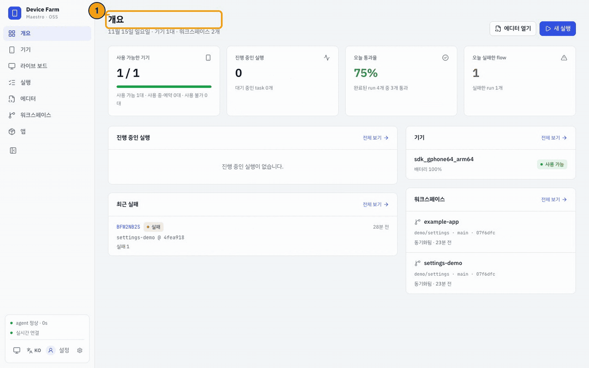
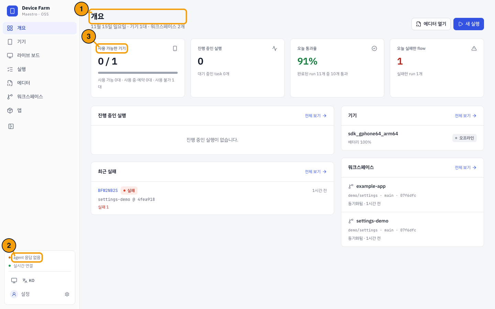
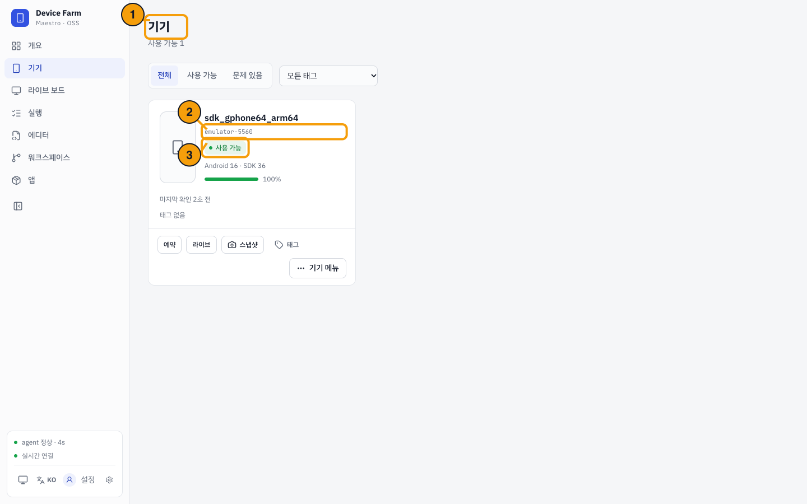
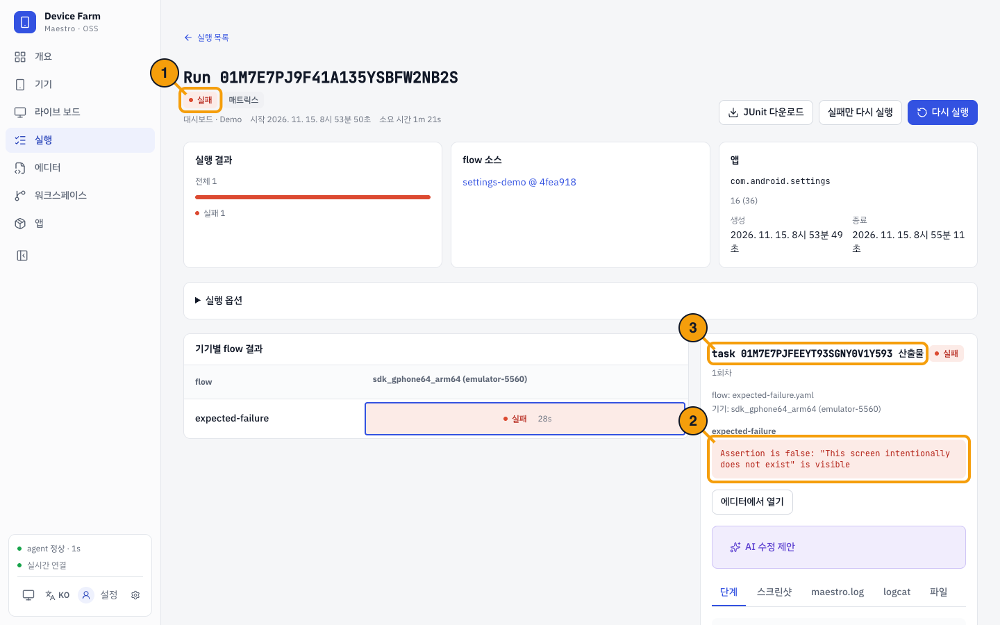
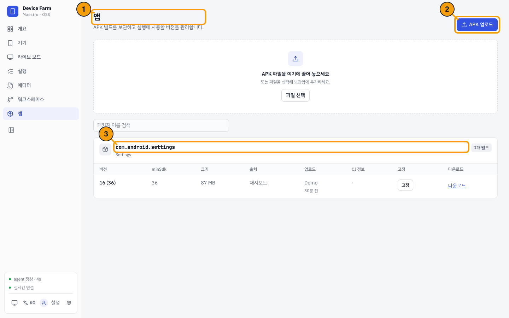
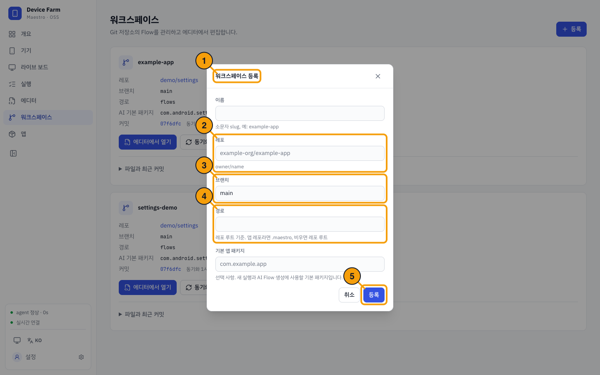
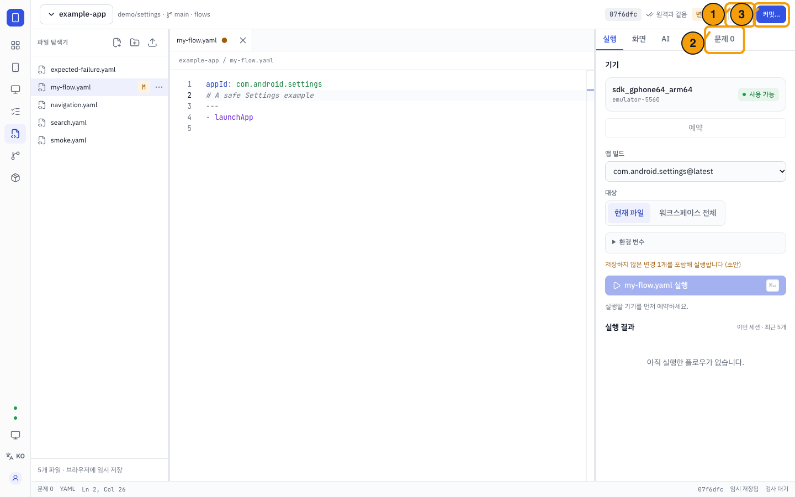
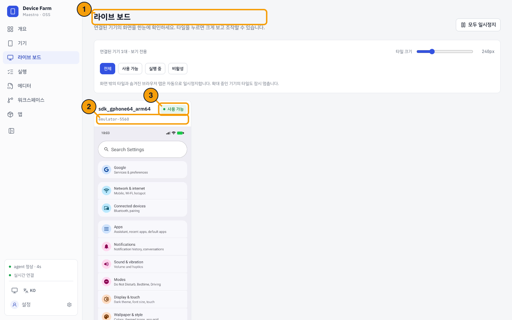

[English](README.md) | 한국어

# Maestro Device Farm

내가 관리하는 안드로이드 기기에서 [Maestro](https://maestro.dev/) 화면 테스트를 돌리고, 결과를 브라우저에서 확인할 수 있습니다. 서버가 테스트 순서를 정하고, **agent**라는 별도 프로그램이 기기에 앱을 설치하고 테스트를 실행합니다. 기기 연결이 아직 어렵다면 화면부터 띄워 보세요. 준비가 되면 기기를 연결해 첫 테스트를 돌리면 됩니다.



**표시 번호:** (1) **개요**, (2) **새 실행**, (3) 실행 결과 상태.

## 세 줄로 빠르게 시작하기

아래 명령으로 저장소를 내려받으세요. 필요한 도구의 설치부터 차근차근 따라가려면 [Docker 안내](docs/ko/guides/getting-started-docker.md) 또는 [직접 설치 안내](docs/ko/guides/getting-started-native.md)를 보세요.

**Docker** (macOS, Windows, Linux):

```sh
git clone https://github.com/slg1119/maestro-device-farm.git
cd maestro-device-farm
docker compose up -d --build
```

`docker compose ps`에서 `api`가 `healthy`가 되면 `http://localhost:8700/`을 여세요.

**직접 설치** (macOS, Linux):

```sh
git clone https://github.com/slg1119/maestro-device-farm.git
cd maestro-device-farm
(cd server && uv sync) && (cd web && pnpm install --frozen-lockfile && pnpm build) && (cd server && uv run farm api)
```

마지막 명령이 실행 중인 터미널을 닫지 말고 `http://localhost:8700/`을 여세요.

## 어떤 방법으로 시작할까요?

| 상황 | 따라 할 안내 | 먼저 켜지는 것 |
| --- | --- | --- |
| macOS·Windows·Linux에서 화면을 빨리 보고 싶다 | [Docker로 시작](docs/ko/guides/getting-started-docker.md) | API와 대시보드 |
| macOS·Linux에서 안드로이드 도구를 이미 쓰고 있다 | [컴퓨터에 직접 설치](docs/ko/guides/getting-started-native.md) | API와 대시보드, 나중에 agent |

두 방법 모두 [Git](https://git-scm.com/downloads)과 브라우저가 필요합니다. Docker를 고르면 [macOS용 Docker Desktop](https://docs.docker.com/desktop/setup/install/mac-install/), [Windows용 Docker Desktop](https://docs.docker.com/desktop/setup/install/windows-install/), 또는 Linux의 [Docker Engine](https://docs.docker.com/engine/install/)과 [Compose 플러그인](https://docs.docker.com/compose/install/linux/)을 설치하세요. 직접 설치할 때는 [Python 3.12 이상](https://www.python.org/downloads/), [uv](https://docs.astral.sh/uv/getting-started/installation/), [Node.js](https://nodejs.org/en/download), [pnpm](https://pnpm.io/installation)이 필요합니다. 실제 테스트에는 APK, 테스트 파일, 안드로이드 기기도 필요합니다.

## 5분 화면 둘러보기

빠른 시작을 마쳤다면 버튼을 하나씩 눌러 보세요. 명령을 입력하는 창을 **터미널**이라고 합니다. macOS는 Terminal, Windows는 PowerShell, Linux는 사용하는 터미널 앱을 열면 됩니다.

1. 브라우저에서 `http://localhost:8700/`을 여세요. **보여야 할 것:** **개요**와 agent 상태. **다르다면:** API가 실행 중인지 확인하세요.
2. 왼쪽에서 **실행 목록**을 누르세요. **보여야 할 것:** **실행 기록**. **다르다면:** 주소가 맞는지 확인하세요.
3. **새 실행**을 누르세요. **보여야 할 것:** **실행 설정**. **다르다면:** `http://localhost:8700/runs/new`를 직접 여세요.
4. 왼쪽에서 **앱**을 누르세요. **보여야 할 것:** APK 목록과 **APK 업로드**. **다르다면:** API가 켜진 뒤 새로고침하세요.
5. 왼쪽에서 **워크스페이스**를 누르세요. **보여야 할 것:** **워크스페이스 관리**와 **워크스페이스 등록**. **다르다면:** `http://localhost:8700/workspaces`를 직접 여세요.

실제 실행을 시작하려면 앱에 맞는 APK, 테스트 파일, 연결된 기기가 있어야 합니다. 아래 안내를 순서대로 따라가면 됩니다.

## 화면에서 할 수 있는 일

| 화면 | 하는 일 | 모습 |
| --- | --- | --- |
| **개요** | agent 상태와 최근 실행 확인 |  |
| **기기** | 기기 상태·모델·배터리·안드로이드 버전 확인 |  |
| **실행 목록** | 새 실행, 기록, 결과, JUnit 내려받기 |  |
| **앱** | APK 빌드 보관 |  |
| **워크스페이스** | 테스트 파일이 있는 Git 저장소 연결 |  |
| **에디터** | YAML 수정·검증·이력 확인, 선택적 AI 제안 |  |
| **라이브 보드** | 연결된 기기 화면 보기 |  |

각 이미지의 번호는 [촬영 목록](docs/ko/guides/SHOTLIST.md)에 정리했습니다.

## 하나씩 따라 하기

1. [Docker로 시작](docs/ko/guides/getting-started-docker.md)하거나 [직접 설치](docs/ko/guides/getting-started-native.md)하세요.
2. [안드로이드 기기 연결](docs/ko/guides/connect-a-device.md)을 확인하세요.
3. [첫 테스트 파일 작성](docs/ko/guides/your-first-flow.md)을 해 보세요.
4. [테스트 실행](docs/ko/guides/running-tests.md) 뒤 [결과 읽기](docs/ko/guides/reading-results.md)를 따라 하세요.
5. [실시간 화면과 녹화](docs/ko/guides/live-screen-and-recording.md)를 살펴보세요.
6. [에디터와 AI 제안](docs/ko/guides/flow-editor-and-ai.md)을 사용해 보세요.
7. [워크스페이스와 Git](docs/ko/guides/workspaces-and-git.md)을 관리하거나 [문제 해결](docs/ko/guides/troubleshooting.md)을 참고하세요.

## 처음 듣는 말

**flow**는 Maestro 테스트를 적은 YAML 파일입니다. **YAML**은 들여쓰기로 설정과 동작을 구분하는 글 형식입니다. **태그**는 `smoke`처럼 테스트 파일을 고를 때 쓰는 이름표입니다. **워크스페이스**는 Git 저장소·브랜치·폴더를 묶어 등록한 것입니다. **APK**는 안드로이드 앱 설치 파일입니다. **AVD**는 가상 기기 설정이고 **에뮬레이터**가 컴퓨터에서 그 기기를 실행합니다. **adb**는 컴퓨터와 안드로이드 기기를 이어 주는 도구입니다. **산출물**은 실행 뒤 저장된 화면이나 로그 파일입니다. **JUnit**은 다른 테스트 도구도 읽을 수 있는 XML 결과 형식입니다.

**분할**은 선택한 flow마다 작업을 하나씩 만들어 기기에 나눕니다. **매트릭스**는 기기마다 작업을 하나씩 만들어 선택한 flow를 모두 실행합니다. API와 agent는 같은 SQLite 데이터베이스와 데이터 폴더를 사용해야 합니다. 현재 실행기는 안드로이드용이며 iOS 실행은 지원하지 않습니다.

내 앱에 맞춘 가장 짧은 flow는 다음과 같습니다.

```yaml
appId: com.example.app
tags:
  - smoke
---
- launchApp
- assertVisible: "Welcome"
```

`com.example.app`과 `Welcome`을 내 앱의 패키지와 실제 화면 글자로 바꾸세요. 자세한 내용은 [첫 flow 안내](docs/ko/guides/your-first-flow.md)를 보세요.

## 참고 문서

- [설정값과 환경 변수](docs/ko/configuration.md)
- [CLI 명령과 옵션](docs/ko/cli.md)
- [REST API](docs/ko/api.md)
- [Docker 운영](docs/ko/docker.md)
- [macOS 자동 시작](docs/ko/host-setup.md)
- [시스템 구조 그림](docs/diagrams/system-architecture.html)과 [실행 흐름 그림](docs/diagrams/run-lifecycle.html)

API 기본 주소는 `http://localhost:8700/`입니다. 상태 확인 주소는 `/api/v1/healthz`, API 사용 설명 화면은 `/docs`입니다. 여러 사람이 함께 쓰거나 외부에 열 때는 [설정 안내](docs/ko/configuration.md)의 인증과 네트워크 항목을 먼저 확인하세요.

이 프로젝트의 라이선스는 [MIT](LICENSE)입니다.
