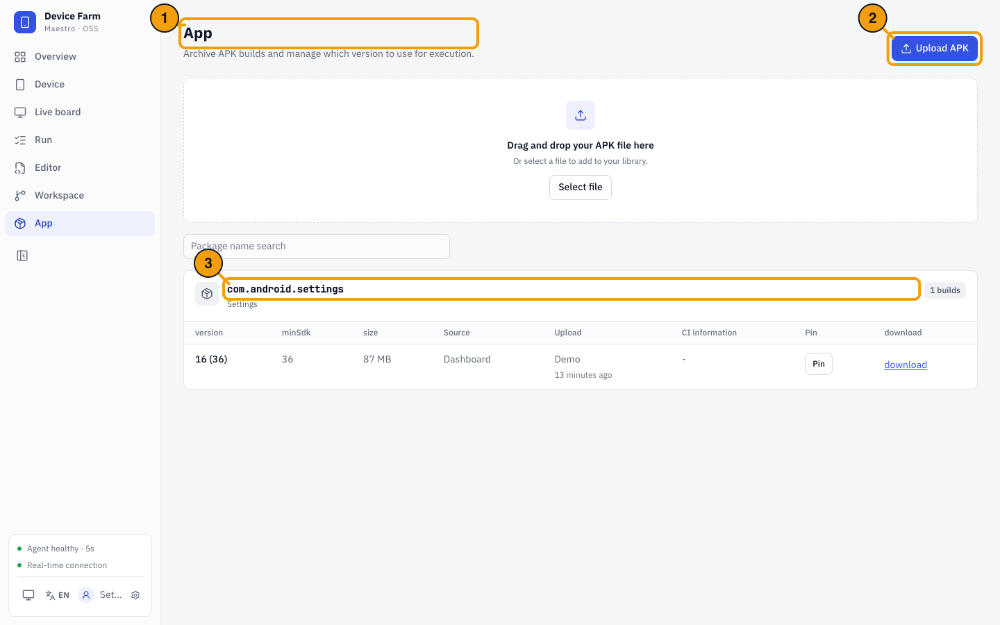
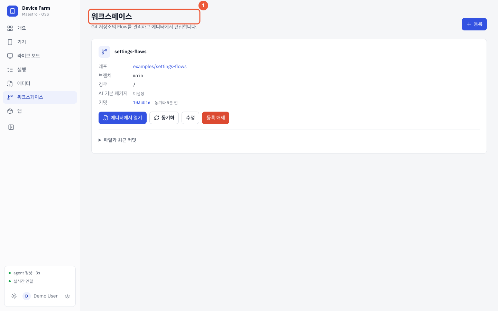

# Maestro Device Farm

Run [Maestro](https://maestro.dev/) Android UI tests on a device you control, then see each run in a browser. Maestro Device Farm connects a dashboard, API, test scheduler, and host-side **agent**. The agent is the program that sees Android devices through **adb** (Android Debug Bridge), installs your APK, and starts Maestro. You can begin by opening the dashboard without a device, then connect one when you are ready to run a test.


**Callouts:** (1) **Overview** in the navigation; (2) **Runs** and **New run**; (3) the run status and task area.

## Quick start in 3 commands

Copy this repository's HTTPS URL from **Code** and replace `PASTE_REPOSITORY_URL`. Install the tools for your path first. The [Docker guide](docs/guides/getting-started-docker.md) and [native guide](docs/guides/getting-started-native.md) explain every action and expected result.

**Docker** (macOS, Windows, or Linux):

```sh
git clone PASTE_REPOSITORY_URL maestro-device-farm
cd maestro-device-farm
docker compose up -d --build
```

Open `http://localhost:8700/` when `docker compose ps` reports `api` healthy.

**Native** (macOS or Linux):

```sh
git clone PASTE_REPOSITORY_URL maestro-device-farm
cd maestro-device-farm
(cd server && uv sync) && (cd web && pnpm install --frozen-lockfile && pnpm build) && (cd server && uv run farm api)
```

Keep the last terminal open and visit `http://localhost:8700/`.

## Pick your path

| Your computer and goal | Start here | What starts first |
| --- | --- | --- |
| macOS, Windows, or Linux; easiest first dashboard | [Docker walkthrough](docs/guides/getting-started-docker.md) | API and built dashboard; agent is an optional Compose profile |
| macOS or Linux; you already use Android tools locally | [Native walkthrough](docs/guides/getting-started-native.md) | API and dashboard build, then a host agent when you choose |

For both paths, you need [Git](https://git-scm.com/downloads) to copy the repository and a web browser. Docker users install [Docker Desktop on macOS](https://docs.docker.com/desktop/setup/install/mac-install/) or [Windows](https://docs.docker.com/desktop/setup/install/windows-install/), or [Docker Engine](https://docs.docker.com/engine/install/) and the [Compose plugin](https://docs.docker.com/compose/install/linux/) on Linux. Native users need [Python 3.12+](https://www.python.org/downloads/), [uv](https://docs.astral.sh/uv/getting-started/installation/), [Node.js](https://nodejs.org/en/download), and [pnpm](https://pnpm.io/installation). Android test execution additionally needs a device, APK, and flow. The [device guide](docs/guides/connect-a-device.md) explains the Android tools.

## Five-minute dashboard walkthrough

After the quick start above, use these single clicks to find the main areas. The [Docker](docs/guides/getting-started-docker.md) and [native](docs/guides/getting-started-native.md) guides show setup checks and fixes.

1. Open `http://localhost:8700/`. **You should see:** **Overview** and agent status. **If it looks different:** check that the API process is running.
2. Click **Runs** in the sidebar. **You should see:** **Run history**. **If it looks different:** use the browser's back button and check the API URL.
3. Click **New run**. **You should see:** **Run Settings**. **If it looks different:** open `http://localhost:8700/runs/new` directly.
4. Click **App** in the sidebar. **You should see:** the APK library and **Upload APK**. **If it looks different:** refresh after the API starts.
5. Click **Workspace** in the sidebar. **You should see:** **Workspace Management** and **Register workspace**. **If it looks different:** open `http://localhost:8700/workspaces` directly.

A real test needs a compatible APK, a flow, and a connected Android device. Follow the guides below for each part.

## Feature tour

| Area | What it is for | View |
| --- | --- | --- |
| **Overview** | Agent health, device counts, and recent work |  |
| **Device** | Availability, model, battery, SDK level, tags, and reservations |  |
| **Runs** | New run, history, task results, and JUnit download |  |
| **App** | APK build library |  |
| **Workspace** | Git repositories containing flows |  |
| **Editor** | YAML flow editing, validation, history, and optional AI proposals |  |
| **Live board** | Connected Android screens and recording controls |  |

The [shot list](docs/guides/SHOTLIST.md) names the numbered callouts for every image.

## Learn one task at a time

1. [Get started with Docker](docs/guides/getting-started-docker.md) or [install natively](docs/guides/getting-started-native.md).
2. [Connect an Android device](docs/guides/connect-a-device.md).
3. [Write your first flow](docs/guides/your-first-flow.md).
4. [Run tests](docs/guides/running-tests.md) and [read results](docs/guides/reading-results.md).
5. [View and record a live screen](docs/guides/live-screen-and-recording.md).
6. [Edit a flow and review AI proposals](docs/guides/flow-editor-and-ai.md).
7. [Use Git workspaces](docs/guides/workspaces-and-git.md) or [troubleshoot](docs/guides/troubleshooting.md).

## Core ideas

A **flow** is a YAML text file describing a Maestro test. **YAML** uses indentation to organize its settings and actions. A **tag** is a label used to select flows. A **workspace** is a Git repository, branch, and optional folder containing flows. An **APK** is an Android app installation file. An **AVD** (Android Virtual Device) is a saved profile for an Android **emulator**, the program that runs the virtual device. An **artifact** is an output file such as a screenshot or report. **JUnit** is an XML result format used by test and CI tools.

A **split** run creates a task per selected flow; eligible devices claim those tasks. A **matrix** run creates one task per eligible device and runs the selected flow set on each. The agent and API must share the same SQLite database and data directory. The current runner is Android-specific; iOS execution is not implemented.

A minimal flow for your own app looks like this:

```yaml
appId: com.example.app
tags:
  - smoke
---
- launchApp
- assertVisible: "Welcome"
```

Replace the package and visible text with values from your app. See [Your first flow](docs/guides/your-first-flow.md) before running it. An Android APK with a matching package is required.

## Reference

- [Configuration and environment variables](docs/configuration.md)
- [CLI commands and flags](docs/cli.md)
- [REST API and OpenAPI](docs/api.md)
- [Docker operations](docs/docker.md)
- [macOS launchd services](docs/host-setup.md)
- [Server development](server/README.md) and [dashboard development](web/README.md)
- [System architecture](docs/diagrams/system-architecture.html) and [run lifecycle](docs/diagrams/run-lifecycle.html)

The API is served at `http://localhost:8700/` by default. Its health check is `GET /api/v1/healthz`, and interactive endpoint documentation is at `/docs`. For a shared or exposed installation, review authentication and network settings in [Configuration](docs/configuration.md) before allowing write access.

This project is licensed under [MIT](LICENSE).
