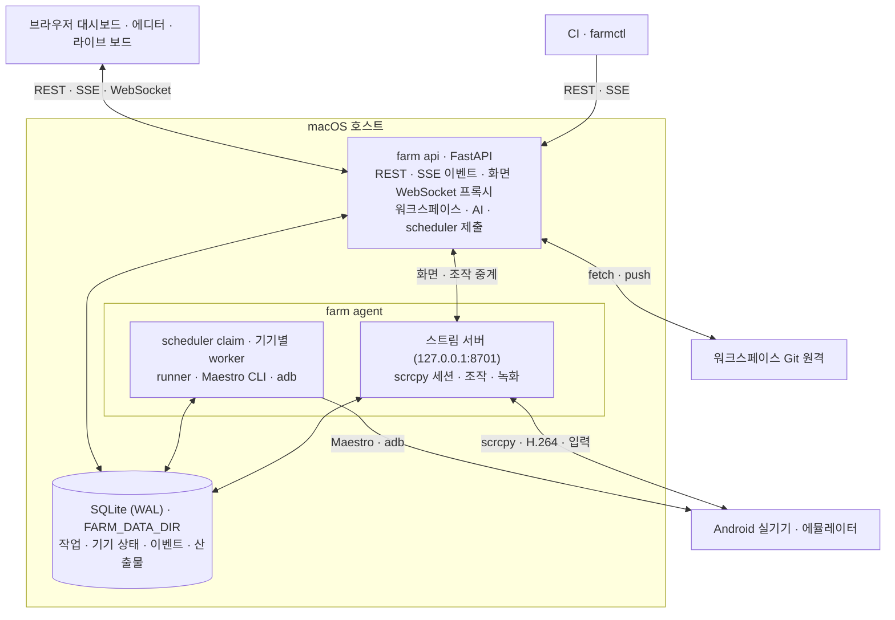

# maestro-device-farm

**우리 기기에서 돌리고, 브라우저에서 확인하는 Maestro 디바이스 팜.**

      

Mac 한 대에 연결된 Android 실기기와 에뮬레이터를 팀의 테스트 자원으로 묶습니다.<br>
대시보드, CI, 에디터에서 Maestro flow를 제출하면 팜이 조건에 맞는 기기에 작업을 배분합니다.<br>
실시간 화면으로 진행을 살피고, 실패한 단계의 스크린샷·로그·JUnit으로 원인을 확인합니다.<br>
Git 워크스페이스에서 flow를 편집하고, 직접 조작한 동작을 다음 테스트의 YAML로 남길 수 있습니다.

[빠른 시작](#빠른-시작) · [설정](#설정) · [사용 흐름](#사용-흐름) · [CI 연동](#ci-연동) · [운영](#운영) · [문서](#문서)

## 주요 기능

| 영역 | 할 수 있는 일 |
| :--- | :--- |
| 기기 풀 | `adb`로 실기기·에뮬레이터 감지, 상태·배터리 확인, 태그 편집, 활성화·비활성화, 기기 예약 |
| 테스트 실행 | `matrix`·`split`, 기기 조건과 flow 태그 필터, `flow_paths`, 취소, 전체·실패 항목 재실행 |
| 결과 확인 | 기기별 결과, 단계 타임라인, 스크린샷·로그·파일 열람, 병합 JUnit 다운로드, run `env` 값 마스킹 |
| APK 보관함 | APK 업로드, 패키지·버전별 조회, 고정, 다운로드, 기존 빌드로 실행 |
| Git 워크스페이스 | 저장소·브랜치·flow 경로 등록, 주기·수동 동기화, 커밋별 실행 스냅샷 |
| Flow 에디터 | Monaco 편집, 문법 검사, 미커밋 초안 실행, 커밋·push, 이력·diff·되돌리기, 화면 요소 셀렉터 삽입 |
| AI 도움 **(선택)** | flow 생성·실패 수정 제안·예약 기기에서 자동 보정, 제안을 검토한 뒤 에디터에 반영 |
| 실시간 화면 | scrcpy + WebCodecs, 탭·스와이프·키·텍스트 조작, 크게 보기, 화면 높이·드로어 너비 조절 |
| 라이브 보드 | 연결된 기기의 화면을 한곳에서 보기, 상태·태그 필터, 타일 크기 조절, 선택한 기기 확대·조작 |
| 조작 녹화 | 라이브 조작을 Maestro YAML로 변환, 복사·에디터에서 열기, AI로 다듬기 **(선택)** |
| CI·운영 | `farmctl`·REST API, GitHub Actions 예제, launchd 상시 실행, `farm doctor`, 보관 기간 정리 |

**`matrix`는 같은 flow를 기기마다, `split`은 flow를 기기들에 나눠 실행합니다.**
호환성 비교에는 `matrix`, 독립적인 flow의 병렬 회귀에는 `split`을 사용하세요.
`split`은 flow 사이의 실행 순서를 보장하지 않습니다.

AI는 팜 실행 사용자의 Codex CLI 로그인 또는 `FARM_OPENAI_API_KEY`가 필요합니다.
GitHub PAT는 선택입니다. SSH 키로도 워크스페이스를 동기화하고 커밋을 push할 수 있습니다.

## 아키텍처



API와 agent는 같은 호스트에서 같은 사용자·`FARM_DATA_DIR`로 실행합니다.
작업 상태는 공유 DB로 전달하고, 화면과 조작 입력은 WebSocket으로 중계합니다.
브라우저가 WebCodecs로 영상을 디코딩합니다.

- [`api/`](server/src/farm/api/): REST, SSE, 인증, 스트림 프록시와 대시보드 정적 파일 서빙.
- [`scheduler/`](server/src/farm/scheduler/) · [`agent/`](server/src/farm/agent/): 작업 분해·원자적 할당·예약과 기기별 실행 루프.
- [`runner/`](server/src/farm/runner/): Maestro 실행, APK 설치, 취소, JUnit·단계·로그 처리.
- [`stream/`](server/src/farm/stream/) · [`recording/`](server/src/farm/recording/): scrcpy 영상·입력 중계, 조작을 단계와 YAML로 변환.
- [`workspaces/`](server/src/farm/workspaces/) · [`ai/`](server/src/farm/ai/): Git 동기화·스냅샷·커밋과 선택적 AI 작업.
- [`web/src/`](web/src/): React 대시보드, 라이브 보드, flow 에디터.

## 빠른 시작

### 준비물

| 준비물 | 확인할 내용 |
| :--- | :--- |
| macOS 호스트 | 로그인 상태 유지, 잠자기·자동 재시작 설정 확인, 실기기는 전원 공급 USB 허브 권장 |
| Python 3.12+ · uv | 서버 의존성 설치와 `farm`·`farmctl` 실행 |
| Node.js · pnpm | 대시보드 설치·빌드 |
| Android SDK platform-tools | `adb`가 PATH에 있고 기기가 `device` 상태여야 함 |
| Java · Maestro CLI | Maestro 실행에 필요. `java`와 `maestro`가 PATH에 있어야 함 |
| Git | 워크스페이스 원격에 읽기 접근, 에디터 커밋 시 쓰기 접근 필요 |
| WebCodecs 지원 브라우저 | 실시간 화면은 Chrome·Edge 최신 버전 권장 |

실기기는 개발자 옵션·USB 디버깅을 켜고 호스트의 RSA 키를 허용합니다.
에뮬레이터는 먼저 실행하세요. `adb devices -l`로 연결을 확인할 수 있습니다.
scrcpy 서버는 [`ops/scrcpy/`](ops/scrcpy/)에 버전 4.1로 포함되어 있습니다.
자세한 준비 절차는 [호스트 설정](docs/host-setup.md)을 따릅니다.

### 설치하고 실행하기

저장소 루트에서 실행합니다. 비공개 Git 원격을 쓴다면 아래 [설정](#설정)도 먼저 적용하세요.

```sh
cd server
uv sync
uv run farm db upgrade
cd ../web
pnpm install --frozen-lockfile
pnpm build
cd ../server
uv run farm doctor
uv run farm api
```

별도 터미널을 열고 저장소 루트에서 agent를 시작합니다.

```sh
cd server
uv run farm agent
```

**[http://localhost:8700](http://localhost:8700)** 에서 대시보드를 엽니다.
API 문서는 [http://localhost:8700/docs](http://localhost:8700/docs)에서 확인할 수 있습니다.
API가 `web/dist`를 서빙하므로 운영 시 별도 웹 서버가 필요하지 않습니다.

첫 시작 전 `farm doctor`의 agent heartbeat 경고가 있으면 agent를 실행한 뒤 다시 확인하세요.
`FAIL`은 종료 코드 1, `WARN`만 있으면 0입니다.

## 설정

서버 설정의 기준은 [`server/src/farm/config.py`](server/src/farm/config.py)입니다.
환경 변수로 전달하며, API와 agent의 데이터·포트 설정을 맞춰주세요.

| 환경 변수 | 기본값 | 의미 |
| :--- | :--- | :--- |
| `FARM_DATA_DIR` | `~/maestro-device-farm/data` | DB·APK·산출물 데이터 루트 |
| `FARM_DB_PATH` | `$FARM_DATA_DIR/farm.db` | SQLite 경로 재정의 |
| `FARM_API_HOST` / `FARM_API_PORT` | `0.0.0.0` / `8700` | API 바인딩 주소·포트 |
| `FARM_PUBLIC_URL` | `http://localhost:8700` | 실행 결과 링크의 기준 URL |
| `FARM_AGENT_STREAM_PORT` | `8701` | agent 스트림 서버 포트, 루프백 전용 |
| `FARM_STREAM_MAX_SIZE` / `FARM_STREAM_MAX_FPS` | `1280` / `30` | 영상 긴 변·프레임 수 상한 |
| `FARM_SCRCPY_SERVER_PATH` / `FARM_SCRCPY_VERSION` | `ops/scrcpy/scrcpy-server-v4.1` / `4.1` | 저장소 기준 서버 파일·프로토콜 버전 |
| `FARM_WEB_DIST` | `web/dist` | 저장소 기준 대시보드 빌드 경로 |
| `FARM_GIT_REMOTE_TEMPLATE` | `https://github.com/{repo}.git` | `{repo}`에 `owner/repo`를 넣는 원격 주소 형식 |
| `FARM_GIT_POLL_SEC` | `60` | Git 동기화 주기(초), `0`이면 주기 동기화 중지 |
| `FARM_GITHUB_TOKEN` | 미설정 **(선택)** | GitHub HTTPS 원격용 fine-grained PAT, Contents read/write |
| `FARM_REQUIRE_TOKEN` | `false` | `true`이면 API 쓰기 요청에 Bearer 토큰 필요 |
| `FARM_AI_PROVIDER` | `auto` | OpenAI 키 우선, 없으면 로그인된 Codex. `openai`·`codex`로 고정 가능 |
| `FARM_OPENAI_API_KEY` / `FARM_OPENAI_MODEL` | 미설정 **(선택)** / `gpt-6.1-sol` | OpenAI 인증·모델 |
| `FARM_CODEX_BIN` / `FARM_CODEX_MODEL` | `codex` / Codex 기본 모델 | Codex CLI 실행 파일·모델 재정의 |
| `FARM_AI_TIMEOUT_SEC` / `FARM_AI_MAX_REPAIRS` | `300` / `3` | AI 호출 제한 시간(초)·보정 상한 |
| `FARM_TASK_TIMEOUT_SEC` / `FARM_MIN_BATTERY` | `1800` / `20` | task 제한 시간(초)·최소 배터리(%) |
| `FARM_RESERVATION_TTL_SEC` | `900` | 기기 예약 유효 시간(초), 갱신 시 연장 |
| `FARM_RETENTION_DAYS` / `FARM_APP_KEEP_PER_PACKAGE` | `30` / `20` | 완료 run 보관 일수·패키지별 최근 APK 보호 개수 |

SSH를 사용하려면 API·agent를 실행할 셸에 설정합니다.

```sh
export FARM_GIT_REMOTE_TEMPLATE='git@github.com:{repo}.git'
```

로컬 bare 저장소로 검증할 때는 `file://` 원격도 사용할 수 있습니다.
다음 예시는 `$HOME/farm-remotes/owner/repo.git`에 bare 저장소가 준비된 경우입니다.

```sh
export FARM_GIT_REMOTE_TEMPLATE="file://$HOME/farm-remotes/{repo}.git"
```

AI를 쓰려면 팜 실행 사용자로 `codex login` 후 `codex login status`를 확인하거나,
`FARM_OPENAI_API_KEY`를 설정합니다. 둘 다 없으면 AI가 비활성화됩니다.
제공자는 API 시작 시 선택됩니다. 화면 포함·자동 보정에는 기기 예약이 필요하며 자동 보정에는 APK도 필요합니다.
AI 제안은 검토·반영 후 사람이 커밋합니다.

기본 인증 설정은 사내망용으로 쓰기 요청도 허용합니다.
토큰 인증은 `server/`에서 `uv run farm token create ci`로 토큰을 만든 뒤
`FARM_REQUIRE_TOKEN=true`로 API를 실행해 켭니다.
대시보드 설정에 토큰을 입력하고, CLI에는 `FARM_TOKEN`을 전달합니다.

## 사용 흐름

1. **워크스페이스 등록** — 저장소를 `owner/repo` 형식으로 입력하고 브랜치와 flow 경로(예: `.maestro`)를 지정합니다. 동기화 상태와 파일을 확인하세요.
2. **APK 준비** — APK 보관함에 업로드하거나, 새 실행에서 APK 파일 또는 기존 빌드를 선택합니다.
3. **실행 제출** — 대시보드에서 모드·기기 조건·태그·flow 경로를 선택합니다. 에디터에서는 기기를 예약하고 미커밋 변경분도 바로 실행할 수 있습니다.
4. **진행 확인** — 라이브 보드에서 연결된 기기를 함께 보고 타일을 열어 확대합니다. 테스트 중 조작하면 해당 task에 `수동 조작 있음`이 표시됩니다.
5. **결과 확인** — 실행 상세의 단계·스크린샷·로그와 JUnit을 확인합니다. 필요하면 실패 항목만 다시 실행하거나 flow를 고쳐 커밋합니다.

등록된 `android-smoke` 워크스페이스와 현재 디렉터리의 `app.apk`로 실행하는 REST 예시입니다.
`options`는 JSON 문자열, `apk`는 파일인 `multipart/form-data`입니다.

```sh
curl --fail-with-body http://localhost:8700/api/v1/runs \
  -H 'X-Farm-User: ci' \
  -F 'options={"mode":"split","flow_source":"workspace","workspace":"android-smoke","origin":"ci"}' \
  -F 'apk=@app.apk'
```

토큰 인증을 켰다면 `-H "Authorization: Bearer $FARM_TOKEN"`을 추가하세요.
ZIP 업로드 실행은 `flow_source=upload`와 파일 필드 `flows`를 사용합니다.
APK 업로드 대신 `options.app_build_id` 또는 `options.app`(`패키지@latest`)를 사용할 수도 있습니다.

run `env` 값은 API 응답에서 가리고, UTF-8 텍스트 산출물에서는 길이 4자 이상인 값을 `***`로 가립니다.
빈 값·4자 미만의 값과 스크린샷·영상 같은 바이너리는 산출물 마스킹 대상에서 제외됩니다.
세부 동작은 [서버 문서](server/README.md)를 참고하세요.

## CI 연동

[`ops/github-actions/device-farm.yml`](ops/github-actions/device-farm.yml)을 앱 저장소의 `.github/workflows/`에 복사합니다.
GitHub 호스팅 runner가 APK를 빌드하고, Mac의 self-hosted runner가 팜 실행과 JUnit 게시를 맡습니다.

- Mac runner에 `device-farm` 라벨을 추가하고 팜 접근 권한을 부여합니다.
- 저장소 루트에서 `uv tool install ./server`로 CLI를 설치하거나 `server/.venv/bin`을 runner PATH에 추가합니다.
- 저장소 변수 `FARM_WORKSPACE`를 등록된 워크스페이스 이름으로 설정합니다.
- Gradle 작업과 APK 경로를 앱 프로젝트에 맞추고, 워크스페이스 원격에 `$GITHUB_SHA`가 있는지 확인합니다.
- 토큰 인증을 켰다면 runner에 `FARM_TOKEN`을 전달하도록 workflow 환경을 설정합니다.

핵심 호출은 다음과 같습니다. `--server`는 `run` 앞에 둡니다.

```sh
farmctl --server http://localhost:8700 run \
  --workspace "$FARM_WORKSPACE" --ref "$GITHUB_SHA" \
  --apk app.apk --mode split --wait --junit farm-junit.xml
```

`--wait`는 완료까지 진행 상황을 출력합니다. 종료 코드는 통과 `0`, 실패 `1`, 오류 `2`, 취소·대기 시간 초과 `3`입니다.

## 운영

저장소 루트에서 launchd 설치 내용을 먼저 확인합니다.

```sh
ops/launchd/install.sh --dry-run
ops/launchd/install.sh
# 서비스 해제
ops/launchd/install.sh --uninstall
```

사용자 LaunchAgent 두 개가 로그인 시 API·agent를 실행하고 종료 시 다시 띄웁니다.
셸의 `export`는 launchd에 자동 전달되지 않습니다. 필요한 설정은 설치된 plist의 `EnvironmentVariables`에 넣으세요.
설치 스크립트를 다시 실행하면 plist가 덮어써집니다. 설정 변경·서비스 재시작은 [호스트 설정](docs/host-setup.md)을 참고하세요.

로그는 `~/Library/Logs/maestro-device-farm/`의 `api.log`, `agent.log`와 각 `*-error.log`에 남습니다.
데이터는 `FARM_DATA_DIR` 아래에 모입니다.

| 경로 | 내용 |
| :--- | :--- |
| `farm.db` | 실행·기기·예약·이벤트 등 상태 |
| `git/` | 워크스페이스 bare 저장소 |
| `apks/` | APK 보관함 |
| `uploads/` | 실행별 flow 스냅샷 |
| `runs/` | task·attempt별 JUnit, Maestro 산출물, 로그 |
| `inspect/` · `ai/` | 화면 인스펙트 결과·AI 작업 자료 |

agent는 시작 60초 후, 이후 24시간마다 보관 정리를 실행합니다.
완료 run 산출물은 기본 30일, APK는 패키지별 최근 20개와 pinned·미정리 run 참조 빌드를 보호합니다.
완료 run의 DB 이력은 유지합니다. launchd 로그는 별도 순환 정책이 필요합니다.
수동 정리는 `server/`에서 미리보기 후 실행할 수 있습니다.

```sh
uv run farm retention run --dry-run
uv run farm retention run
```

업그레이드 전 진행 중인 run을 마치고 API·agent를 중지한 뒤 데이터 경로 전체와 운영 plist를 백업합니다.
소스 갱신 후 의존성 설치·DB 마이그레이션·웹 빌드를 수행하고 두 서비스를 시작해 `farm doctor`로 확인합니다.

## 개발

각 디렉터리에서 실행합니다. 웹 개발 서버는 `http://localhost:5173`이며 `/api`를 API로 프록시합니다.
프록시 대상은 `FARM_API_URL`로 바꿀 수 있고 기본값은 `http://localhost:8700`입니다.

```sh
# server/
uv run pytest -q
uv run pytest -q -W error::ResourceWarning

# web/
pnpm dev
pnpm test
pnpm typecheck
pnpm build
```

| 경로 | 역할 |
| :--- | :--- |
| [`server/`](server/) | Python 서버, 운영·CI CLI, DB 마이그레이션, 테스트 |
| [`web/`](web/) | React 대시보드, 에디터, 실시간 화면과 웹 테스트 |
| [`ops/`](ops/) | launchd, GitHub Actions 예제, 고정 버전 scrcpy 서버 |
| [`docs/`](docs/) | 호스트 준비, 설계, 구현 계획, 인수 테스트 기록 |

## 문서

- [호스트 설정·운영 가이드](docs/host-setup.md)
- [Maestro 디바이스 팜 설계](docs/superpowers/specs/2026-10-20-maestro-device-farm-design.md)
- [구현 계획 모음](docs/superpowers/plans/)
- [백엔드 코어 계획](docs/superpowers/plans/2026-10-20-backend-core-p1-p2.md) · [대시보드 계획](docs/superpowers/plans/2026-10-20-p4-dashboard.md)
- [에디터·AI 계획](docs/superpowers/plans/2026-10-21-p5-redesign-editor-ai.md) · [라이브·녹화·운영 계획](docs/superpowers/plans/2026-10-21-p6-p10-live-recording-ops.md)
- [P2 인수 테스트 기록](docs/acceptance/p2-real-device.md) — Android 에뮬레이터 검증 결과와 실기기 재확인 항목
- [서버·CLI 상세](server/README.md) · [웹 개발 가이드](web/README.md) · [scrcpy 배포·라이선스 고지](ops/scrcpy/NOTICE.md)
