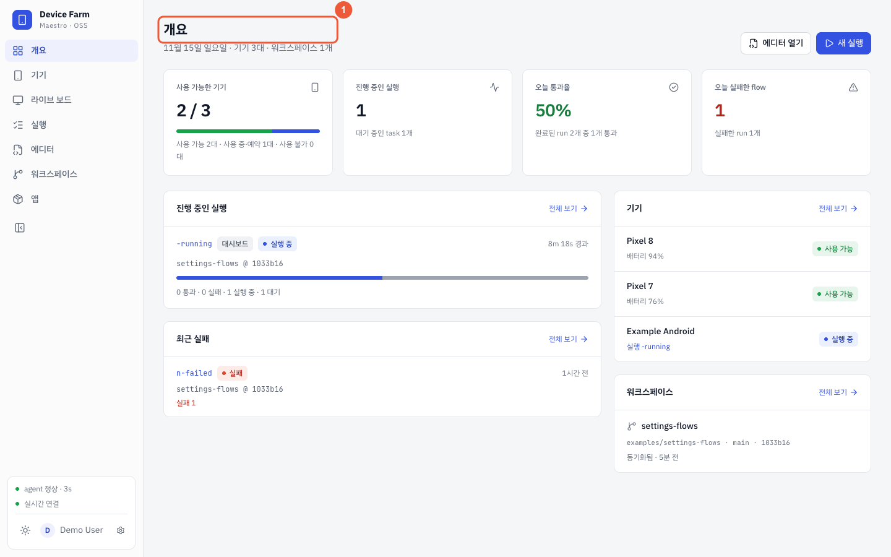
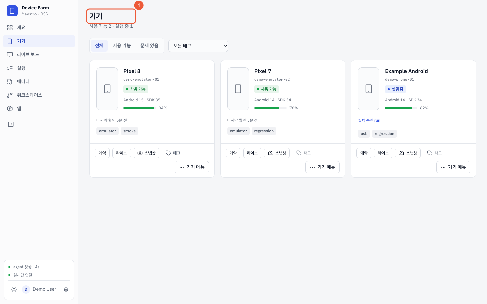
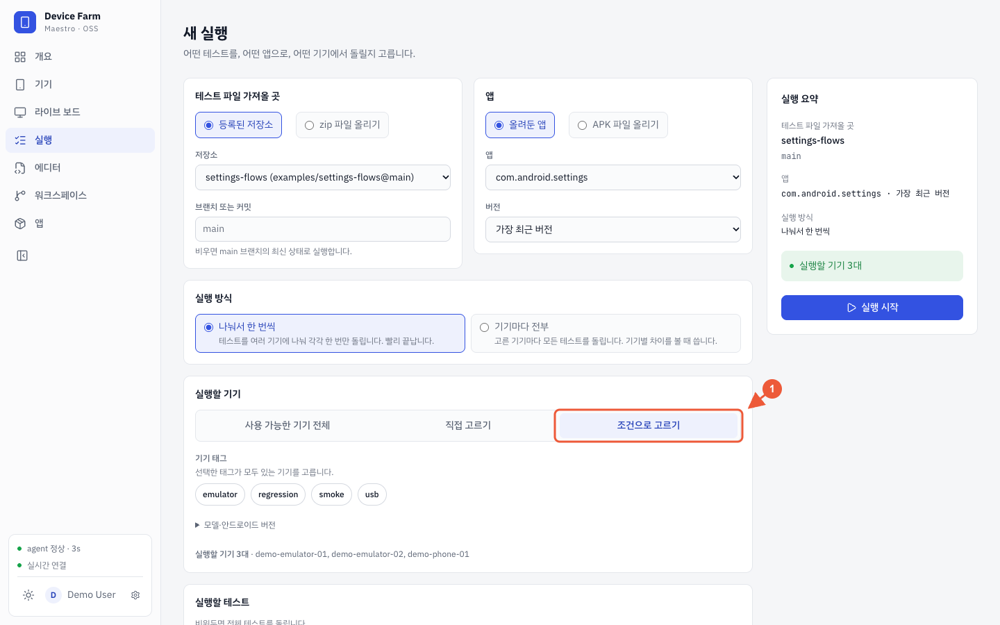
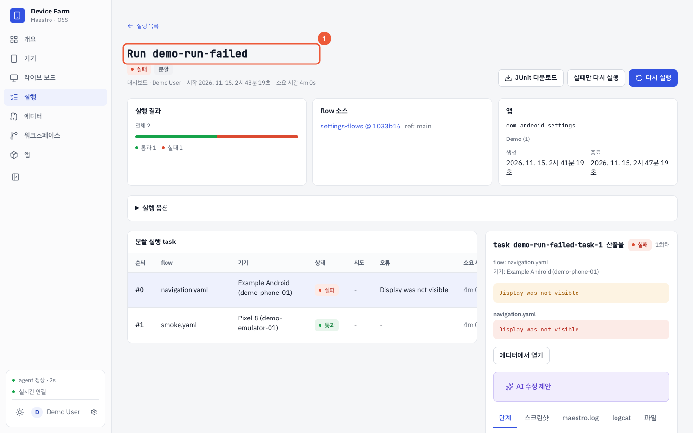
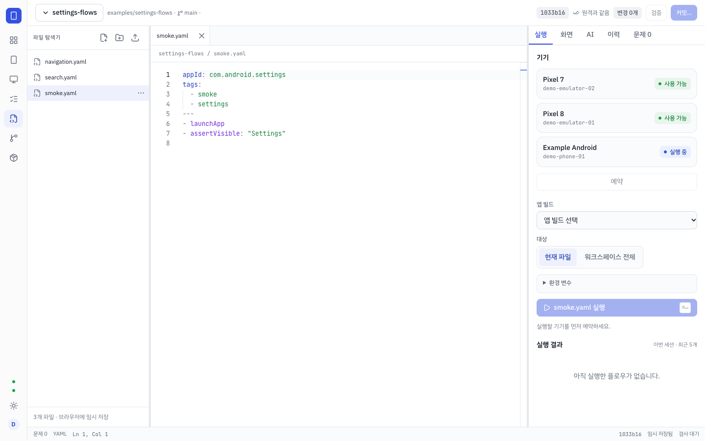
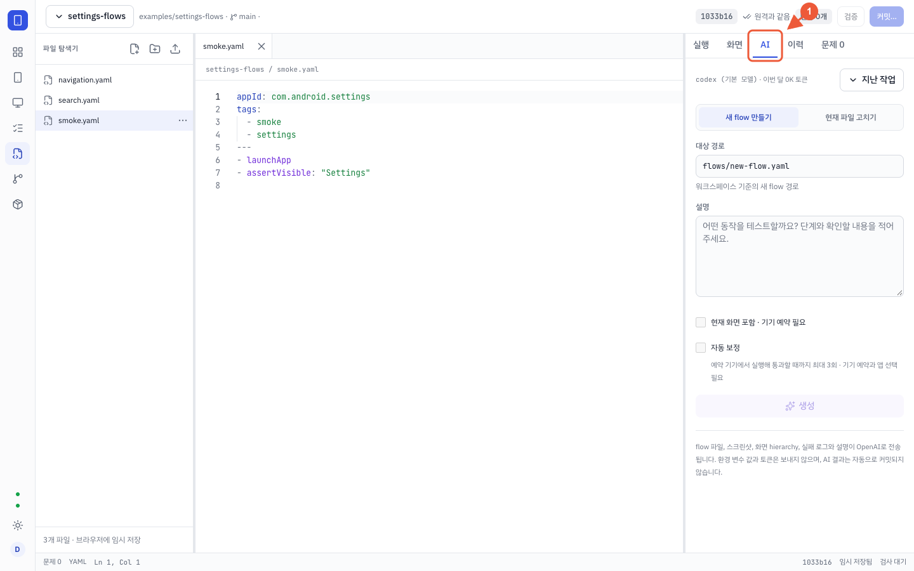
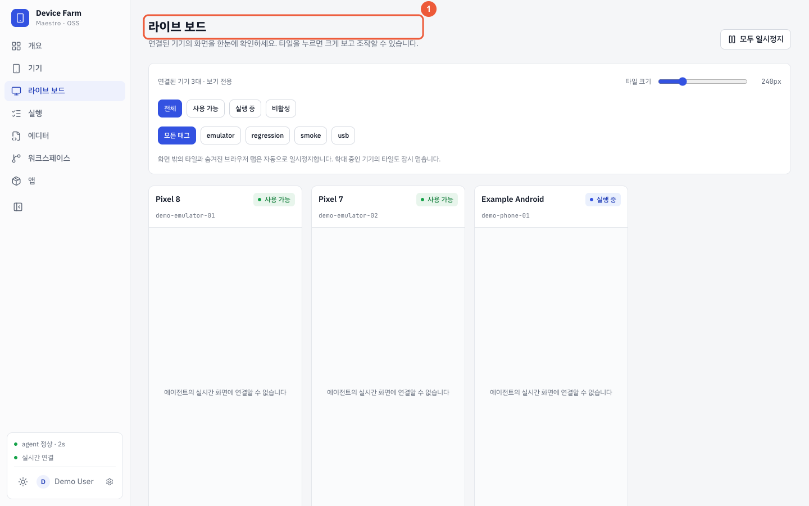
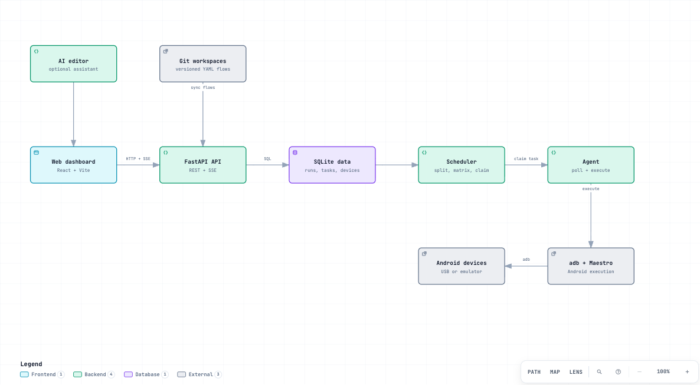
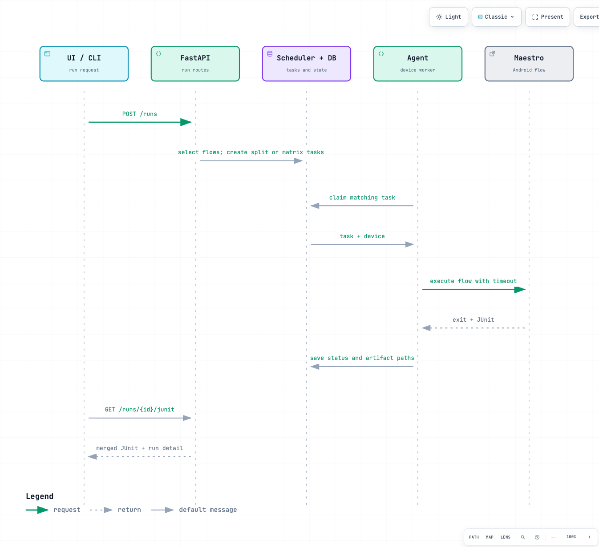

# Maestro Device Farm

Maestro Device Farm is a self-hosted dashboard and API for scheduling [Maestro](https://maestro.dev/) Android UI flows across emulators and phones. Register versioned Git flow workspaces, upload APK builds, select devices, follow runs in real time, inspect JUnit and artifacts, and edit flows from the browser. It combines a React dashboard, FastAPI control plane, SQLite state and a host-side agent that uses adb and Maestro.


*The GIF opens the New run form from the seeded demo dashboard. No company app or physical device was used for capture.*

## Pick your path

| Path | Best for | Start here |
| --- | --- | --- |
| Docker Compose | Get the API and built dashboard running in one command, then deliberately connect an agent to host adb. | [Docker beginner guide](docs/guides/getting-started-docker.md) and [Docker operations](docs/docker.md) |
| Native | Work directly with a host Android emulator or USB device; full local live screen support. | [Native beginner guide](docs/guides/getting-started-native.md) |

The default Compose command starts the API only; the agent is an explicit profile because it can control every device exposed by its adb server. For real execution, read [Connect a device](docs/guides/connect-a-device.md).

## Feature tour

| Feature | What you can do | Real demo screenshot |
| --- | --- | --- |
| Overview | See devices, running work, recent failures and workspaces. |  |
| Devices | Inspect availability, battery, SDK and tags; reserve or disable a device. |  |
| New run | Select workspace or ZIP, APK, split/matrix, flow tags and device conditions. |  |
| Run history and detail | Filter runs, select tasks, inspect results and download JUnit. |  |
| Workspaces and editor | Sync Git flows, edit YAML, validate and commit reviewed changes. |  |
| AI assistant | Optionally propose flow changes in an editor panel. |  |
| Live board and recording | View connected Android screens and record actions into draft YAML when an agent and device are available. |  |

Screenshots are 1440×900 light theme captures from a separate API with temporary seeded data. The device serials and run history are demo values. Live screen pixels and real Maestro execution were not captured.

## Guides

| Beginner task | Guide |
| --- | --- |
| Install with Docker | [Getting started with Docker](docs/guides/getting-started-docker.md) |
| Install locally | [Getting started natively](docs/guides/getting-started-native.md) |
| Connect Android | [Connect a device](docs/guides/connect-a-device.md) |
| Write YAML | [Your first flow](docs/guides/your-first-flow.md) |
| Choose run options | [Running tests](docs/guides/running-tests.md) |
| Interpret results | [Reading results](docs/guides/reading-results.md) |
| View and record a screen | [Live screen and recording](docs/guides/live-screen-and-recording.md) |
| Edit with AI assistance | [Flow editor and AI](docs/guides/flow-editor-and-ai.md) |
| Manage revisions | [Workspaces and Git](docs/guides/workspaces-and-git.md) |
| Resolve errors | [Troubleshooting](docs/guides/troubleshooting.md) |

Reference pages: [Configuration](docs/configuration.md), [REST API](docs/api.md), [CLI](docs/cli.md), [Docker](docs/docker.md), and [macOS services](docs/host-setup.md).

## Architecture



[Open the interactive system diagram](docs/diagrams/system-architecture.html) · [JSON specification](docs/diagrams/system-architecture.json)

The browser talks to FastAPI over REST and server-sent events. FastAPI stores devices, workspaces, apps, runs and tasks in SQLite. The scheduler creates tasks and the agent claims them from the shared database. The agent prepares Android devices with adb, installs the selected APK, invokes Maestro, and writes task artifacts and JUnit. A Git cache pins workspace revisions. The optional AI editor uses a server-side provider and returns proposals for review.



[Open the interactive run diagram](docs/diagrams/run-lifecycle.html) · [JSON specification](docs/diagrams/run-lifecycle.json)

The current deployment is designed for API and agent processes that share a SQLite database and artifact directory. In Compose they share a named volume; the API reaches the agent stream service by the Compose hostname. Multi-host agents with independent data stores are not implemented.

## Requirements

| Component | Requirement |
| --- | --- |
| API | Python 3.12+ and `uv`, or Docker Compose. |
| Dashboard development | Node.js and `pnpm`; production dashboard is built into the API image or served from `web/dist`. |
| Android execution | Android SDK platform-tools (`adb`), Java 17+, Maestro CLI, and an Android emulator or USB-debuggable device. The agent image includes Java 17, adb and pinned Maestro CLI 2.12.0. |
| Host | macOS or Linux for native agent operation. The documentation build was verified on macOS. Docker Desktop supports API startup on macOS/Windows; host adb wiring differs by OS. |

The host used for documentation had Python 3.12.7, uv 0.10.4, Node 22.18.0, pnpm 10.29.1, adb 37.0.1, Java 21 and Maestro CLI 2.11.0. See the [official Maestro installation guide](https://docs.maestro.dev/maestro-cli/how-to-install-maestro-cli) for current installation steps.

**iOS is not supported by this farm yet.** Its device provider, APK library and runner are Android-specific. Maestro's own CLI supports iOS Simulators, but [physical iOS devices are not supported by Maestro's local execution](https://docs.maestro.dev/get-started/supported-platform/ios/uikit). Physical iPhones would need other tooling and a separate integration.

## Quick start

### Docker Compose

```sh
git clone <repository-url> maestro-device-farm
cd maestro-device-farm
cp .env.example .env
docker compose build
docker compose up -d
curl http://localhost:8700/api/v1/healthz
```

Open `http://localhost:8700/`. Expect `"status":"ok"` in the health response. This command starts the API and dashboard; start the agent only after following [Docker adb setup](docs/docker.md#3-connect-an-agent). Stop with `docker compose down` to keep data, or `docker compose down -v` only when you intend to delete the named volume.

### Native

```sh
git clone <repository-url> maestro-device-farm
cd maestro-device-farm/server
uv sync
cd ../web
pnpm install --frozen-lockfile
pnpm build
cd ../server
uv run farm api
```

In another terminal, after checking `adb devices` for devices this farm may control, run `cd maestro-device-farm/server && uv run farm agent`. Open `http://localhost:8700/`. For frontend development, `cd web && pnpm dev` serves Vite at `http://localhost:5173/` and proxies `/api` to the API.

## Five-minute tour with the example flows

1. Open [examples/flows/smoke.yaml](examples/flows/smoke.yaml). It targets Android Settings and has `smoke` and `settings` tags.
2. Put `examples/flows/` into a Git repository you control, then register that repository as a workspace using the UI or `farm workspace add` below. The dashboard's editor displays the YAML and exact commit SHA.
3. Open **New run**. Choose the workspace, an Android APK build, split or matrix, and eligible devices. The `appId` in the selected YAML must match the APK package. The example Android Settings flows are for editor/tag exploration; real execution requires a compatible APK and OS language matching their assertions.
4. Click **Start run**. The run detail shows task state and, after an agent executes it, JUnit and artifact links. Follow [Running tests](docs/guides/running-tests.md) for every option.

The isolated documentation demo uses a temporary local Git remote, seeded APK metadata and seeded history. Its GIFs show UI submission and navigation, not a completed device run.

## Core concepts

| Concept | Meaning |
| --- | --- |
| Workspace | A registered Git repository, branch and subdirectory of flow files. The farm pins a commit SHA when it snapshots a run. |
| Flow | A Maestro YAML file with an `appId` and commands. A flow can have `tags` in its metadata. |
| Flow tags | Include tags match **any** requested tag. Exclude tags remove a matching flow. |
| Explicit flow paths | `flow_paths` / `--flow` select named files and bypass tag filtering. Paths are relative to the workspace/archive root. |
| Split | One task per selected flow. Eligible devices claim tasks dynamically, so each flow runs once. |
| Matrix | One pinned task per eligible device; every device runs the selected flow set. |
| Device selector | Serial, model, SDK bounds and device tags. A device must have **all** requested device tags and meet the APK minimum SDK. |
| Timeout | `FARM_TASK_TIMEOUT_SEC=1800` by default, applied **per task**; a run may override it. |
| Retry | Eligible infrastructure errors retry once after the configured backoff. Assertion failures need an explicit rerun. |

### Write a flow

```yaml
appId: com.example.app
tags:
  - smoke
---
- launchApp
- assertVisible: "Welcome"
```

Replace the package and visible text for your app. See [the annotated walkthrough](docs/guides/your-first-flow.md).

### Register a Git workspace

```sh
cd server
uv run farm workspace add --name example-app --repo your-account/example-app --branch main --path .maestro --app-package com.example.app
uv run farm workspace list
```

The command fetches the branch and prints `workspace example-app added at <short-sha>` on success. For private repositories, provide `FARM_GITHUB_TOKEN` in the process environment or configure `FARM_GIT_REMOTE_TEMPLATE` for another secure Git transport.

### Submit from the UI

Use **New run** to pick flow source and app, split or matrix, devices, tags or explicit paths, and timeout. The right column previews the selection. The [running-tests guide](docs/guides/running-tests.md) has annotated screenshots for all three device selection modes.

### Submit from the CLI

```sh
cd server
uv run farmctl --server http://localhost:8700 --user demo run \
  --workspace example-app --app com.example.app@latest \
  --mode split --include-tags smoke --timeout 1800 --wait \
  --junit ./report.xml
```

`farmctl` requires one flow source (`--flows` or `--workspace`) and one app source (`--apk` or `--app`). The output starts with `run <id> submitted: <dashboard-url>`; with `--wait`, it reports progress and exits 0/1/2/3 for passed/failed/error/cancelled. For a matrix run across selected devices, use `--mode matrix --serials device-a,device-b`. For an exact file independent of tags, repeat `--flow path/to/file.yaml`. See [all verified flags](docs/cli.md).

### Submit via REST

The real demo request below was sent to an isolated API. Substitute your own registered resources on a normal installation:

```sh
curl -X POST http://127.0.0.1:8711/api/v1/runs \
  -F 'options={"mode":"split","flow_source":"workspace","workspace":"settings-flows","app":"com.android.settings@latest","device_selector":{"serials":["demo-emulator-01"]},"flow_paths":["smoke.yaml"],"origin":"ci"}'
```

```json
{"id":"01M7DPF78XXFDZA0RAHWKVARXW","url":"http://127.0.0.1:8711/runs/01M7DPF78XXFDZA0RAHWKVARXW"}
```

The endpoint accepts multipart `options` JSON and optional uploaded `apk` or `flows` files. [REST API reference](docs/api.md) lists related endpoints.

### Read results, live screen and AI

Download merged JUnit from `GET /api/v1/runs/{run_id}/junit`; list task files with `GET /api/v1/tasks/{task_id}/artifacts`; fetch a listed artifact path with `GET /api/v1/tasks/{task_id}/artifacts/{path}`. The run detail UI links them. Live screen and recording require a real connected Android device, agent heartbeat and a stream ticket; the seeded demo only shows the controls. See [Live screen and recording](docs/guides/live-screen-and-recording.md).

The AI assistant is optional. Set `FARM_OPENAI_API_KEY` in the API process environment at runtime, or use an already authenticated Codex CLI provider. The key is not written to Git, a flow, browser storage or an image. The editor shows AI proposals for review; applying and committing are separate actions. See [Flow editor and AI](docs/guides/flow-editor-and-ai.md).

## Configuration

Set server variables in the environment before starting `farm api` or `farm agent`. Docker Compose reads optional `.env`; do not commit it. Every server setting, default and client-only `FARM_*` value is explained in [the configuration guide](docs/configuration.md).

| Variable | Default | What it controls |
| --- | --- | --- |
| `FARM_DATA_DIR` | `~/maestro-device-farm/data` | SQLite database, APKs, Git cache and run artifacts. |
| `FARM_DB_PATH` | unset (inside data dir) | Override SQLite path. API and agent must use the same database. |
| `FARM_API_HOST` | `0.0.0.0` | API bind address. |
| `FARM_API_PORT` | `8700` | API listening port. |
| `FARM_AGENT_STREAM_PORT` | `8701` | Agent stream service port. |
| `FARM_AGENT_STREAM_HOST` | `127.0.0.1` | Hostname the API uses to reach the agent stream service. |
| `FARM_AGENT_STREAM_BIND_HOST` | `127.0.0.1` | Agent stream service bind address. |
| `FARM_STREAM_MAX_SIZE` | `1280` | Maximum live screen dimension. |
| `FARM_STREAM_MAX_FPS` | `30` | Maximum live screen frame rate. |
| `FARM_SCRCPY_SERVER_PATH` | bundled `ops/scrcpy/scrcpy-server-v4.1` | scrcpy server binary path. |
| `FARM_SCRCPY_VERSION` | `4.1` | scrcpy protocol version. |
| `FARM_PUBLIC_URL` | `http://localhost:8700` | URL embedded in submitted run responses. |
| `FARM_TASK_TIMEOUT_SEC` | `1800` | Timeout in seconds **per task**. |
| `FARM_RETRY_BACKOFF_SEC` | `15` | Delay before automatic retry after an eligible failure. |
| `FARM_MIN_BATTERY` | `20` | Agent precheck battery floor, percent. |
| `FARM_PINNED_WAIT_SEC` | `600` | Wait before a pinned task is considered stuck. |
| `FARM_RESERVATION_TTL_SEC` | `900` | Device reservation lifetime. |
| `FARM_MAX_APK_MB` | `500` | APK upload limit. |
| `FARM_MAX_FLOWS_MB` | `50` | Flow archive upload limit. |
| `FARM_MAX_MEDIA_MB` | `10` | Editor media upload limit. |
| `FARM_RETENTION_DAYS` | `30` | Age limit for retained run data (`0` disables age retention). |
| `FARM_APP_KEEP_PER_PACKAGE` | `20` | Number of recent APK builds kept per package. |
| `FARM_GITHUB_TOKEN` | unset | GitHub token for private workspace access. Supply at runtime. |
| `FARM_OPENAI_API_KEY` | unset | OpenAI provider key, read from the server environment. |
| `FARM_OPENAI_MODEL` | `gpt-6.1-sol` | OpenAI model identifier. |
| `FARM_AI_PROVIDER` | `auto` | `auto`, `openai` or `codex`. |
| `FARM_CODEX_BIN` | `codex` | Codex CLI executable path. |
| `FARM_CODEX_MODEL` | unset | Optional Codex model override. |
| `FARM_AI_TIMEOUT_SEC` | `300` | AI job timeout in seconds. |
| `FARM_AI_MAX_REPAIRS` | `3` | Maximum AI repair attempts. |
| `FARM_GIT_BOT_NAME` | `maestro-device-farm` | Author name on editor commits. |
| `FARM_GIT_BOT_EMAIL` | `maestro-device-farm@users.noreply.github.com` | Author email on editor commits. |
| `FARM_GIT_POLL_SEC` | `60` | Git workspace refresh interval; `0` disables polling. |
| `FARM_GIT_REMOTE_TEMPLATE` | `https://github.com/{repo}.git` | Remote URL template; `{repo}` is `owner/name`. |
| `FARM_WEB_DIST` | repository `web/dist` | Built dashboard directory served by the API. |
| `FARM_REQUIRE_TOKEN` | `false` | Require API tokens for writes. Create one with `farm token create`. |

## Operations and troubleshooting

On macOS, `ops/launchd/install.sh --dry-run` previews the API and agent LaunchAgents; `ops/launchd/install.sh` installs them under `~/Library/LaunchAgents/`. See [host setup](docs/host-setup.md). Compose build, logs, backup, upgrade and teardown are in [Docker operations](docs/docker.md). This implementation shares SQLite and artifact paths between API and agent; it does not implement multi-host agents with independent storage.

If the dashboard opens but devices are offline, check agent heartbeat and `adb devices` on the agent host. `no_matching_devices` means state, tags, SDK or serial conditions excluded every device. `no_flows` means tag filters selected nothing. `flow_not_found` means an explicit path does not exist. See [troubleshooting](docs/guides/troubleshooting.md) for exact fixes.

### FAQ

**Do I need GitHub?** No for ZIP uploads. Registered workspaces use Git; the default remote template is GitHub, and it can be changed.

**Can I run without an agent?** You can browse the UI and submit a queued run, but no device task executes.

**Does a timeout cover the whole run?** No. It applies to each task separately.

**Are tags AND or OR?** Flow include tags are OR; requested device tags are AND.

**Can I use a real iPhone?** No. This project has an Android-only agent and APK pipeline.

## Project layout

```text
server/             FastAPI, SQLite models, scheduler, agent, runner, CLIs, tests
web/                React/Vite dashboard, editor, frontend tests
examples/flows/     Neutral Android Settings YAML examples
ops/launchd/        macOS service templates and installer
ops/github-actions/ Example CI workflow
docs/guides/        Beginner walkthroughs with captured UI media
docs/diagrams/      Archify JSON specifications and interactive HTML
docs/assets/        Screenshots, GIFs, diagram PNG/SVG
```

## Development

```sh
cd server && uv run pytest -q
cd server && uv run ruff check .
cd web && pnpm test
cd web && pnpm build
```

The server suite and web suite are independent. The web build typechecks before Vite builds. To try the API without real devices, use a separate data directory and do not start a real adb agent. The documentation media were captured this way.

## Contributing and license

Issues and pull requests are welcome. Explain the user-visible behavior, include focused tests for scheduler/API changes, run the commands above, and avoid committing API keys, APKs, device data or run artifacts. The project is licensed under [MIT](LICENSE), Copyright (c) 2026 RokHyung Son.
