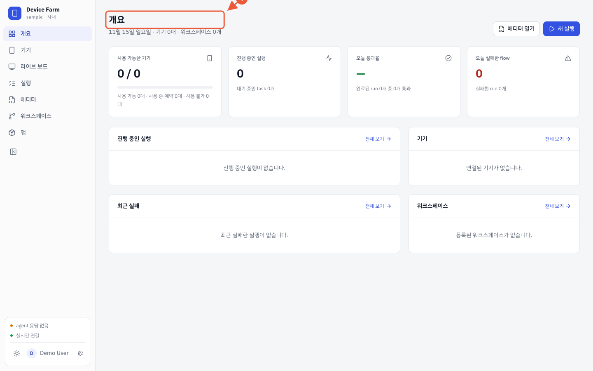

English | [한국어](ko/docker.md)

# Docker Compose setup

Before running any command, open Terminal (macOS), PowerShell (Windows), or your terminal app (Linux), paste one command block at a time, and press Enter. Docker Compose reads `docker-compose.yml` from the repository folder. An **agent** is the process that controls Android devices through adb (Android Debug Bridge). A named volume keeps the SQLite database and test artifacts (saved output files) between container restarts. The [Docker beginner walkthrough](guides/getting-started-docker.md) covers the first launch with screenshots.


This path packages the FastAPI server and built React dashboard in one image. The default `docker compose up -d` starts **only the API**. The agent is behind the `agent` profile because it needs intentional access to an adb server and Android devices. The API and agent share the `farm-data` named volume, including SQLite, APKs, Git workspaces and artifacts.

## 1. Install prerequisites

Install Docker Desktop on macOS or Windows, or Docker Engine with the Compose plugin on Linux. Verify both commands before continuing:

```sh
docker version
docker compose version
```

The host also needs Android SDK platform-tools (`adb`) and an Android emulator or phone for real runs. The default API-only stack can start without adb. On Linux, install the `adb` package or Android SDK platform-tools. On Windows, use Docker Desktop and run adb from Windows; a WSL hosted adb server needs extra network configuration that is not verified here.

**You should see:** `docker version` reports both Client and Server, and `docker compose version` reports a Compose version. **If it looks different:** Start Docker Desktop or the Linux daemon, then reopen the terminal.

## 2. Configure and start

Clone the repository with the command below, then start Docker Compose.

```sh
git clone https://github.com/slg1119/maestro-device-farm.git
cd maestro-device-farm
cp .env.example .env
docker compose build
docker compose up -d
docker compose ps
curl http://localhost:8700/api/v1/healthz
```

Open `http://localhost:8700/` in a browser. You should see the dashboard; the footer says the agent is not responding until an agent is started. A healthy API returns JSON with `"status":"ok"`. Set `FARM_HOST_PORT=8710` and `FARM_PUBLIC_URL=http://localhost:8710` in `.env` before starting if port 8700 is occupied. The dashboard is served from the image; no separate Vite process is needed.



**Screenshot callouts:** (1) Overview navigation; (2) agent status; (3) summary cards.

**You should see:** `docker compose ps` reports the API healthy, and `/api/v1/healthz` includes `"status":"ok"`. **If it looks different:** Check `docker compose logs --tail=100 api` and confirm the host port matches `.env`.

## 3. Connect an agent

For a Compose installation, enable the optional agent service only after you have prepared an adb server whose visible devices are all intended for this farm. The API and agent containers share the named data volume. The API reaches the agent stream service through the internal Compose hostname `agent` using `FARM_AGENT_STREAM_HOST`; the agent binds its stream service with `FARM_AGENT_STREAM_BIND_HOST=0.0.0.0` inside the Compose network. For the most direct device setup, run the entire stack natively on one host.

The optional agent image contains adb, Java 17 and Maestro CLI 2.12.0. It is **not started by default**. On macOS or Windows with Docker Desktop, start a host adb server that listens beyond loopback, then confirm its firewall limits access to trusted local clients:

```sh
adb kill-server
adb -a start-server
docker compose --profile agent up -d --build
```

The Compose agent uses `ADB_SERVER_SOCKET=tcp:host.docker.internal:5037`. On Linux, `host.docker.internal` is mapped to the host gateway by Compose. The host adb daemon must listen on that interface; USB permissions and firewall rules still apply. Alternatives for Linux include USB passthrough with `/dev/bus/usb` and elevated container permissions, or host networking, but those setups have **not** been validated here and are intentionally absent from the default Compose file. Do not enable the agent profile until you have verified which devices the host adb server exposes.

For emulators, start the emulator on the host and verify it with `adb devices` before enabling the agent profile. For physical Android devices, enable USB debugging and accept the phone's RSA prompt. See [Connect a device](guides/connect-a-device.md).

**You should see:** The agent reports a heartbeat and only your intended devices appear in the **Device** page. **If it looks different:** Check the host adb list, the Compose agent logs, and the API and agent data volume settings.

## 4. Inspect, stop, update and back up

```sh
docker compose ps
docker compose logs --tail=100 api
docker compose stop
docker compose start
docker compose down
```

`docker compose down` removes containers and the network but keeps the named volume. `docker compose down -v` **also deletes the farm data**. Use the latter only when you intentionally want a clean start.

For an upgrade, pull the latest source, then run `docker compose build` and `docker compose up -d`. Back up the volume before upgrading. One simple cold backup is:

```sh
mkdir -p backups
docker compose stop api
docker compose cp api:/data ./backups/data
docker compose start api
```

This copies the database, APKs and artifacts while the API is stopped. `backups/` is ignored by Git. To restore, stop the stack, copy the saved data back into the volume through the container, then start the API. Verify ownership and paths before restore; a restore replaces current data.

**You should see:** `docker compose ps` reflects the stop or start action, and the backup folder contains a copy of `/data`. **If it looks different:** Confirm you are in the repository root and that the API container exists before using `docker compose cp`.

## Troubleshooting

- **Port already in use:** set `FARM_HOST_PORT` and matching `FARM_PUBLIC_URL` in `.env`, then recreate the API container.
- **Dashboard opens but device list is empty:** the API is running; start an agent and connect a device. Check `docker compose logs agent` only if you explicitly enabled its profile.
- **Agent cannot reach adb:** check the host adb server bind address, port 5037, host firewall, Docker gateway name, and the device list from the host.
- **AI assistant disabled:** set `FARM_OPENAI_API_KEY` at runtime in an untracked `.env` or secret manager, then restart. It is never copied into the Docker image.
- **`no_matching_devices`:** a live agent, device state, SDK range, tags, and selectors must all match.

See [configuration](configuration.md) for all server settings and [troubleshooting](guides/troubleshooting.md) for more errors.

## Recap and next step

You can start and inspect the API container, connect the optional agent after checking adb, and stop the stack without deleting the named volume. **Next:** [Connect a device](guides/connect-a-device.md), then [Run tests](guides/running-tests.md).
