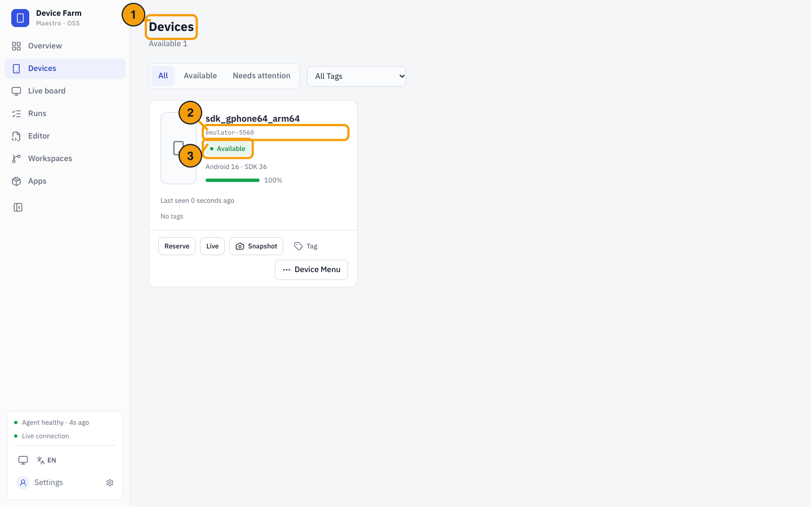
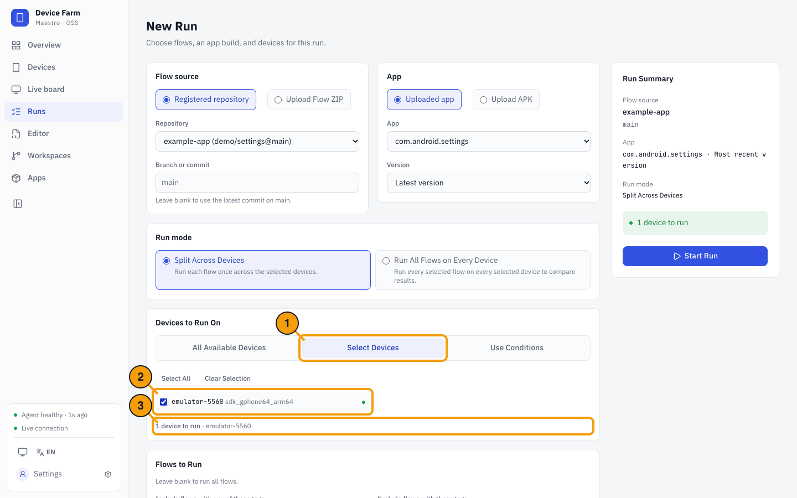

# Connect an Android device

**What you'll have at the end:** one Android emulator **or** phone visible to adb and listed on the dashboard's **Device** page.

## Copy-paste quick path

After following either device path below, run this from a terminal:

```sh
adb devices
```

A working device appears as one line ending in `device`. Then start the agent using your [native](getting-started-native.md) or [Docker](../docker.md#3-connect-an-agent) setup and open `http://localhost:8700/devices`.

## Before you begin

Finish [Docker setup](getting-started-docker.md) or [native setup](getting-started-native.md). Install [Android Studio](https://developer.android.com/studio) or [SDK Platform Tools](https://developer.android.com/tools/releases/platform-tools) for your operating system. **adb** means Android Debug Bridge: it lets the agent communicate with Android. An **AVD** (Android Virtual Device) is a saved emulator profile; an **emulator** runs that profile on your computer. Choose **one** path below.

## Path A: Android emulator

Follow Google's [Create and manage virtual devices](https://developer.android.com/studio/run/managing-avds) page if your Android Studio menus differ.

### 1.1 Open Device Manager

In Android Studio, click **Tools > Device Manager**. **You should see:** a **Virtual** tab with a **Create Device** button. **If it looks different:** open a project first, then try **View > Tool Windows > Device Manager**.

### 1.2 Start the AVD wizard

Click **Create Device**. **You should see:** **Select Hardware**. **If it looks different:** look for the **+** button in the Virtual tab and select **Create Virtual Device**.

### 1.3 Choose hardware

Select a phone profile. **You should see:** its row highlighted. **If it looks different:** choose any available phone profile; the exact model is not important for this first connection.

### 1.4 Continue to the system image

Click **Next**. **You should see:** **System Image**. **If it looks different:** select a hardware profile in step 1.3 first.

### 1.5 Choose Android

Select a downloaded system image. **You should see:** its row highlighted. **If it looks different:** click **Download** beside an image, wait for it to finish, then select it.

### 1.6 Continue to configuration

Click **Next**. **You should see:** **Verify Configuration**. **If it looks different:** finish the system image download first.

### 1.7 Save the AVD

Click **Finish**. **You should see:** the new device in Device Manager's **Virtual** tab. **If it looks different:** return to Verify Configuration and check for a validation message.

### 1.8 Start the emulator

Click the play button beside the AVD. **You should see:** an Android screen finish booting. **If it looks different:** read the emulator error and the [official emulator guide](https://developer.android.com/studio/run/emulator).

## Path B: Physical Android phone

The exact settings path differs by manufacturer. Google's [developer options guide](https://developer.android.com/studio/debug/dev-options) lists paths for common models.

### 2.1 Find Build number

On a Pixel phone, tap **Settings > About phone > Build number**. **You should see:** a Build number row. **If it looks different:** search the phone's Settings app for `Build number`.

### 2.2 Enable developer options

Tap **Build number** seven times. **You should see:** a message like `You are now a developer!` or a PIN prompt. **If it looks different:** enter the phone PIN if requested; the message may say you are already a developer.

### 2.3 Open USB debugging

Tap **Settings > System > Advanced > Developer options > USB debugging**. **You should see:** a USB debugging switch. **If it looks different:** search Settings for `USB debugging`; some phones omit **Advanced** or move this option.

### 2.4 Enable USB debugging

Turn on the **USB debugging** switch. **You should see:** it enabled. **If it looks different:** confirm developer options are active.

### 2.5 Connect USB

Plug the phone into the computer with a data-capable USB cable. **You should see:** a phone prompt asking whether to allow USB debugging. **If it looks different:** unlock the phone and try another data cable or USB port.

### 2.6 Authorize this computer

On the phone, tap **Allow** on the USB debugging prompt. **You should see:** the prompt closes. **If it looks different:** reconnect the cable and confirm USB debugging is still enabled.

## Confirm in the farm

### 3.1 Check adb

In a terminal, run:

```sh
adb devices
```

**You should see:** output shaped like this; your serial will differ:

```text
List of devices attached
YOUR_DEVICE_SERIAL    device
```

**If it looks different:** `unauthorized` means accept the phone prompt. `offline` means reconnect the device. If an unintended device appears, stop before starting the agent.

### 3.2 Open an agent terminal

If you installed natively, open a **second** terminal. **You should see:** a new terminal prompt while the API terminal remains open. **If it looks different:** keep the API terminal running and open another terminal window. Docker users can follow [Compose agent instructions](../docker.md#3-connect-an-agent) instead of steps 3.2–3.4.

### 3.3 Enter the server folder

From the folder where you originally ran `git clone`, run:

```sh
cd maestro-device-farm/server
```

**You should see:** no output and a prompt inside `server`. **If it looks different:** locate the folder where you cloned the project. If you already opened the terminal inside the repository, run `cd server` instead.

### 3.4 Start the native agent

Run:

```sh
uv run farm agent
```

**You should see:** the terminal stays open while the agent runs. **If it looks different:** confirm the API is running and `FARM_DATA_DIR` matches the API.

### 3.5 Open the device page

In your browser, open `http://localhost:8700/devices`. **You should see:** the connected device row with state, model, battery, and Android version.



**Callouts:** (1) visible text **Device**; (2) the connected device row; (3) its **Available** state.

**If it looks different:** wait for an agent heartbeat, then check the agent terminal and [Troubleshooting](troubleshooting.md).

### 3.6 Open New run

Open `http://localhost:8700/runs/new`. **You should see:** **New run** and a device selection area. **If it looks different:** check the API URL and port.

### 3.7 Check run eligibility

Click **Pick your own** under device selection. **You should see:** your device in the list and a nonzero eligible count.



**Callouts:** (1) visible text **Pick your own**; (2) your device row; (3) eligible device count.

**If it looks different:** check the device state, app minimum SDK, and reservations. A physical phone must also meet the configured battery minimum.

## Recap

You can now identify your device in adb, see it on the dashboard, and check whether a run can use it. **Next:** [Write your first flow](your-first-flow.md).

## Troubleshooting

| Symptom | Cause | Fix |
| --- | --- | --- |
| No device after `adb devices` | Emulator is still booting or phone USB is not connected for data | Finish booting or reconnect with a data cable |
| `unauthorized` | Phone has not trusted this computer | Unlock the phone and tap **Allow** |
| Device is **Offline** in the dashboard | Agent heartbeat is missing | Start the agent with the same data directory as the API |
| Device is absent from **New run** | Selector, reservation, battery, or SDK rule excludes it | Check the **Device** row and loosen the selector |
