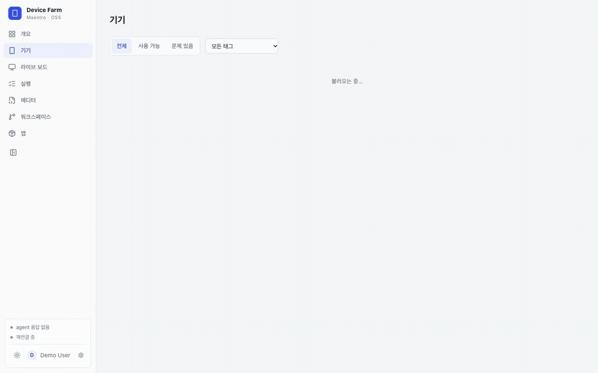

# Connect an Android device

## Before you begin

Complete [Docker setup](getting-started-docker.md) or [native setup](getting-started-native.md). Install [Android Studio](https://developer.android.com/studio) on macOS, Windows, or Linux to get the emulator and SDK Platform Tools. If you need only adb, use the [standalone SDK Platform Tools download](https://developer.android.com/tools/releases/platform-tools) for your OS. **adb** means Android Debug Bridge: it lists and talks to Android devices. An **AVD** is an Android Virtual Device profile; the **emulator** is the app that runs that profile. A physical phone must have developer options and USB debugging enabled. Connect only a device you are permitted to use for tests.

The farm supports Android emulators and physical Android devices through adb. The agent sees whatever the configured adb server exposes. The screenshots below use **example serials**; they are not a claim that these devices were connected during capture.

## 1. Choose an emulator or phone

For an emulator, install Android Studio, open **Device Manager**, select **Create Virtual Device**, choose a device and Android system image, and start it. For a phone, open Android settings, tap **Build number** repeatedly to enable Developer options, enable **USB debugging**, connect USB, and accept the RSA authorization prompt on the phone. Use Google's [Android Studio emulator guide](https://developer.android.com/studio/run/emulator) for OS specific installation details.


**Screenshot callouts:** (1) Device navigation; (2) device state and model; (3) battery, SDK and tags.

**You should see:** Android Studio Device Manager shows your started emulator as running, or the phone displays the USB debugging authorization prompt.

**If it looks different:** If no emulator appears, finish installing an Android system image in Device Manager. If the phone prompt is absent, check the cable and USB debugging setting.

## 2. Verify adb sees the intended device

```sh
adb devices
```

Expected shape (your serial will differ):

```text
List of devices attached
<your-device-serial>    device
```

`unauthorized` means the phone still needs the RSA prompt accepted. `offline` usually means reconnecting USB or restarting adb is needed. Do not proceed until the intended serial says `device`.


**Screenshot callouts:** (1) Device navigation; (2) device state and model; (3) battery, SDK and tags.

**You should see:** The intended serial is followed by `device` on a line under `List of devices attached`.

**If it looks different:** For `unauthorized`, accept the phone prompt. For `offline`, reconnect it. If the list includes another device, stop here and isolate the adb server first.

## 3. Start the farm agent

From the native `server/` directory, run `uv run farm agent`. In Docker, first read the [adb networking and agent profile section](../docker.md#3-connect-an-agent). The agent heartbeat makes the device state visible in the dashboard. A connected device should show its model, battery, SDK and tags.



**Screenshot callouts:** (1) Device navigation; (2) agent-connected state; (3) device row and status.

**You should see:** The **Device** page lists the connected model, battery, SDK, and state after the agent heartbeat.

**If it looks different:** If it remains offline, confirm the agent runs on the same data directory as the API and that the host adb list is correct.

## 4. Check selection conditions

Open **New run**. Choose all available devices, choose serials directly, or filter by device tags, model and SDK range. The selection preview tells you how many devices match before submission.


**Screenshot callouts:** (1) Pick your own option; (2) device selector; (3) eligible count.

A physical Android phone requires a compatible APK and sufficient battery (`FARM_MIN_BATTERY`, default 20%). The farm currently has no iOS execution path.

**You should see:** **New run** shows the intended device in the selection preview.

**If it looks different:** Check the app minimum SDK, tags, disabled state, and reservations. A filtered out device cannot be selected.

## Recap

You know which Android device adb sees, whether the agent reports it, and how to check run eligibility.

**Next:** [Your first flow](your-first-flow.md).
