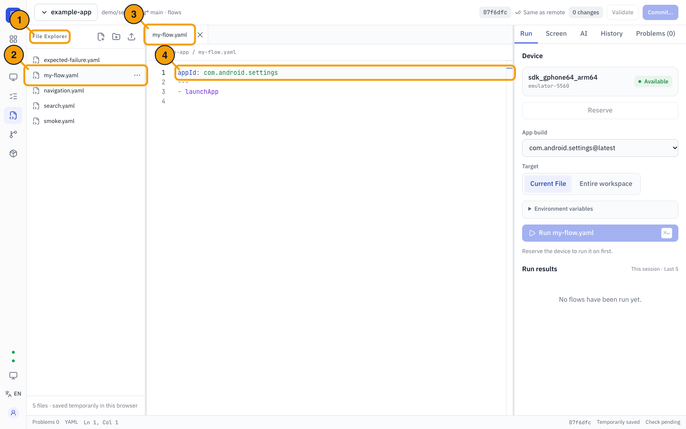

# Flow editor and AI assistant

**What you'll have at the end:** a validated YAML change committed to your workspace, plus a way to review optional AI suggestions before applying them.

## Copy-paste quick path

Open your registered workspace in the editor:

```text
http://localhost:8700/editor
```

Select a workspace, open a YAML file, edit, click **Validate**, then **Commit…**. AI is optional and requires a server-side provider.

## Before you begin

Register a [workspace](workspaces-and-git.md) with a YAML flow. A **flow** is a Maestro test file; YAML is indentation-sensitive text. An editor **draft** is temporarily stored in the browser. A **commit** records reviewed changes in Git. An AI **proposal** is a suggested change that you inspect before applying; applying it still leaves a draft until you commit.

## Edit a flow

### 1.1 Open the editor

Open `http://localhost:8700/editor`. **You should see:** **Select workspace** or the most recently used workspace. **If it looks different:** confirm the API is running.

### 1.2 Select a workspace

Use **Select workspace** to choose your registered repository. **You should see:** the workspace name and **Files** tree. **If it looks different:** register or sync it from **Workspace**.

### 1.3 Open a file

Click a `.yaml` file under **Files**. **You should see:** its YAML in the **Code** pane.



**Callouts:** (1) **Files**; (2) `my-flow.yaml`; (3) **Code**; (4) `appId:`.

**If it looks different:** check the workspace path and click **Sync** on **Workspace**.

### 1.4 Edit the YAML

Change one visible assertion or add one Maestro action in the code pane. **You should see:** a changed-file marker and a temporary draft. **If it looks different:** click inside the code pane first.

### 1.5 Validate

Click **Validate**. **You should see:** validation feedback under **Problems**. **If it looks different:** fix the line and indentation named in the error.


**Callouts:** (1) visible text **Validate**; (2) visible text **Problems**; (3) visible text **Commit…**.

### 1.6 Open the commit dialog

Click **Commit…**. **You should see:** a form asking for a commit message. **If it looks different:** make a change first and resolve validation problems.

### 1.7 Write a commit message

Enter a short message in the commit dialog. **You should see:** the text in the message field. **If it looks different:** reopen **Commit…** from the editor.

### 1.8 Commit the change

Click **Commit**. **You should see:** a new commit ID or **Committed** state. **If it looks different:** if the remote branch moved, use **Fetch** and resolve the displayed conflict.

## Optional AI assistance

### 2.1 Stop the native API

If the native API host already has an authenticated Codex CLI, press **Control-C** in the API terminal. **You should see:** the server stop and the terminal prompt return. **If it looks different:** use the process manager for your installation; [Configuration](../configuration.md) explains provider settings.

### 2.2 Start the API with Codex

From the native `server/` folder, run:

```sh
FARM_AI_PROVIDER=codex uv run farm api
```

**You should see:** the API stay running on port 8700. **If it looks different:** check that the Codex CLI is installed and authenticated on the API host. Docker users should configure a supported provider through their private runtime environment and restart the API container.

### 2.3 Check AI status

In another terminal, run:

```sh
curl http://localhost:8700/api/v1/ai/status
```

**You should see:** JSON containing:

```text
"enabled":true
```

**If it looks different:** inspect the API terminal for the provider startup error. Keep credentials out of flow files and command examples.

### 2.4 Open the AI panel

In the editor, click **AI**. **You should see:** **AI creation mode**, **Description**, and **Generate**.


**Callouts:** (1) visible text **AI creation mode**; (2) visible text **Description**; (3) visible text **Generate**.

**If it looks different:** the provider may be disabled; check `/api/v1/ai/status`.

### 2.5 Enter a request

In **Description**, type one behavior to test and the visible text to check. **You should see:** your request in the field. **If it looks different:** select a workspace and the correct AI creation mode first.

### 2.6 Generate a proposal

Click **Generate**. **You should see:** an AI job and then a proposal preview. **If it looks different:** read the AI job error. Screen context and automatic repair need a reserved device; a text-only request does not.

### 2.7 Review the proposal

Open the proposed file comparison. **You should see:** original and suggested YAML side by side. **If it looks different:** wait for the job to finish or open it from previous jobs.

### 2.8 Select a reviewed file

Select the proposed file you want to use. **You should see:** the file marked for reflection. **If it looks different:** inspect the proposal's target path before proceeding.

### 2.9 Apply that file

Click **Reflect selected files in editor**. **You should see:** the file marked as changed in the editor. **If it looks different:** return to the proposal and inspect its target path. Validate and commit this draft with steps 1.5–1.8.

## Recap

You can edit, validate, and commit a flow, and review optional AI work before applying it. **Next:** [Run tests](running-tests.md) or [inspect Git history](workspaces-and-git.md).

## Troubleshooting

| Symptom | Cause | Fix |
| --- | --- | --- |
| No files in **Files** | Workspace path or sync is wrong | Check **Workspace** and click **Sync** |
| **Validate** reports a problem | YAML syntax or Maestro action is invalid | Read **Problems** and fix the named line |
| **Commit…** fails | Remote branch moved or draft is invalid | Click **Fetch**, resolve conflict, validate again |
| AI panel is disabled | API has no enabled provider | Check `/api/v1/ai/status` and server configuration |
