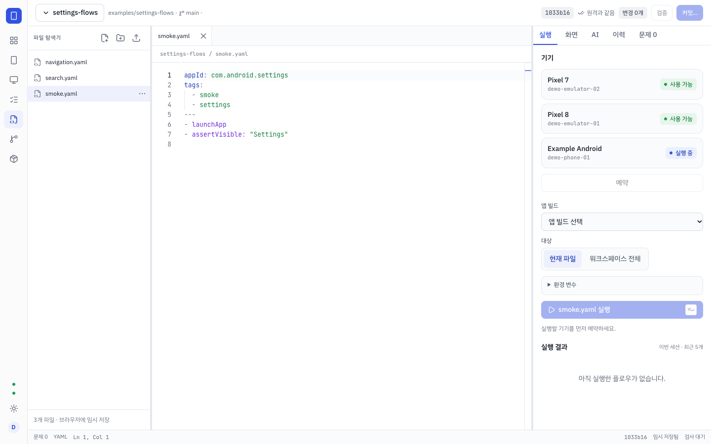
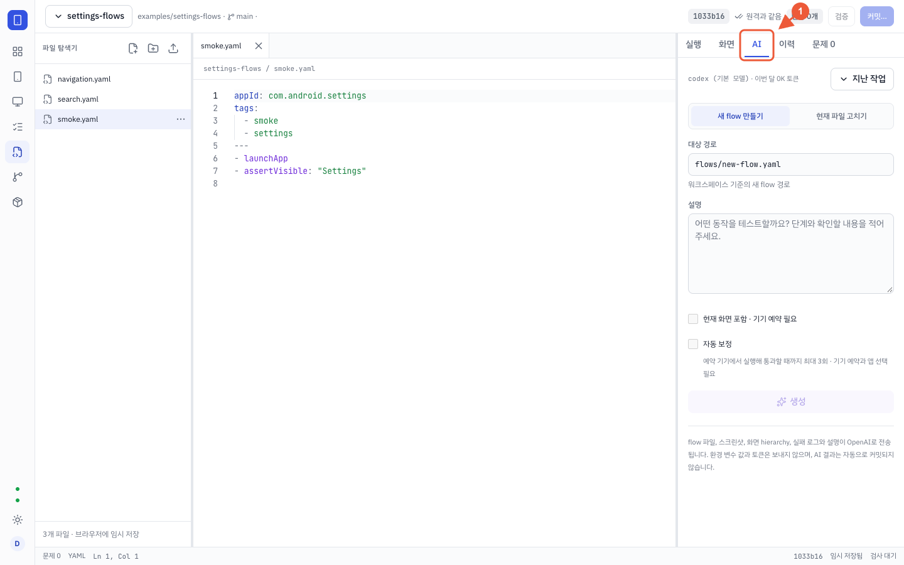

# Flow editor and AI assistant

The editor reads a Git workspace revision, keeps draft changes in your browser, validates YAML and lets you commit reviewed changes. AI is optional. The screenshots are from the real seeded demo workspace; no AI generation was requested during capture.

## 1. Open a workspace file

Click **Editor**, select your workspace, and choose a `.yaml` file in the left file tree. The central pane is a Monaco editor. The top bar shows the branch, short commit SHA and pending change count.

## 2. Edit, validate and commit

Change the YAML, click **Validate**, review any problems, then click **Commit**. The editor stores an uncommitted draft in the browser; a Git commit is a separate action. Use the history panel to inspect previous changes.

## 3. Enable AI at runtime

Set `FARM_OPENAI_API_KEY` in the **server process environment** and restart the API, or select the Codex CLI provider with `FARM_AI_PROVIDER=codex` if that CLI is installed and already authenticated. The key is read by the server and is not stored in the repository, flow, browser settings or Docker image. In Compose, put the variable in an untracked `.env` or use a secret manager; Compose passes it only at runtime. Never put the key in a command you intend to commit or share.

The AI panel is shown only when the API reports an enabled provider. In automatic mode, a configured OpenAI key is preferred; otherwise an authenticated Codex CLI can be used. The default model setting is `FARM_OPENAI_MODEL=gpt-6.1-sol`.

## 4. Review generated suggestions

Click **AI**, choose a new flow or the current file, enter the target path and a specific request, and submit. Screen inclusion and automatic repair require a reserved device; the default text-only request does not. The panel explains that flow text, selected screenshots, hierarchy and failure context may be sent to the provider. Review the suggested diff, apply only the files you want, then validate and commit separately.

*The GIF opens the AI panel in the real editor. It sends no prompt and uses no API key.*
