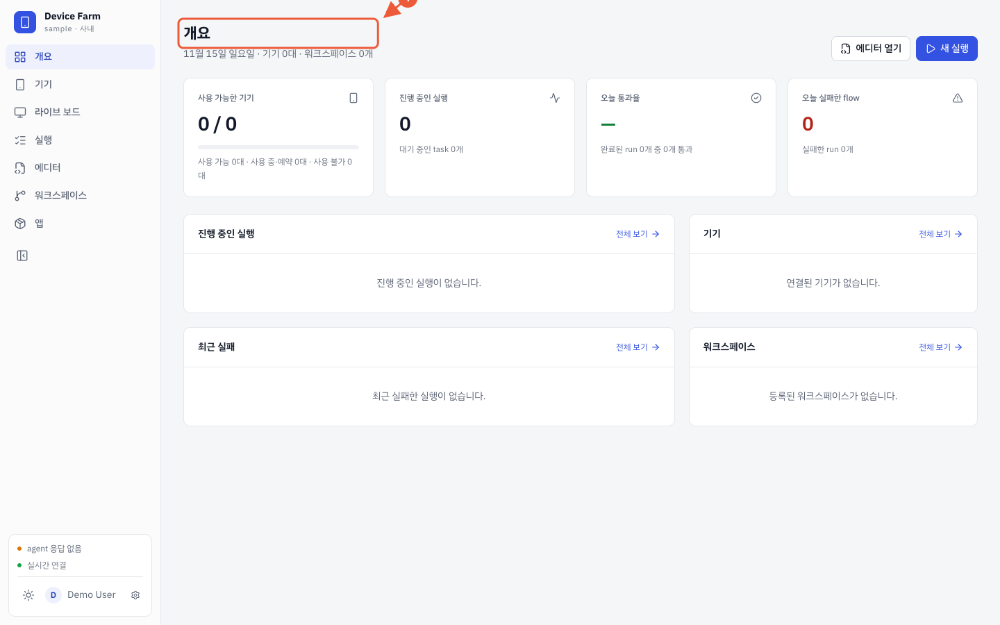
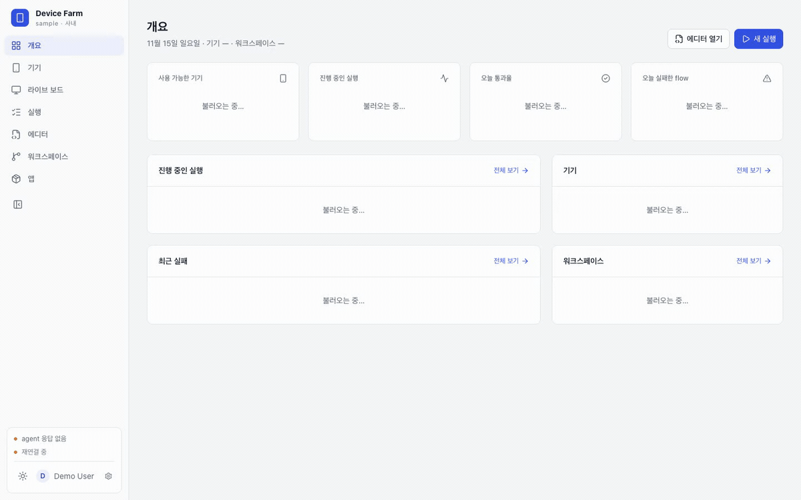

# Getting started with Docker

## Before you begin

Docker runs the API and dashboard in containers (small, isolated application environments). Docker Compose reads `docker-compose.yml` and starts the services together. This first session needs [Git](https://git-scm.com/downloads), a web browser, and [Docker Desktop for macOS](https://docs.docker.com/desktop/setup/install/mac-install/), [Docker Desktop for Windows](https://docs.docker.com/desktop/setup/install/windows-install/), or [Docker Engine](https://docs.docker.com/engine/install/) plus the [Compose plugin](https://docs.docker.com/compose/install/linux/) on Linux. Start Docker Desktop before opening a terminal. On Windows, use PowerShell; on macOS, use Terminal; on Linux, use your terminal app. Copy a command block, paste it, and press Enter. Run each block from the directory named above it.

An **agent** is the process that controls Android devices and executes tests. This guide first starts the dashboard without an agent. An **artifact** is an output file from a test, such as a screenshot or JUnit report. JUnit is an XML test result format used by CI systems.

This guide gets the API and dashboard running. A real test also needs an Android device, an APK, flows, and an agent. The images show the controls to look for; your own devices and run IDs will differ.

## 1. Install Docker and verify it

Install [Docker Desktop](https://www.docker.com/products/docker-desktop/) on macOS or Windows, or Docker Engine plus the Compose plugin on Linux. Open a terminal and run:

```sh
docker version
docker compose version
```

You should see both a Client and Server version and a Compose version. Your version numbers will differ. If the Server line is missing, start Docker Desktop or the Docker daemon. The dashboard you will reach is shown below.

**You should see:** `docker version` prints Client and Server sections, and `docker compose version` prints a version.

**If it looks different:** If `docker` is not recognized, finish the installation and reopen the terminal. If Server is unavailable, launch Docker Desktop or the Linux daemon.

## 2. Clone and set up the environment file

```sh
git clone PASTE_REPOSITORY_URL maestro-device-farm
cd maestro-device-farm
cp .env.example .env
```

On this repository page, click **Code**, copy the HTTPS URL, and replace `PASTE_REPOSITORY_URL` with it before pressing Enter. Leave the commented defaults alone for a first launch. `.env` is ignored by Git; add `FARM_HOST_PORT=8710` and `FARM_PUBLIC_URL=http://localhost:8710` only if port 8700 is occupied. The image below shows the first page after these steps and startup.

**You should see:** Your prompt is inside the `maestro-device-farm` folder; `.env` is a local configuration copy.

**If it looks different:** Replace the example clone URL with the repository URL from the project page. If Git asks for credentials, check repository access; do not paste credentials into the command.

## 3. Build and start

```sh
docker compose build
docker compose up -d
docker compose ps
```

You should see `api` in the service list. The API container should become `healthy`. The agent is an optional profile and stays stopped until you deliberately connect adb.



**Screenshot callouts:** (1) Overview navigation; (2) agent status; (3) summary cards.

**You should see:** `docker compose ps` lists an `api` service and eventually reports it healthy.

**If it looks different:** A first build can take several minutes. If it fails, inspect `docker compose logs --tail=100 api` and confirm Docker has enough disk space.

## 4. Open the dashboard

Visit `http://localhost:8700/` (or your chosen host port). Confirm that `curl http://localhost:8700/api/v1/healthz` returns JSON containing `"status":"ok"`. The footer will say the agent is not responding until you enable one.


**Screenshot callouts:** (1) Overview navigation; (2) agent status; (3) summary cards.

**You should see:** The **Overview** page opens at `http://localhost:8700/`; the health endpoint contains `"status":"ok"`.

**If it looks different:** If the browser cannot connect, run `docker compose ps`. For a port conflict, set `FARM_HOST_PORT` and `FARM_PUBLIC_URL` in `.env` as described in the [Docker reference](../docker.md).

## 5. Prepare a first run

Follow [Connect a device](connect-a-device.md), [Your first flow](your-first-flow.md), and [Running tests](running-tests.md). Upload an Android APK for the flow's package before submitting. The GIF points out the navigation and source form.



**Screenshot callouts:** (1) Runs navigation; (2) New run action; (3) source form.


For adb networking, backup, upgrades, and the optional agent profile, read [Docker operations](../docker.md).

**You should see:** You have a working dashboard. **Device** may be empty until an agent and device are connected.

**If it looks different:** An empty device list is expected at this stage. Continue with the linked device guide before trying a real run.

## Recap

The API and dashboard are running in Docker. The agent stays optional until you connect Android devices deliberately.

**Next:** [Connect an Android device](connect-a-device.md) or read [Docker operations](../docker.md).
