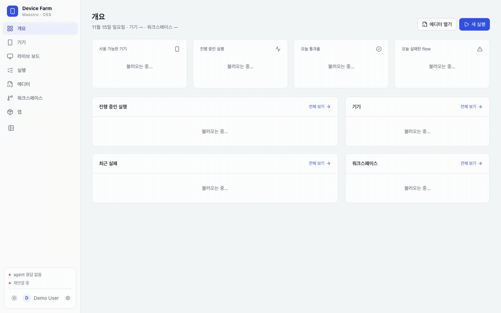

# Getting started natively

This path runs Python and the web UI on your host. It is the simplest route when adb and an Android emulator already work on your machine. The screenshots show an isolated seeded demo; the instructions below start your own instance.

## 1. Install the tools

Install Python 3.12 or newer, [uv](https://docs.astral.sh/uv/getting-started/installation/), Node.js, pnpm, Android SDK platform-tools (`adb`), Java 17+, and [Maestro CLI](https://docs.maestro.dev/maestro-cli/how-to-install-maestro-cli). Verify:

```sh
python3 --version
uv --version
node --version
pnpm --version
adb version
java -version
maestro --version
```

You should see a version for each command. The project uses `uv` for Python and `pnpm` for the dashboard. This screenshot shows the destination after startup.


## 2. Install dependencies and build the dashboard

```sh
git clone <repository-url> maestro-device-farm
cd maestro-device-farm/server
uv sync
cd ../web
pnpm install --frozen-lockfile
pnpm build
```

The verified web build ended with `✓ built` and generated `web/dist`. Return to `server/` before the next command.


## 3. Start the API

In terminal A:

```sh
cd maestro-device-farm/server
uv run farm api
```

`farm api` applies database migrations and listens on port 8700. Open `http://localhost:8700/` and `http://localhost:8700/api/v1/healthz`. The health JSON should include `"status":"ok"` and may have `"agent":null` at this stage.


## 4. Connect a device and start the agent

First run `adb devices` and confirm only devices you intend this farm to control are visible. In terminal B:

```sh
cd maestro-device-farm/server
uv run farm agent
```

The device list should move from offline to available or busy after a heartbeat. The agent may prepare, install APKs, and run Maestro on devices exposed by adb. Use [Connect a device](connect-a-device.md) before this step.


## 5. Optional web development server

The API already serves `web/dist`. For frontend editing, run `cd web && pnpm dev` in terminal C and visit `http://localhost:5173/`; Vite proxies `/api` to port 8700. Set `FARM_API_URL` if your API uses another port.



*The GIF moves from the overview to the device page. It does not start an adb session.*

Now follow [Your first flow](your-first-flow.md) and [Running tests](running-tests.md).
