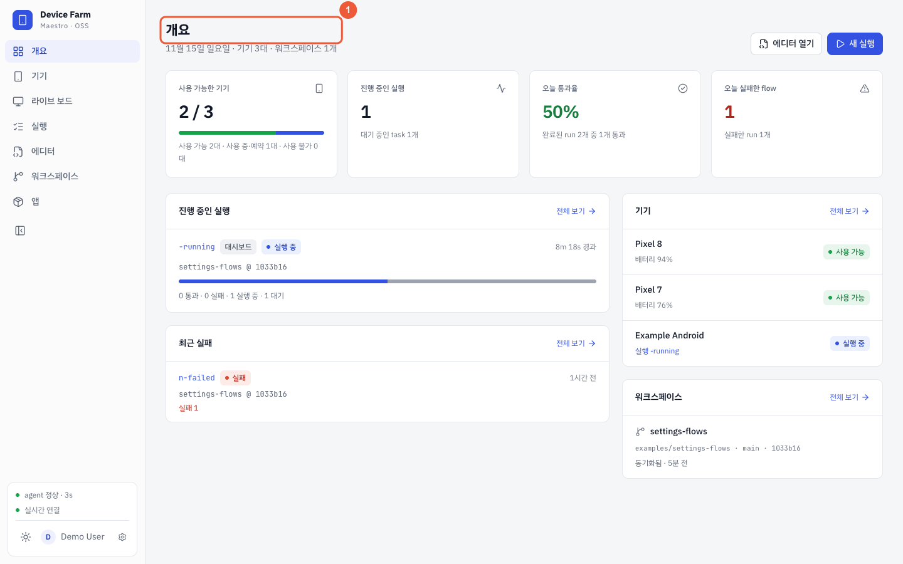

# Getting started natively

**What you'll have at the end:** the API and built English dashboard running on your macOS or Linux computer. A separate agent can run Android tests afterward.

## Copy-paste quick path

After installing the tools listed below, copy the repository HTTPS URL from **Code** and replace `PASTE_REPOSITORY_URL`:

```sh
git clone PASTE_REPOSITORY_URL maestro-device-farm
cd maestro-device-farm/server
uv sync
cd ../web
pnpm install --frozen-lockfile
pnpm build
cd ../server
uv run farm api
```

Keep the last terminal open; visit `http://localhost:8700/`.

## Before you begin

Install [Git](https://git-scm.com/downloads), [Python 3.12+](https://www.python.org/downloads/), [uv](https://docs.astral.sh/uv/getting-started/installation/), [Node.js](https://nodejs.org/en/download), and [pnpm](https://pnpm.io/installation). For Android tests, also install [Android Studio/SDK Platform Tools](https://developer.android.com/studio), [Java 17+](https://adoptium.net/), and [Maestro CLI](https://docs.maestro.dev/maestro-cli/how-to-install-maestro-cli). On Windows, follow the [Docker path](getting-started-docker.md) for the API. A **terminal** is the text window where you paste one command and press Enter. **adb** (Android Debug Bridge) lets the agent communicate with Android; an **AVD** is a virtual device profile run by an emulator.

## Install and start

### 1.1 Check Python

Run `python3 --version` in Terminal (macOS) or your Linux terminal. **You should see:** a line like this, with version 3.12 or newer:

```text
Python 3.12.7
``` **If it looks different:** install Python 3.12+ and reopen the terminal.

### 1.2 Check uv

Run `uv --version`. **You should see:** a line like:

```text
uv 0.10.4
``` **If it looks different:** install uv from the link above.

### 1.3 Check Node.js

Run `node --version`. **You should see:** a line like:

```text
v22.18.0
``` **If it looks different:** install Node.js and reopen the terminal.

### 1.4 Check pnpm

Run `pnpm --version`. **You should see:** a version number, for example:

```text
10.29.1
``` **If it looks different:** install pnpm from the link above.

### 1.5 Copy the repository URL

On this repository page, click **Code > HTTPS > Copy**. **You should see:** an HTTPS clone URL on your clipboard. **If it looks different:** use your Git host's clone control.

### 1.6 Clone the repository

Replace `PASTE_REPOSITORY_URL` with the copied URL and run:

```sh
git clone PASTE_REPOSITORY_URL maestro-device-farm
```

**You should see:**

```text
Cloning into 'maestro-device-farm'...
```

**If it looks different:** check Git installation and repository access.

### 1.7 Enter the server folder

Run `cd maestro-device-farm/server`. **You should see:** no error and a prompt inside `server`. **If it looks different:** return to the terminal where you cloned the repository.

### 1.8 Install Python packages

Run:

```sh
uv sync
```

**You should see:** uv end with lines like:

```text
Resolved 73 packages
Installed 73 packages
```

The counts can differ by platform and cache. **If it looks different:** check Python 3.12+ and network access.

### 1.9 Enter the web folder

Run `cd ../web`. **You should see:** no error and a prompt inside `web`. **If it looks different:** confirm the preceding directory was `server`.

### 1.10 Install web packages

Run:

```sh
pnpm install --frozen-lockfile
```

**You should see:** a completed install summary containing a line like:

```text
Done in 3.2s
```

The time will differ. **If it looks different:** check Node.js, pnpm, and network access.

### 1.11 Build the dashboard

Run:

```sh
pnpm build
```

**You should see:** a Vite line like:

```text
✓ built in 2.3s
```

The time will differ; the build creates `web/dist`. **If it looks different:** read the first TypeScript or Vite error above the summary.

### 1.12 Return to the server folder

Run `cd ../server`. **You should see:** no error. **If it looks different:** confirm you were in `web` after step 1.11.

### 1.13 Start the API

Run:

```sh
uv run farm api
```

**You should see:** a line like this and the terminal remaining open:

```text
Uvicorn running on http://0.0.0.0:8700 (Press CTRL+C to quit)
```

**If it looks different:** check the error in this terminal and whether port 8700 is in use.

### 1.14 Open the dashboard

Open `http://localhost:8700/` in a browser. **You should see:** **Overview** and the navigation sidebar.



**Callouts:** (1) **Overview**; (2) **Agent not responding**; (3) **Available devices**.

**If it looks different:** keep the API terminal open and visit `http://localhost:8700/api/v1/healthz` to check the server.

### 1.15 Check the health response

In a second terminal, run:

```sh
curl http://localhost:8700/api/v1/healthz
```

**You should see:** JSON containing:

```json
"status":"ok"
```

**If it looks different:** return to the API terminal to read its startup error.

## Recap

Your API and dashboard are running. Keep the API terminal open. **Next:** [Connect an Android device](connect-a-device.md), then start the agent only after confirming which device adb sees.

## Troubleshooting

| Symptom | Cause | Fix |
| --- | --- | --- |
| `uv sync` cannot find Python | Python is too old or not on PATH | Install Python 3.12+ and reopen the terminal |
| `pnpm` is missing | Package manager not installed | Follow the pnpm install link above |
| Build fails | TypeScript or Vite error | Read the first error from `pnpm build` |
| Browser cannot connect | API terminal closed or port occupied | Restart `uv run farm api` and check port 8700 |
