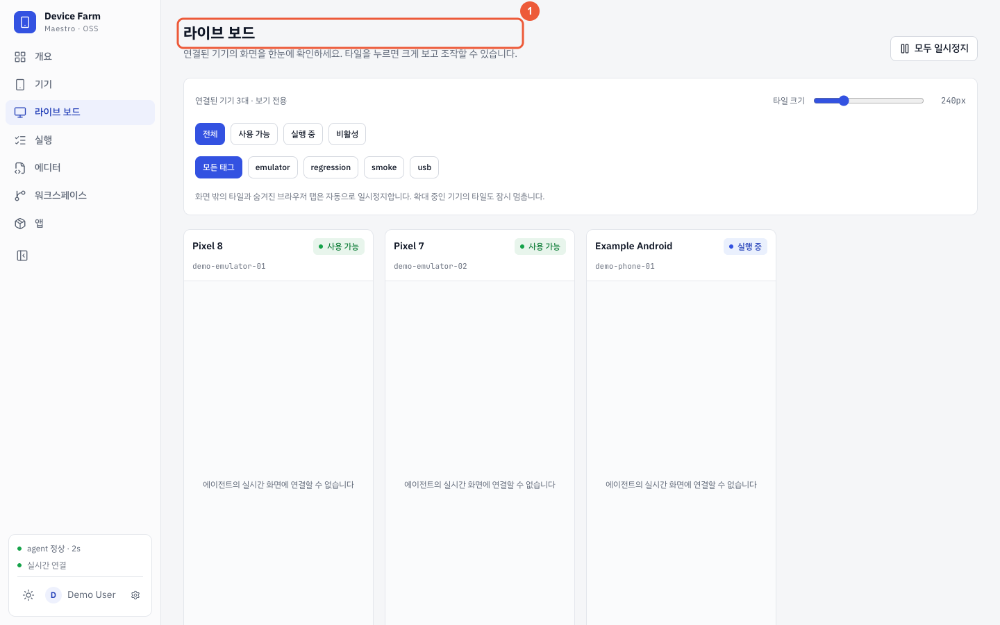
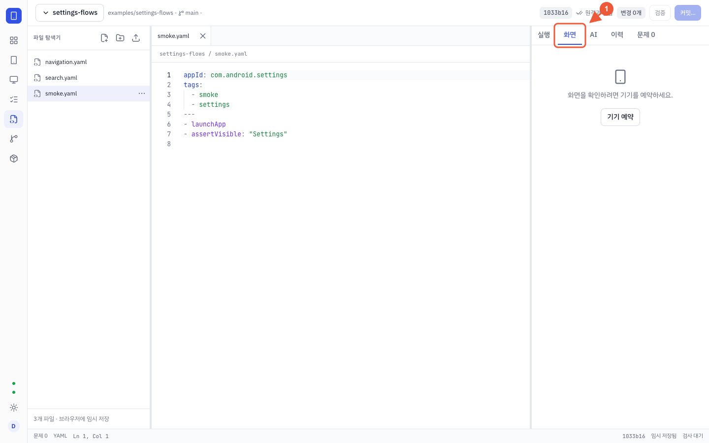
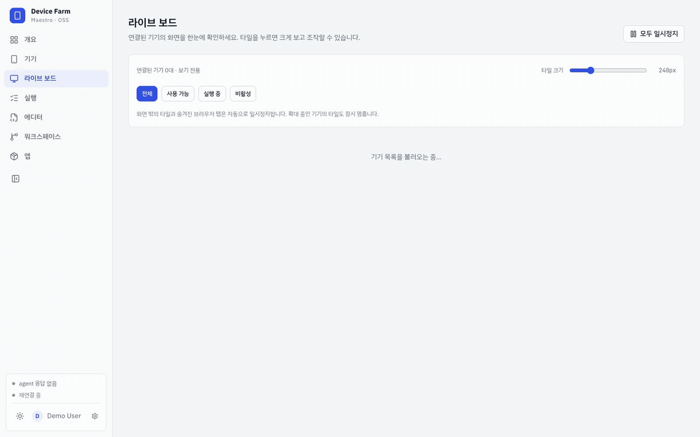

# Live screen and recording

Live viewing uses a WebSocket from the browser to the API, then the API to the agent's stream service. It requires a connected Android device and a running agent. The documentation demo had no real connected device, so the screenshots show the reachable controls and empty states rather than a live phone image.

## 1. Open the live board

Click **Live board** in the sidebar. Use the status filters and tile size control to find a connected device. An offline device appears in the collapsed section and cannot show a screen.

## 2. Open the editor screen panel

Open a workspace in **Editor**, then click the **Screen** tab. Reserve an available device before controlling it. The API issues a short-lived stream ticket for control; a view-only connection does not get the same control ability.

## 3. Record interactions

With a connected, reserved device, use the recording controls in the screen panel. Start recording, interact with the device, then stop. The recorder can produce a draft YAML flow for review in the editor. Check the generated actions before committing them to Git.

*The GIF shows live board filters. No screen stream or recording was captured because the demo used seeded devices only.*

If a stream does not open, check agent heartbeat, device state, adb access and the API-to-agent stream address. In Compose, the API uses `FARM_AGENT_STREAM_HOST=agent`; natively both processes default to `127.0.0.1` and port 8701.
