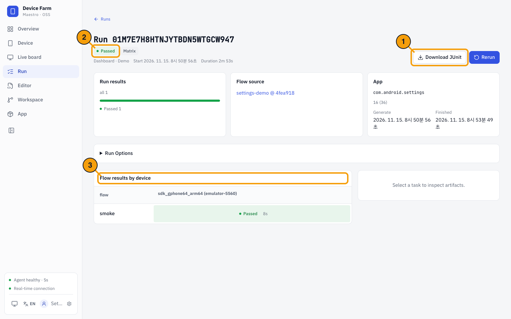

# Read run results

## Before you begin

Submit a run using [Run tests](running-tests.md). A **task** is one device assignment. An **artifact** is a saved output file, such as a screenshot or text summary. **JUnit** is an XML test result format used by continuous integration (CI) tools. The API and browser can show a queued run before a device finishes it.

The dashboard shows queued, running, passed, failed, error and cancelled states. The images show sample history; your run IDs and output will differ.

## 1. Open the runs list

Click **Runs** in the sidebar. The list can be filtered by status and links each run ID to detail. Passed means all tasks passed; failed means an assertion or case failed; error means an infrastructure or execution error; cancelled means cancellation was requested or completed.


**Screenshot callouts:** (1) Runs navigation; (2) search or filter; (3) run row and status.

**You should see:** **Run history** lists the run ID and a status such as Queued, Running, Passed, Failed, Error, or Canceled.

**If it looks different:** If it is empty, submit a run first. Use the search/filter controls if a known ID is hidden.

## 2. Open a run and select a task

Select the run ID you submitted. The detail page shows the run mode, source revision, APK build, options and task distribution. Select a task row to see its per-task results and artifacts on the right. A matrix run has a device-by-flow grid.


**Screenshot callouts:** (1) run status; (2) selected task; (3) task output and Artifacts.

**You should see:** The detail shows a task list; selecting a task changes the output panel.

**If it looks different:** A queued task has no output yet. Refresh after the agent claims it, or check agent health on Overview.

## 3. Read artifacts and JUnit

The task panel lists files under that task's artifact directory, such as JUnit XML and summaries. A real Maestro run may also produce logs, screenshots and other captures. Click a file to inspect or download it. Use **Download JUnit** at the top for the merged report from all tasks.

Replace `RUN_ID` and `TASK_ID` below with the IDs shown in your run detail before pasting the commands.

```sh
curl -o report.xml http://localhost:8700/api/v1/runs/RUN_ID/junit
curl http://localhost:8700/api/v1/tasks/TASK_ID/artifacts
```



**Screenshot callouts:** (1) Download JUnit; (2) run status; (3) task list.

**You should see:** **Artifacts** lists available files and **Download JUnit** offers the merged XML after results exist.

**If it looks different:** A task can have no screenshot. If a download is unavailable, wait for completion and inspect the task status.

## 4. Retry or cancel

Use **Rerun only on failure** for a new run containing failed or errored tasks, or **Rerun** for the complete selection. Queued and running runs expose **Cancel**. The GIF follows the runs list into a failed run's detail.


**Screenshot callouts:** (1) run row; (2) task selector; (3) task output.

**You should see:** A rerun creates a new run; Cancel requests a stop for queued or active work.

**If it looks different:** Use **Rerun only on failure** only when failed tasks exist. The original run remains in history.

## Recap

You can find a run, inspect a task and its artifacts, download JUnit, and create a deliberate rerun.

**Next:** [Troubleshooting](troubleshooting.md) when a result needs investigation.
