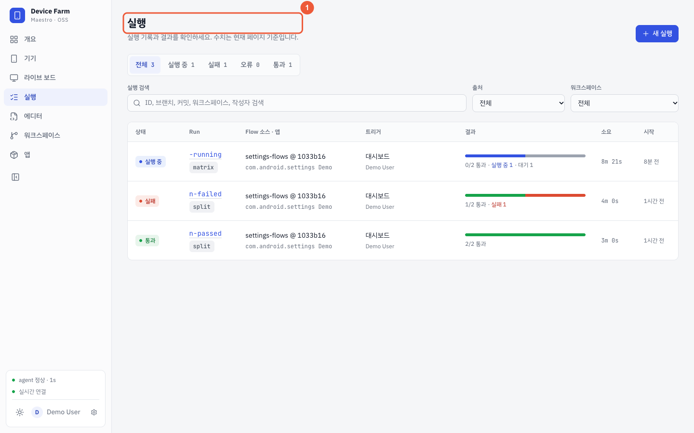
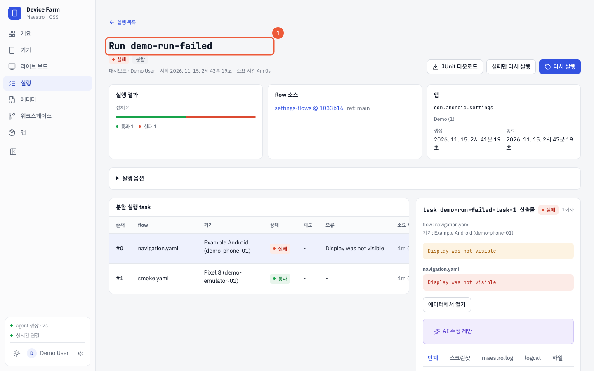
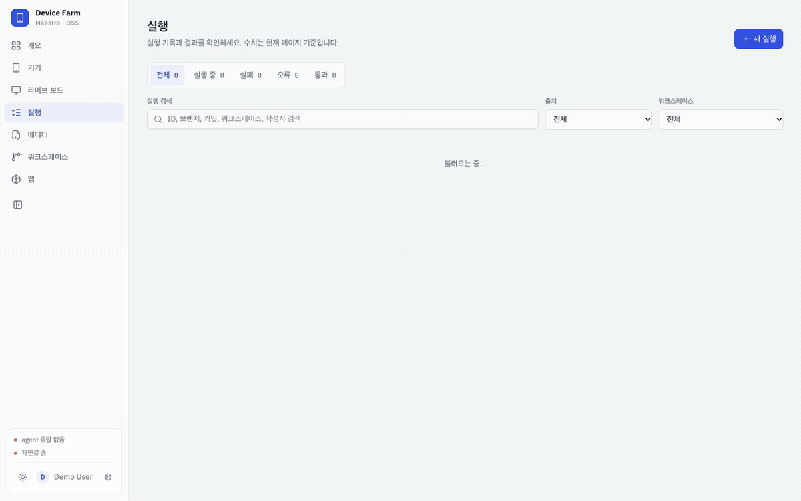

# Read run results

The dashboard shows queued, running, passed, failed, error and cancelled states. The pictures are from seeded demo history, including one failure, so you can see the interface without running on a device.

## 1. Open the runs list

Click **Runs** in the sidebar. The list can be filtered by status and links each run ID to detail. Passed means all tasks passed; failed means an assertion or case failed; error means an infrastructure or execution error; cancelled means cancellation was requested or completed.



## 2. Open a run and select a task

Select `demo-run-failed`. The detail page shows the run mode, source revision, APK build, options and task distribution. Select a task row to see its per-task results and artifacts on the right. A matrix run has a device-by-flow grid.



## 3. Read artifacts and JUnit

The task panel lists files under that task's artifact directory, such as JUnit XML and summaries in this demo. A real Maestro run may also produce logs, screenshots and other captures. Click a file to inspect or download it. Use **JUnit download** at the top for the merged report from all tasks.

```sh
curl -o report.xml http://localhost:8700/api/v1/runs/<run-id>/junit
curl http://localhost:8700/api/v1/tasks/<task-id>/artifacts
```


## 4. Retry or cancel

Use **Rerun failures only** for a new run containing failed or errored tasks, or **Rerun** for the complete selection. Queued and running runs expose **Cancel**. The GIF follows the runs list into a failed run's detail.



*The GIF opens the failed demo run and scrolls to its tasks. The history was seeded; it is not a recorded device execution.*
