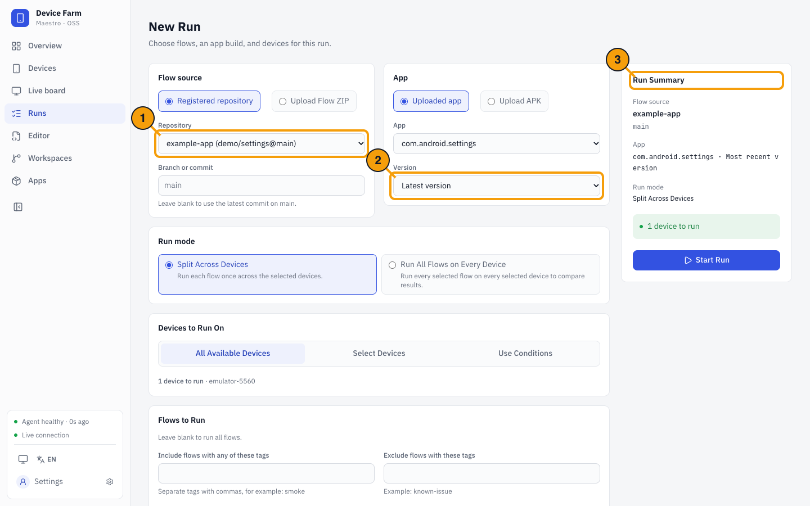
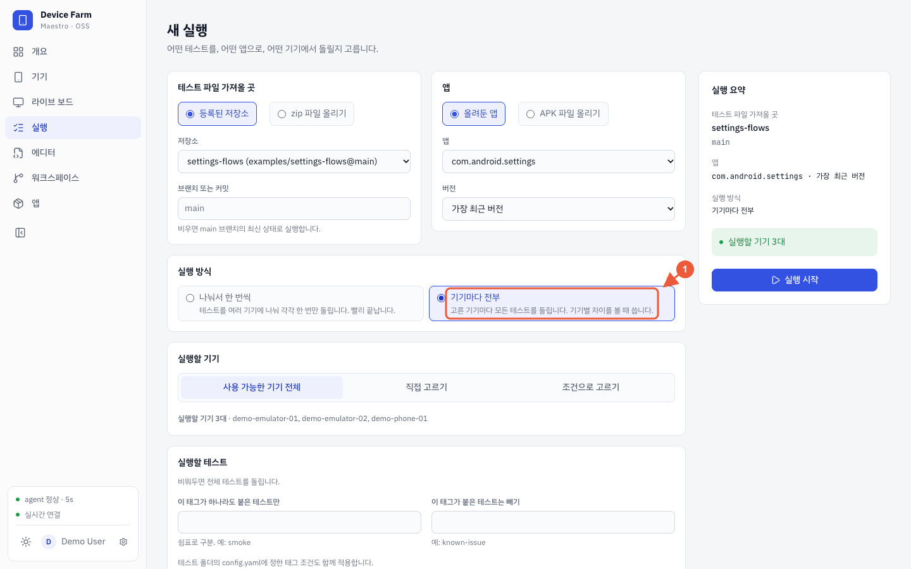
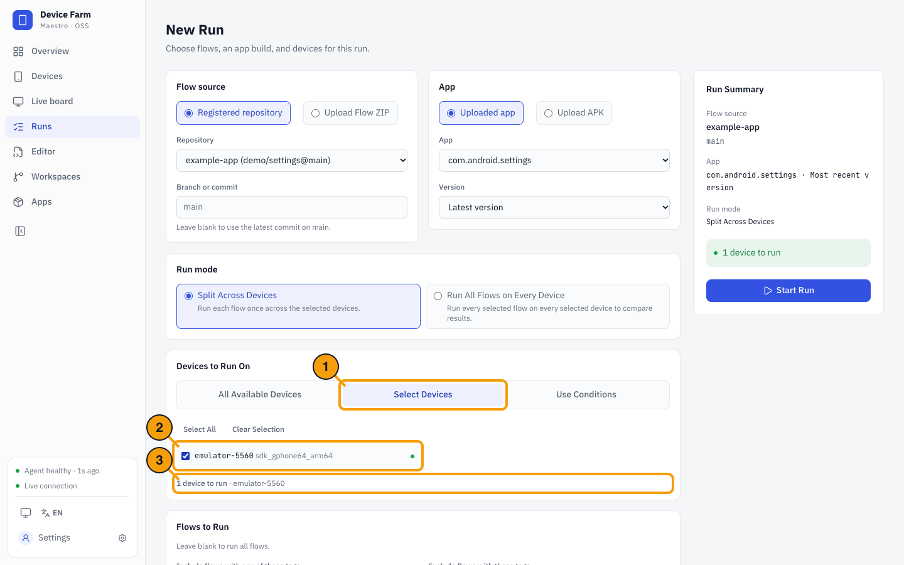
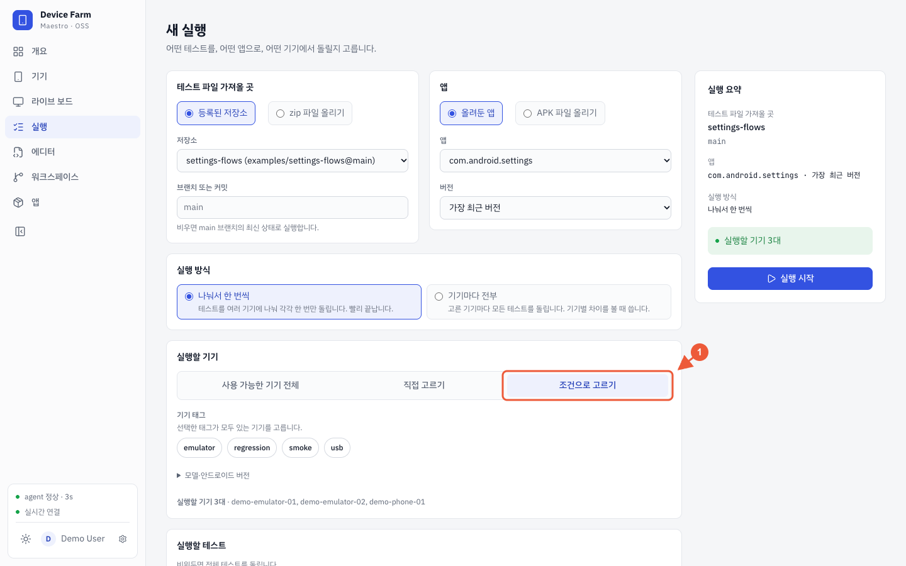

# Run tests

## Before you begin

You need a running API and agent, an available Android device, an APK (Android application package), and a flow whose `appId` equals the APK package. Follow [Connect a device](connect-a-device.md) and [Your first flow](your-first-flow.md). A **run** is a submitted test request; a **task** is one unit assigned to a device. A **tag** is a flow label used to include or exclude tests. A **workspace** supplies versioned flows from Git. An uploaded ZIP is a one-off flow source. A JUnit report is an XML summary for test tools.

A run selects flows, an APK build and eligible Android devices. The UI shows a preview before submission. The images show example states; your run will move beyond queued when an agent executes its tasks.

## 1. Choose flow source and app

Open **Runs**, then **New run**. Choose **Registered repository** and a workspace, or upload a ZIP of YAML flows. Choose an uploaded app build or upload an APK. The `appId` in your YAML must match the APK package. A registered workspace may use a branch or commit ref; leaving it blank selects its configured branch head.

**Screenshot callouts:** (1) flow source selector; (2) app build selector; (3) Run summary.

**You should see:** **Run summary** names the chosen flow source and app build.

**If it looks different:** If no workspace appears, register one. If no app appears, use **Upload your APK file** or the **App** page.

## 2. Choose split or matrix

**Split** creates one task for each selected flow. Each task can be claimed by an eligible device; a flow runs once. **Matrix** creates one pinned task for each eligible device; that task runs the selected flow set on its device. With flows A and B and devices D1 and D2:

| Mode | Tasks created |
| --- | --- |
| Split | A → one of D1/D2; B → one of D1/D2. |
| Matrix | D1 → A+B; D2 → A+B. |

The matrix mode can run all flows through Maestro's directory/tag selection, while split enumerates the files before creating tasks. Select the mode card and check the summary on the right.

**Screenshot callouts:** (1) Matrix mode card; (2) Split mode card; (3) Run summary.

**You should see:** The selected **Run mode** card is highlighted; **Split** distributes flow tasks and **Matrix** repeats the set per device.

**If it looks different:** Use Split for a first run. Matrix intentionally increases the number of executions.

## 3. Select devices

Choose **All available devices**, **Pick your own** by serial, or **Choose based on conditions**. Conditions include device tags, model and SDK range; the device must have **all** requested device tags. The app build's minimum SDK is also enforced. The count preview is your final check before submission.

**Screenshot callouts:** (1) Pick your own option; (2) device selector; (3) eligible count.

**Screenshot callouts:** (1) conditions option; (2) tags/model/SDK inputs; (3) eligible count.

**You should see:** The preview counts at least one eligible device and shows its state.

**If it looks different:** A count of zero means you must connect an agent/device or loosen the selector. Do not submit until the intended device matches.

## 4. Select flows

The **include tags** field matches a flow with **any** listed tag. Exclude tags remove matching flows. For example, `smoke,search` includes a flow tagged `smoke` **or** `search`. An explicit relative flow path such as `smoke.yaml` selects that path directly and bypasses tag filtering. For nested files, use paths relative to the workspace root. A flow named in an explicit path must exist or submission fails.

**Screenshot callouts:** (1) include tags; (2) exclude tags; (3) Specify test file directly.

**You should see:** The tag or explicit file field contains your selection, and the summary reflects it.

**If it looks different:** Leave both empty to run all flows. An explicit path must be relative to the flow root and bypasses tag filtering.

## 5. Set timeout and submit

The optional timeout is in seconds **per task**. The default is `FARM_TASK_TIMEOUT_SEC=1800` (30 minutes). Optional `KEY=VALUE` entries are passed to Maestro and are hidden on run detail; avoid putting secrets in browser forms or shell history. Click **Start run** and follow the new run detail page.

**Screenshot callouts:** (1) source and app; (2) device preview; (3) Start run and queued status.

Infrastructure errors (`device_disconnected`, `install_failed`, `timeout`, `agent_restarted`, `no_junit`) are retried once, with `FARM_RETRY_BACKOFF_SEC` delay (default 15 seconds). A normal assertion failure does not get an automatic retry. Use **Rerun** or **Rerun only on failure** on run detail for a deliberate rerun.

**You should see:** A run detail page opens with a run ID and initial queued state, then task updates.

**If it looks different:** If submission fails, read the error and check source, APK, and device preview. A queued run needs a running agent.

## Recap

You selected a flow source, app build, run mode, devices, and flow filters, then submitted a run.

**Next:** [Read run results](reading-results.md).
