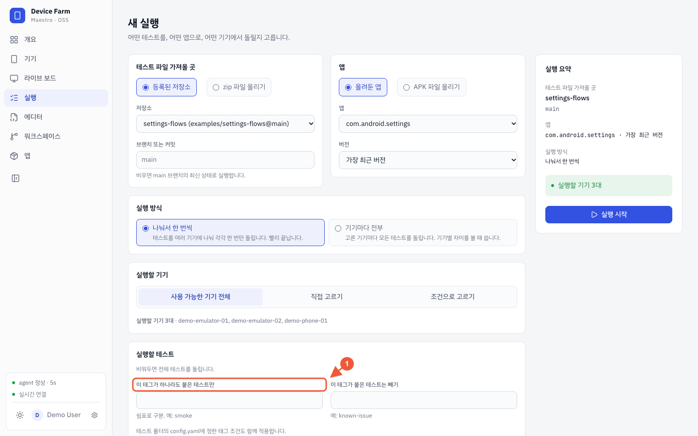
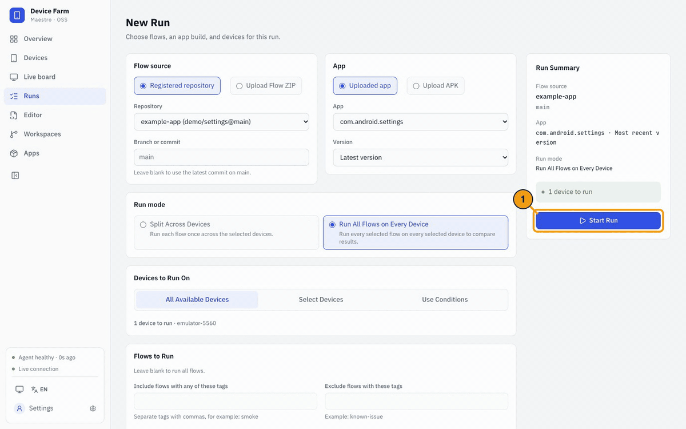

# Run tests

A run selects flows, an APK build and eligible Android devices. The UI shows a preview before submission. The screenshots and GIF are from a seeded demo; the final run stays queued because no execution agent was started.

## 1. Choose flow source and app

Open **Runs → New run**. Choose **Registered repository** and a workspace, or upload a ZIP of YAML flows. Choose an uploaded app build or upload an APK. The `appId` in your YAML must match the APK package. A registered workspace may use a branch or commit ref; leaving it blank selects its configured branch head.

## 2. Choose split or matrix

**Split** creates one task for each selected flow. Each task can be claimed by an eligible device; a flow runs once. **Matrix** creates one pinned task for each eligible device; that task runs the selected flow set on its device. With flows A and B and devices D1 and D2:

| Mode | Tasks created |
| --- | --- |
| Split | A → one of D1/D2; B → one of D1/D2. |
| Matrix | D1 → A+B; D2 → A+B. |

The matrix mode can run all flows through Maestro's directory/tag selection, while split enumerates the files before creating tasks. Select the mode card and check the summary on the right.

## 3. Select devices

Choose **All available devices**, **Choose directly** by serial, or **Choose by conditions**. Conditions include device tags, model and SDK range; the device must have **all** requested device tags. The app build's minimum SDK is also enforced. The count preview is your final check before submission.

## 4. Select flows

The **include tags** field matches a flow with **any** listed tag. Exclude tags remove matching flows. For example, `smoke,search` includes a flow tagged `smoke` **or** `search`. An explicit relative flow path such as `smoke.yaml` selects that path directly and bypasses tag filtering. For nested files, use paths relative to the workspace root. A flow named in an explicit path must exist or submission fails.

## 5. Set timeout and submit

The optional timeout is in seconds **per task**. The default is `FARM_TASK_TIMEOUT_SEC=1800` (30 minutes). Optional `KEY=VALUE` entries are passed to Maestro and are hidden on run detail; avoid putting secrets in browser forms or shell history. Click **Start run** and follow the new run detail page.

*The GIF changes run mode and submits a run. It reaches a queued run detail; no device execution occurred during capture.*

Infrastructure errors (`device_disconnected`, `install_failed`, `timeout`, `agent_restarted`, `no_junit`) are retried once, with `FARM_RETRY_BACKOFF_SEC` delay (default 15 seconds). A normal assertion failure does not get an automatic retry. Use **Rerun** or **Rerun failures only** on run detail for a deliberate rerun.
