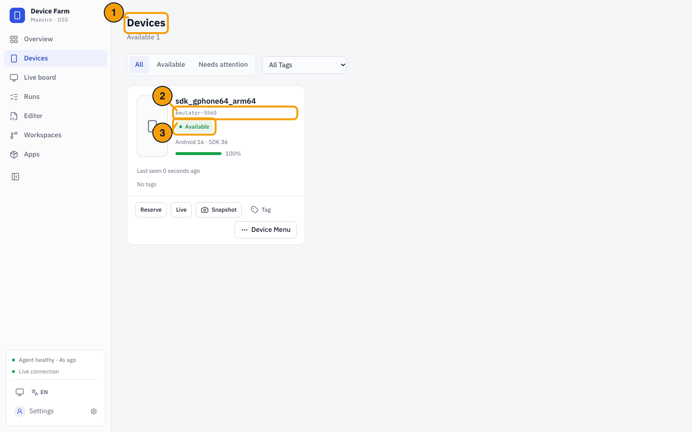
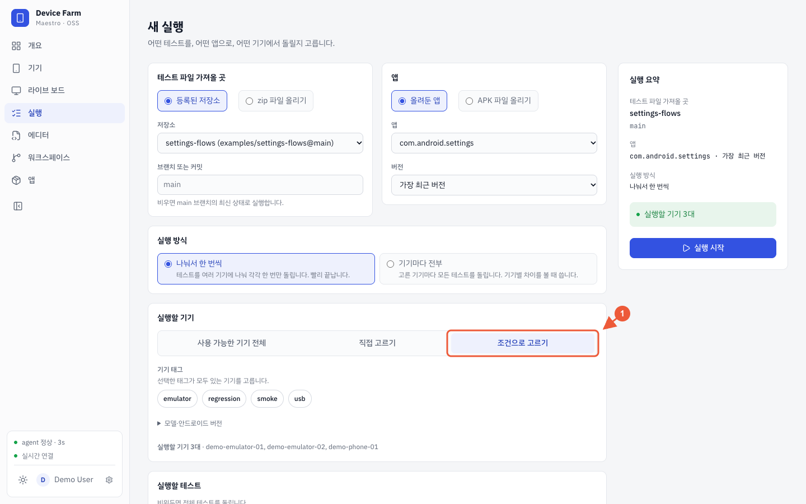
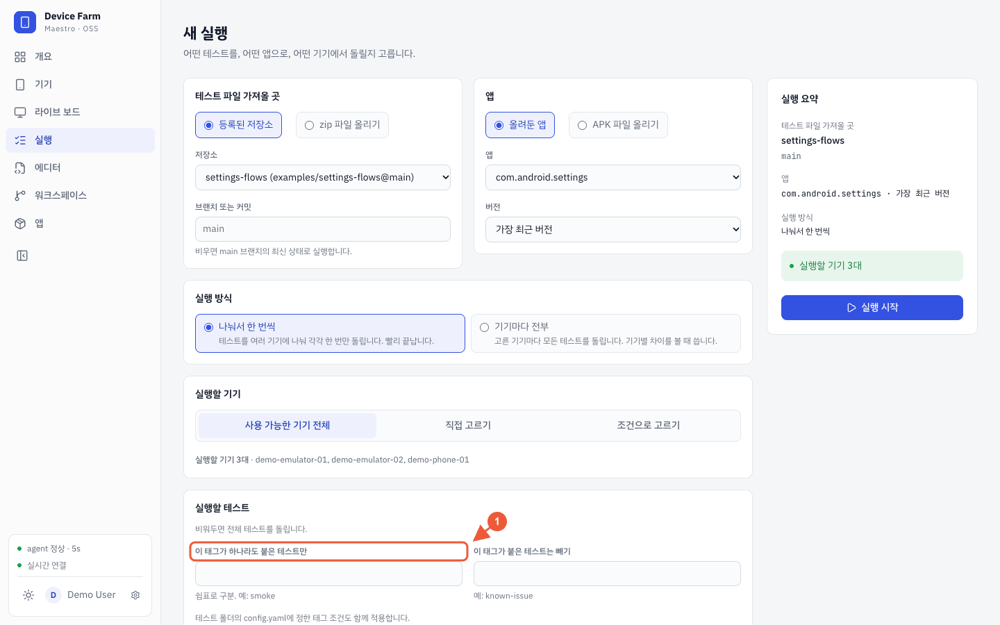
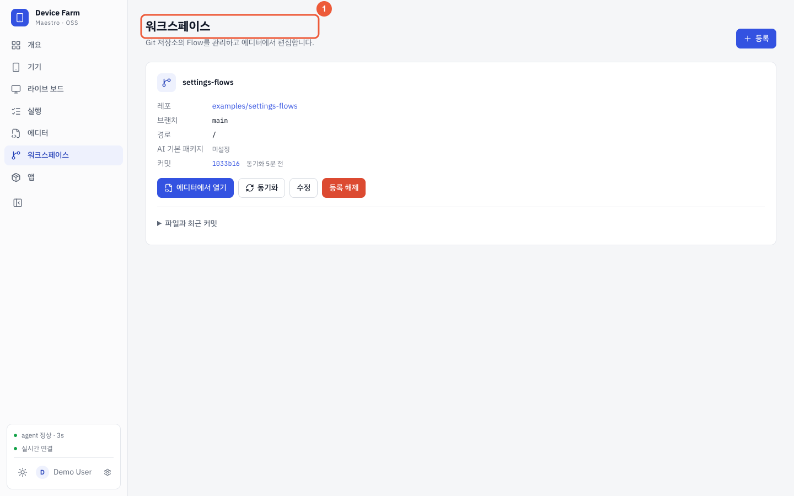
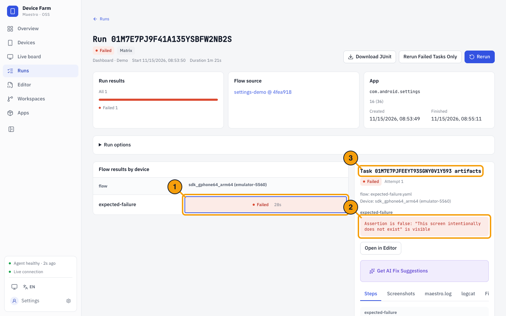
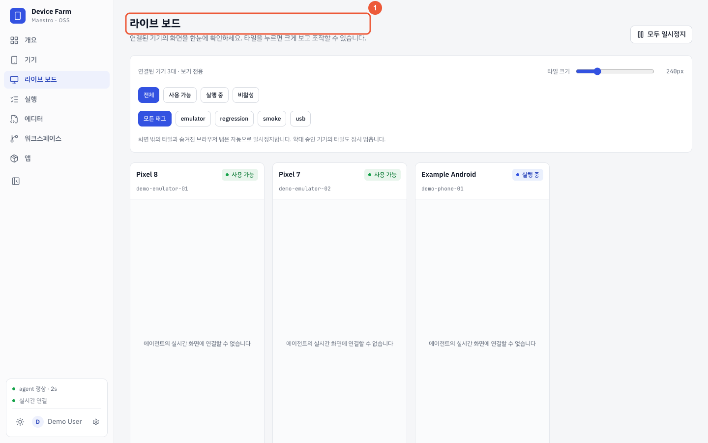

English | [한국어](../ko/guides/troubleshooting.md)

# Troubleshooting

**What you'll have at the end:** the exact failing layer identified and one corrective action to try before repeating a run.

## Copy-paste quick path

With the API running, paste this into a terminal:

```sh
curl http://localhost:8700/api/v1/healthz
```

**You should see:** JSON containing `"status":"ok"`. Then match the symptom in the table at the bottom of this page.

## Before you begin

Keep the API running and read the exact error code on the screen. **adb** (Android Debug Bridge) is the tool the agent uses to see devices. The **agent** runs Maestro tests. A **flow** is a YAML test file, a **tag** selects flows, an **artifact** is saved task output, and JUnit is the XML test report. Choose the case that matches what you see.

## Case 1: All devices are Offline

### 1.1 Check the API

Open `http://localhost:8700/api/v1/healthz`. **You should see:** `"status":"ok"` and an `agent` field. **If it looks different:** restart the API first.

### 1.2 Check adb on the agent host

In a terminal on the agent host, run:

```sh
adb devices
```

**You should see:**

```text
List of devices attached
YOUR_DEVICE_SERIAL    device
```

**If it looks different:** follow [Connect a device](connect-a-device.md). Stop before starting the agent if an unintended device appears.

### 1.3 Check the Device page

Open `http://localhost:8700/devices`. **You should see:** your device row with **Available**, **Reserved**, or **Running** rather than **Offline**.



**Callouts:** (1) visible text **Device**; (2) your device row; (3) state label.

**If it looks different:** start the agent using the same data directory as the API and wait for a heartbeat.

## Case 2: `no_matching_devices`

### 2.1 Open device selection

Open `http://localhost:8700/runs/new`. **You should see:** **New run** and device selection. **If it looks different:** check the API URL.

### 2.2 Check all available devices

Click **All available devices**. **You should see:** a nonzero eligible count. **If it looks different:** check the device state, APK minimum SDK, reservation, and model/tag conditions.



**Callouts:** (1) visible text **Choose based on conditions**; (2) Android API level inputs; (3) eligible count.

## Case 3: `no_flows` or `flow_not_found`

### 3.1 Clear the tag filter

In **New run**, clear **Include flows with any of these tags**. **You should see:** the flow selection restriction disappear. **If it looks different:** inspect the workspace tree; an explicit path must be relative to the flow root.



**Callouts:** (1) include tag input; (2) exclude tag input; (3) visible text **Explicit flow paths**.

## Case 4: `repo_unreachable` or `branch_not_found`

### 4.1 Open the workspace form

Open `http://localhost:8700/workspaces`. **You should see:** **Workspace Management** and **Register workspace**. **If it looks different:** check the API URL.

### 4.2 Check the repository name

Compare **repo** with your Git host's `owner/repository` name. **You should see:** the same value in both places. **If it looks different:** correct the spelling or arrange private repository access on the API host.

### 4.3 Check the branch

Compare **branch** with the branch holding your flow. **You should see:** an existing branch such as `main`. **If it looks different:** enter the branch shown on your Git host.



**Callouts:** (1) **Register workspace**; (2) **repo**; (3) **branch**; (4) **path**; (5) **Register**.

## Case 5: `install_failed`, `timeout`, or `no_junit`

### 5.1 Open task output

On the failed run page, click the failed task row. **You should see:** the error code and any **Artifacts**.



**Callouts:** (1) **Failed** in the selected task row; (2) **task output**; (3) **Artifacts**.

**If it looks different:** check that the run has finished. For `install_failed`, check APK package, SDK, and storage; for `timeout`, inspect the slow step; for `no_junit`, inspect the available text output.

## Case 6: Live screen will not connect

### 6.1 Check the live board

Open `http://localhost:8700/live`. **You should see:** a connected device tile. **If it looks different:** check agent heartbeat, browser support, device state, and the API-to-agent stream address.



**Callouts:** (1) **Device Live Grid**; (2) visible emulator serial; (3) **Available** on the tile.

## Recap

You have checked the API, device, flow, workspace, task, or stream related to your error. **Next:** [Run tests](running-tests.md) after correcting it.

## Troubleshooting table

| Symptom | Likely cause | Fix |
| --- | --- | --- |
| Dashboard cannot load | API is stopped or wrong port | Check the API terminal or `docker compose ps` |
| Every device is **Offline** | Agent heartbeat missing | Start the agent with the shared data directory |
| `no_matching_devices` | Device or app SDK does not match selector | Use **All available devices** and check **Device** |
| `no_flows` | Tag filter matched nothing | Clear tags or check YAML `tags` |
| `flow_not_found` | Explicit path is wrong | Copy the path relative to the workspace root |
| `repo_unreachable` | Repository access or name is wrong | Check `owner/repository` and server access |
| `branch_not_found` | Branch does not exist | Use a branch visible on the Git host |
| `install_failed` | APK is incompatible or storage is low | Check APK package, min SDK, and device storage |
| `timeout` | One task exceeded its limit | Inspect the slow step before increasing the timeout |
| `no_junit` | Maestro did not produce a usable report | Inspect task output and retry after fixing the cause |
| Live screen is blank | Agent stream or browser cannot connect | Check stream settings and use Chrome/Edge |
