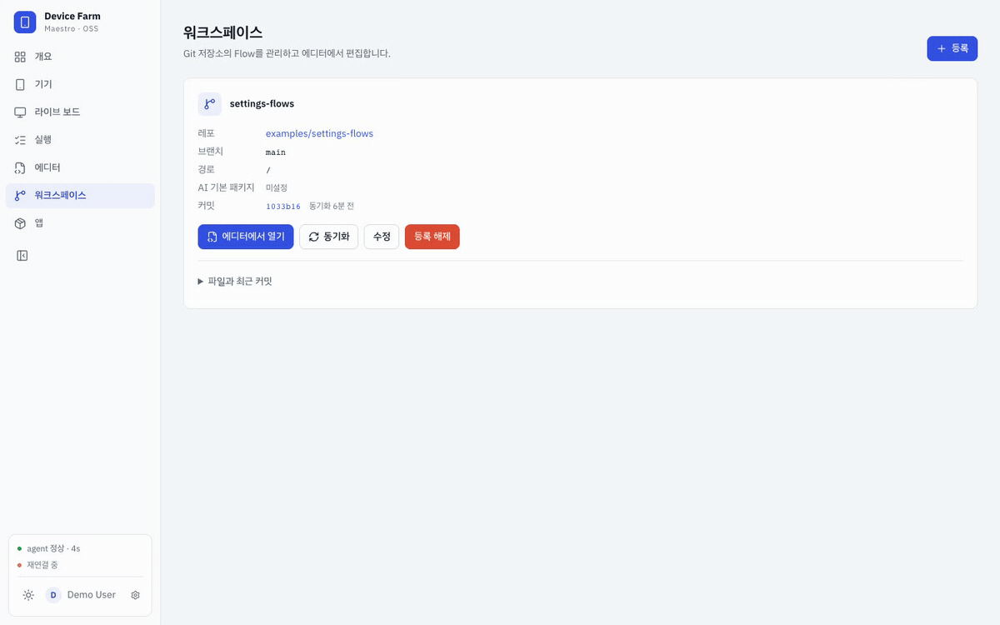

# Workspaces and Git

A workspace points at a Git repository, branch and optional subdirectory containing Maestro flows. The farm keeps a local cache and records the exact commit SHA used for each run. The demo workspace in the screenshots was registered against a temporary local Git remote.

## 1. Register a repository

In the dashboard, click **Workspaces → Register** and enter a lowercase name, `owner/repository`, branch and optional path. Or use:

```sh
cd server
uv run farm workspace add --name example-app --repo your-account/example-app --branch main --path .maestro --app-package com.example.app
```

Registration fetches the branch to verify it is reachable. The default Git URL is `https://github.com/{repo}.git`; change `FARM_GIT_REMOTE_TEMPLATE` when using another transport. For a private repository, supply `FARM_GITHUB_TOKEN` at runtime or configure your Git transport securely.


## 2. Inspect files and history

Open the workspace row to see its current head, file tree and commit history. A workspace can be synced to fetch a newer branch head. Runs retain their recorded commit SHA even if the workspace moves forward.


## 3. Edit and commit

Choose **Open editor**, edit a flow, validate it and commit. A browser draft is local to the browser until committed. If the remote branch moves while you edit, fetch the new head and resolve conflicts before committing.



*The GIF opens the registered demo workspace and shows its available actions.*

For a one-off run without a workspace, upload a ZIP of flows in New run or use `farmctl --flows`. Explicit flow paths are relative to the workspace or archive root.
