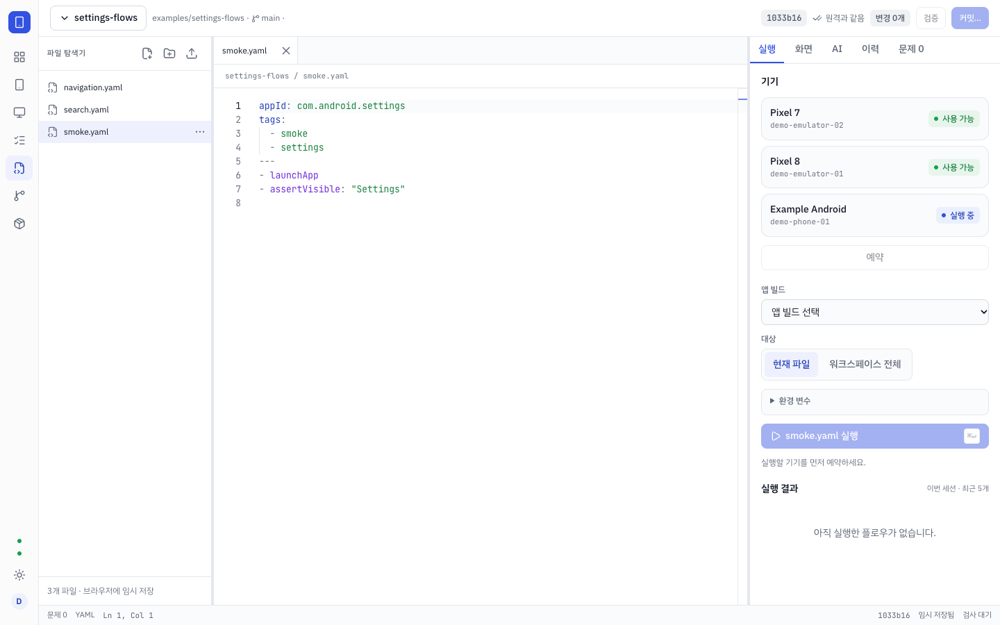

# Your first Maestro flow

A flow is a YAML file with an app package and a list of UI actions. The repository includes `examples/flows/` for Android Settings. Those examples are useful for editing and tag selection; the farm still requires a compatible APK build for a real run. UI text in Android Settings varies with OS version and locale.

## 1. Open the example flow

From the dashboard, select **Editor**, choose the `settings-flows` demo workspace, and open `smoke.yaml`. In your own installation, first register a Git workspace as in step 3. You should see the file tree on the left and YAML in the center.


## 2. Read the YAML line by line

```yaml
appId: com.android.settings
tags:
  - smoke
  - settings
---
- launchApp
- assertVisible: "Settings"
```

- `appId` is the Android package Maestro launches.
- `tags` labels this file for selection; `smoke` and `settings` are separate tags.
- `---` separates flow metadata from commands.
- `launchApp` starts the selected app.
- `assertVisible` waits for visible UI text and fails if it is not found.

Save a new flow as `my-flow.yaml`. For your own app, change `appId` to your APK's actual package and replace the assertion with text visible in that app.



## 3. Put flows in a Git workspace

Create a Git repository such as `your-account/example-app`, commit your `.yaml` files, then register it from `server/`:

```sh
uv run farm workspace add --name example-app --repo your-account/example-app --branch main --path .maestro --app-package com.example.app
uv run farm workspace list
```

`--path` is relative to the Git repository root. Use `--path ''` when the flows are at the root. The add command fetches the branch and reports `workspace example-app added at <short-sha>` on success. The demo used a local, temporary Git remote with the same registration API.


## 4. Find and edit the flow in the dashboard

Open **Workspaces** and choose **Editor** for the workspace. Changes are kept as browser drafts until you commit them. The GIF shows switching between example flow files.


*The GIF opens another YAML file in the same registered demo workspace.*

Next: [Running tests](running-tests.md). For a first real run, supply a compatible APK of your own app and a connected Android device.
