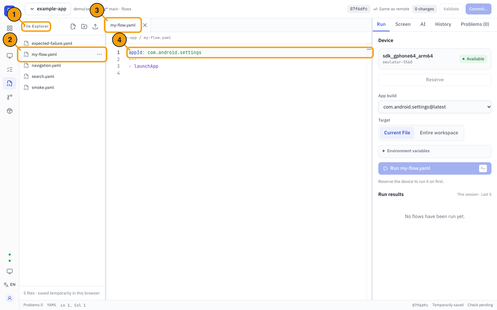
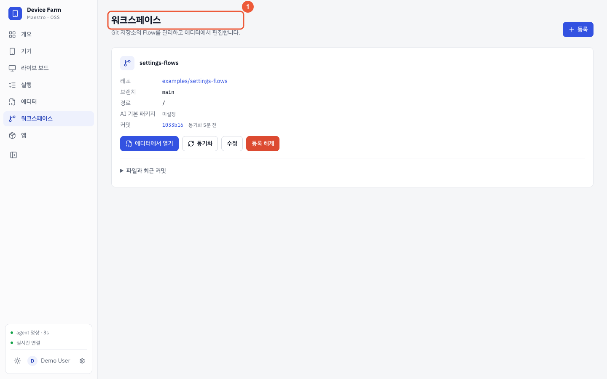

# Your first Maestro flow

## Before you begin

Complete one [installation path](getting-started-native.md) and have a Git repository that you can edit; see [Workspaces and Git](workspaces-and-git.md). A **flow** is a Maestro test file. **YAML** is a plain-text format where indentation and punctuation describe settings and actions. A **tag** is a short label such as `smoke` used to choose tests. A **workspace** points to a Git repository, branch, and optional folder of flows. On macOS use TextEdit in plain-text mode or a code editor; on Windows use Notepad or a code editor; on Linux use a text editor. Save files with `.yaml`, not `.txt`.

A flow is a YAML file with an app package and a list of UI actions. The repository includes `examples/flows/` for Android Settings. Those examples are useful for editing and tag selection; the farm still requires a compatible APK build for a real run. UI text in Android Settings varies with OS version and locale.

## 1. Open the example flow

In the cloned repository, open `examples/flows/smoke.yaml` in your text editor. Later, after registering your own Git workspace in step 3, open **Editor**, select that workspace and open your flow under **Files**. The screenshot previews that later editor view.



**Screenshot callouts:** (1) Files tree and smoke.yaml; (2) YAML code; (3) Validate control.

**You should see:** Your local editor shows the example YAML. The browser editor later shows a file list and the selected flow.

**If it looks different:** If no workspace exists, register your own repository in step 3, then return to the editor.

## 2. Read the YAML line by line

```yaml
appId: com.android.settings
tags:
  - smoke
  - settings
---
- launchApp
- assertVisible: "Settings"
```

- `appId` is the Android package Maestro launches.
- `tags` labels this file for selection; `smoke` and `settings` are separate tags.
- `---` separates flow metadata from commands.
- `launchApp` starts the selected app.
- `assertVisible` waits for visible UI text and fails if it is not found.

Save a new flow as `my-flow.yaml`. For your own app, change `appId` to your APK's actual package and replace the assertion with text visible in that app.


**Screenshot callouts:** (1) workspace and branch context; (2) code editor; (3) Validate and Commit controls.

**You should see:** Your file has a package name above `---` and a list of actions below it.

**If it looks different:** YAML uses spaces for indentation. If validation reports a syntax error, check the `---` separator, quotes, and list dashes.

## 3. Put flows in a Git workspace

Create a repository in your Git hosting account, add `.maestro/my-flow.yaml` to it, and commit the file on its `main` branch. From this project’s `server/` folder, register the repository. Replace the example account, repository and app package below with your own values:

```sh
uv run farm workspace add --name example-app --repo your-account/example-app --branch main --path .maestro --app-package com.example.app
uv run farm workspace list
```

`--path` is relative to the Git repository root. Use `--path ''` when the flows are at the root. The add command fetches the branch and reports `workspace example-app added at <short-sha>` on success. If you prefer the browser, use **Workspace** → **Register workspace** with the same values.



**Screenshot callouts:** (1) Workspace navigation; (2) Register workspace; (3) workspace row.

**You should see:** `farm workspace list` includes `example-app` and a short commit identifier.

**If it looks different:** Replace the placeholder account/repository and package with your own values. If registration fails, check the branch and repository access.

## 4. Find and edit the flow in the dashboard

Open **Workspace** and choose **Open editor** for the workspace. Changes are kept as browser drafts until you commit them. The GIF shows switching between example flow files.


**Screenshot callouts:** (1) Files tree; (2) selected YAML file; (3) code pane.


**You should see:** The editor shows your file under **Files**; edits appear as temporary browser changes until committed.

**If it looks different:** Use **Validate** before **Commit**. A local browser draft is not yet in Git.

## Recap

You have read a YAML flow, changed the package and assertion for your app, and registered a versioned workspace. A real run also needs a compatible APK and connected Android device.

**Next:** [Run tests](running-tests.md).
