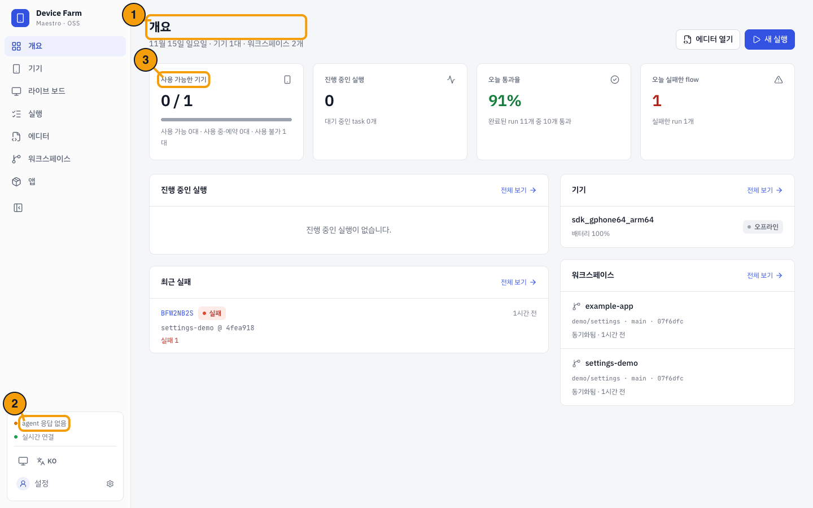

[English](../docker.md) | 한국어

# Docker로 운영하기

Docker Compose는 기본으로 API와 대시보드만 켭니다. 안드로이드 기기를 조작하는 agent는 따로 켜야 합니다. API와 agent는 `farm-data`라는 저장 공간을 함께 쓰며, 여기에 SQLite DB, APK, 워크스페이스, 실행 산출물이 보관됩니다. 처음이라면 [Docker 첫걸음](guides/getting-started-docker.md)부터 따라 하세요.

## 1. 필요한 도구

macOS는 [Docker Desktop](https://docs.docker.com/desktop/setup/install/mac-install/), Windows는 [Docker Desktop](https://docs.docker.com/desktop/setup/install/windows-install/), Linux는 [Docker Engine](https://docs.docker.com/engine/install/)과 [Compose 플러그인](https://docs.docker.com/compose/install/linux/)을 설치하세요. 터미널에서 두 명령을 하나씩 실행하면 버전이 나와야 합니다.

```sh
docker version
docker compose version
``` API 화면만 먼저 띄우는 데는 adb가 필요하지 않습니다. 실제 실행에는 호스트의 adb와 안드로이드 기기가 필요합니다.

## 2. API 켜기

아래 명령으로 저장소를 내려받은 다음 Docker Compose를 시작하세요.

```sh
git clone https://github.com/slg1119/maestro-device-farm.git
cd maestro-device-farm
cp .env.example .env
docker compose build
docker compose up -d
docker compose ps
curl http://localhost:8700/api/v1/healthz
```

브라우저에서 `http://localhost:8700/`을 여세요. **개요**가 보이고 상태 응답에 `"status":"ok"`가 있으면 API가 켜진 것입니다. 8700 포트를 다른 프로그램이 쓰면 `.env`에서 `FARM_HOST_PORT=8710`, `FARM_PUBLIC_URL=http://localhost:8710`으로 바꾸고 다시 시작하세요.



**표시 번호:** (1) **개요**, (2) **agent 응답 없음**, (3) **사용 가능한 기기**.

**보여야 할 것:** `docker compose ps`에서 `api`가 `healthy`입니다. **다르다면:** `docker compose logs --tail=100 api`로 오류를 확인하세요.

## 3. agent 연결

agent는 호스트의 adb 서버가 보여 주는 기기 모두에 접근합니다. 먼저 [기기 연결 안내](guides/connect-a-device.md)에 따라 의도한 기기만 보이는지 확인하세요. Compose는 `ADB_SERVER_SOCKET=tcp:host.docker.internal:5037`로 호스트 adb에 연결합니다. macOS·Windows에서 Docker Desktop을 쓸 때는 호스트 adb가 컨테이너에서 접근 가능한 주소로 듣도록 설정해야 합니다. 네트워크 방화벽도 믿을 수 있는 로컬 접속만 허용하세요.

```sh
adb kill-server
adb -a start-server
docker compose --profile agent up -d --build
```

이 명령은 **내가 관리해도 되는 adb 서버에서만** 실행하세요. Linux에서도 `host.docker.internal`은 Compose가 호스트 게이트웨이로 연결하지만, USB 권한과 방화벽은 별도로 맞춰야 합니다. API와 agent는 같은 `farm-data` 볼륨을 쓰고, API는 `FARM_AGENT_STREAM_HOST=agent`로 agent 화면 서비스에 연결합니다.

**보여야 할 것:** **기기** 화면에 의도한 기기와 agent 상태가 나타납니다. **다르다면:** 호스트의 adb 목록, `docker compose logs agent`, 네트워크 5037 포트를 확인하세요.

## 4. 살펴보고 멈추기

```sh
docker compose ps
docker compose logs --tail=100 api
docker compose stop
docker compose start
docker compose down
```

`docker compose down`은 컨테이너와 네트워크를 내리지만 `farm-data`는 남깁니다. `docker compose down -v`는 저장된 데이터까지 지웁니다. 백업 없이 실행하지 마세요.

업데이트 전에 저장 공간을 복사하려면 API를 멈춘 상태에서 다음을 실행하세요.

```sh
mkdir -p backups
docker compose stop api
docker compose cp api:/data ./backups/data
docker compose start api
```

복구는 현재 데이터를 덮어쓸 수 있으므로 백업 파일과 경로를 먼저 확인하세요.

## 문제 해결

| 증상 | 확인할 것 |
| --- | --- |
| 포트가 사용 중 | `.env`의 `FARM_HOST_PORT`, `FARM_PUBLIC_URL` |
| 화면은 뜨지만 기기가 없음 | agent를 켰는지, 호스트 adb에 기기가 보이는지 |
| agent가 adb에 연결 못 함 | 호스트 바인드 주소, 5037 포트, 방화벽 |
| `no_matching_devices` | 기기 상태, SDK, 태그, 선택 조건 |

**정리:** API를 켜고, 필요한 때만 agent를 연결하고, 데이터를 남긴 채 멈출 수 있습니다. **다음:** [기기 연결](guides/connect-a-device.md)과 [테스트 실행](guides/running-tests.md).
