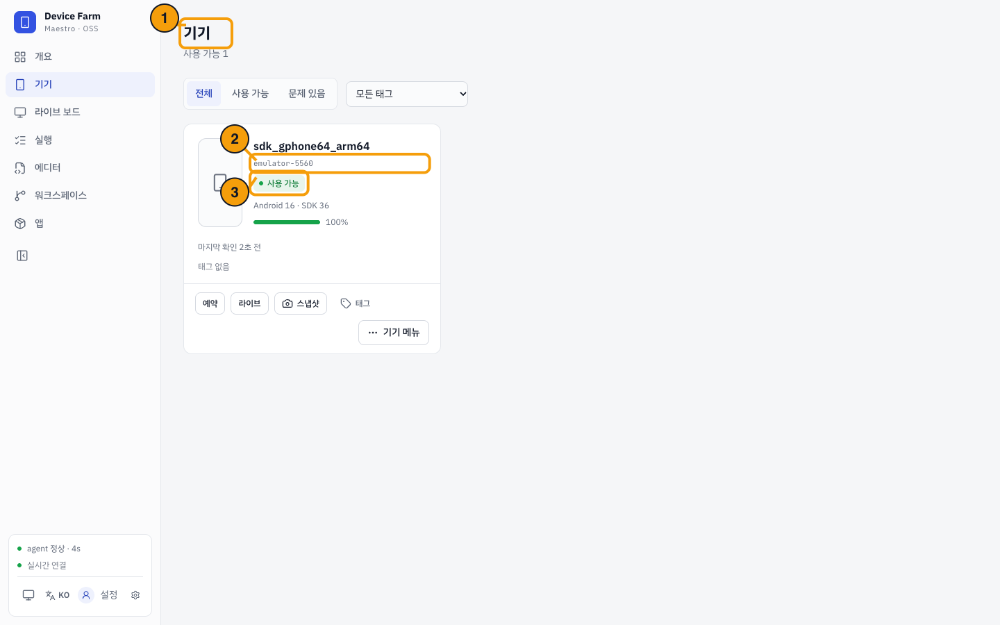
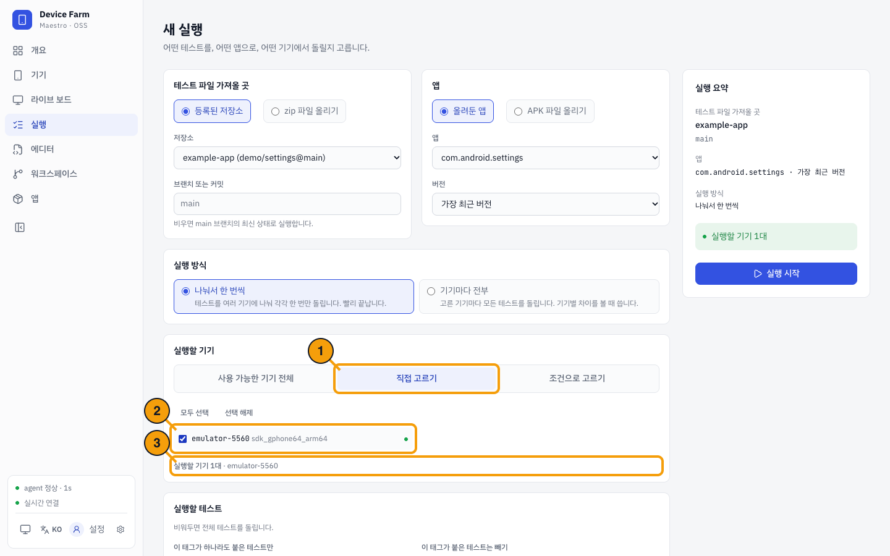

[English](../../guides/connect-a-device.md) | 한국어

# 안드로이드 기기 연결하기

**끝나면:** 에뮬레이터나 휴대폰 한 대가 `adb devices`와 대시보드 **기기** 화면에 나타납니다.

## 명령만 먼저 보기

아래의 에뮬레이터 또는 휴대폰 경로를 마친 뒤 실행하세요.

```sh
adb devices
```

기기 번호 옆에 `device`가 나오면 agent를 켜고 `http://localhost:8700/devices`를 여세요.

## 시작 전에

[Docker 설치](getting-started-docker.md) 또는 [직접 설치](getting-started-native.md)를 마치세요. 컴퓨터 운영체제에 맞는 [Android Studio](https://developer.android.com/studio) 또는 [SDK Platform Tools](https://developer.android.com/tools/releases/platform-tools)를 설치하세요. **adb**는 컴퓨터가 안드로이드 기기를 알아보는 도구입니다. **AVD**는 가상 기기 설정이고 **에뮬레이터**가 이를 실행합니다. 아래 두 방법 중 하나만 고르세요.

## A. 에뮬레이터 쓰기

Android Studio 화면이 다르면 Google의 [가상 기기 만들기 안내](https://developer.android.com/studio/run/managing-avds)를 보세요.

### 1.1 기기 관리자 열기

Android Studio에서 **Tools > Device Manager**를 누르세요. **보여야 할 것:** **Virtual** 탭과 **Create Device** 버튼. **다르다면:** 프로젝트를 연 뒤 **View > Tool Windows > Device Manager**를 시도하세요.

### 1.2 가상 기기 만들기 시작

**Create Device**를 누르세요. **보여야 할 것:** **Select Hardware** 화면. **다르다면:** **Virtual** 탭의 **+ > Create Virtual Device**를 찾으세요.

### 1.3 기기 모양 고르기

휴대폰 모델 하나를 선택하세요. **보여야 할 것:** 선택한 줄이 강조됩니다. **다르다면:** 목록에 보이는 다른 휴대폰 모델을 골라도 됩니다.

### 1.4 다음 화면으로 가기

**Next**를 누르세요. **보여야 할 것:** **System Image** 화면. **다르다면:** 앞 단계의 모델을 선택했는지 확인하세요.

### 1.5 안드로이드 이미지 고르기

다운로드된 시스템 이미지를 선택하세요. **보여야 할 것:** 선택한 줄이 강조됩니다. **다르다면:** 이미지 옆 **Download**로 설치한 다음 선택하세요.

### 1.6 설정 확인 화면으로 가기

**Next**를 누르세요. **보여야 할 것:** **Verify Configuration**. **다르다면:** 이미지 다운로드가 끝났는지 확인하세요.

### 1.7 AVD 저장

**Finish**를 누르세요. **보여야 할 것:** **Virtual** 목록에 새 기기가 보입니다. **다르다면:** 설정 확인 화면의 오류를 읽으세요.

### 1.8 에뮬레이터 켜기

새 AVD 옆의 재생 버튼을 누르세요. **보여야 할 것:** 잠시 뒤 안드로이드 화면이 켜집니다. **다르다면:** [에뮬레이터 안내](https://developer.android.com/studio/run/emulator)의 오류 항목을 확인하세요.

## B. 실제 휴대폰 쓰기

제조사마다 설정 위치가 조금 다릅니다. Google의 [개발자 옵션 안내](https://developer.android.com/studio/debug/dev-options)에 기종별 경로가 있습니다.

### 2.1 빌드 번호 찾기

Pixel에서는 **설정 > 휴대전화 정보 > 빌드 번호**를 누르세요. **보여야 할 것:** 빌드 번호 항목. **다르다면:** 휴대폰 설정에서 `빌드 번호`를 검색하세요.

### 2.2 개발자 옵션 켜기

**빌드 번호**를 일곱 번 누르세요. **보여야 할 것:** 개발자가 되었다는 알림이나 PIN 요청. **다르다면:** 이미 개발자 옵션이 켜졌는지 확인하세요.

### 2.3 USB 디버깅 찾기

**설정 > 시스템 > 고급 > 개발자 옵션 > USB 디버깅**으로 이동하세요. **보여야 할 것:** USB 디버깅 스위치. **다르다면:** 설정에서 `USB 디버깅`을 검색하세요. 기종에 따라 **고급** 메뉴가 없을 수 있습니다.

### 2.4 USB 디버깅 켜기

**USB 디버깅** 스위치를 켜세요. **보여야 할 것:** 스위치가 켜진 상태. **다르다면:** 개발자 옵션이 켜져 있는지 확인하세요.

### 2.5 USB 연결

데이터 전송이 되는 케이블로 휴대폰을 컴퓨터에 연결하세요. **보여야 할 것:** 휴대폰에 USB 디버깅 허용 안내. **다르다면:** 화면 잠금을 풀고 다른 데이터 케이블을 써 보세요.

### 2.6 이 컴퓨터 허용

휴대폰의 안내에서 **허용**을 누르세요. **보여야 할 것:** 안내가 닫힙니다. **다르다면:** 케이블을 다시 연결하고 디버깅 설정을 확인하세요.

## 팜에서 확인하기

### 3.1 adb 확인

```sh
adb devices
```

**보여야 할 것:** 기기 번호는 달라도 마지막이 `device`입니다.

```text
List of devices attached
YOUR_DEVICE_SERIAL    device
```

**다르다면:** `unauthorized`는 휴대폰에서 허용을 눌러야 한다는 뜻입니다. `offline`이면 연결을 다시 확인하세요. 뜻밖의 기기가 보이면 agent를 켜지 마세요.

### 3.2 agent용 터미널 열기

직접 설치했다면 두 번째 터미널을 여세요. **보여야 할 것:** API 터미널은 그대로 있고 새 입력창이 생깁니다. **다르다면:** 새 창을 열어 API를 계속 실행해 두세요. Docker 사용자는 [Compose agent 안내](../docker.md#3-agent-연결)를 따르세요.

### 3.3 서버 폴더로 이동

처음 `git clone`을 실행한 폴더에서 다음을 실행하세요.

```sh
cd maestro-device-farm/server
```

**보여야 할 것:** 출력 없이 `server` 폴더로 이동합니다. **다르다면:** 저장소를 내려받은 위치를 찾으세요.

### 3.4 agent 켜기

```sh
uv run farm agent
```

**보여야 할 것:** 터미널이 계속 실행 중입니다. **다르다면:** API가 켜져 있고 데이터 폴더가 같은지 확인하세요.

### 3.5 기기 화면 열기

브라우저에서 `http://localhost:8700/devices`를 여세요. **보여야 할 것:** 기기 모델과 상태가 적힌 줄.



**표시 번호:** (1) **기기**, (2) 에뮬레이터 번호, (3) **사용 가능**.

**다르다면:** agent 상태를 확인하고 잠시 기다리세요.

### 3.6 새 실행 화면 열기

`http://localhost:8700/runs/new`를 여세요. **보여야 할 것:** **새 실행**과 기기 선택 영역. **다르다면:** API 주소를 확인하세요.

### 3.7 기기 직접 고르기

**직접 고르기**를 누르세요. **보여야 할 것:** 연결한 기기와 0보다 큰 선택 가능 기기 수.



**표시 번호:** (1) **직접 고르기**, (2) 내 기기 번호, (3) 선택 가능 기기 수.

**다르다면:** 기기 상태, 앱의 최소 SDK, 예약 상태를 확인하세요.

## 정리

adb와 대시보드에서 같은 기기를 확인했습니다. **다음:** [첫 flow 작성](your-first-flow.md)으로 넘어가세요.

## 문제 해결

| 증상 | 까닭 | 해결 |
| --- | --- | --- |
| adb 목록이 비어 있음 | 에뮬레이터 부팅 중 또는 USB 연결 문제 | 부팅을 기다리거나 데이터 케이블 확인 |
| `unauthorized` | 컴퓨터 사용 허용 전 | 휴대폰에서 **허용** 누르기 |
| 대시보드에서 **오프라인** | agent 연결 없음 | API와 같은 데이터 폴더로 agent 실행 |
| **새 실행**에 기기가 없음 | 선택 조건이나 SDK가 맞지 않음 | 기기 상태와 조건 확인 |
