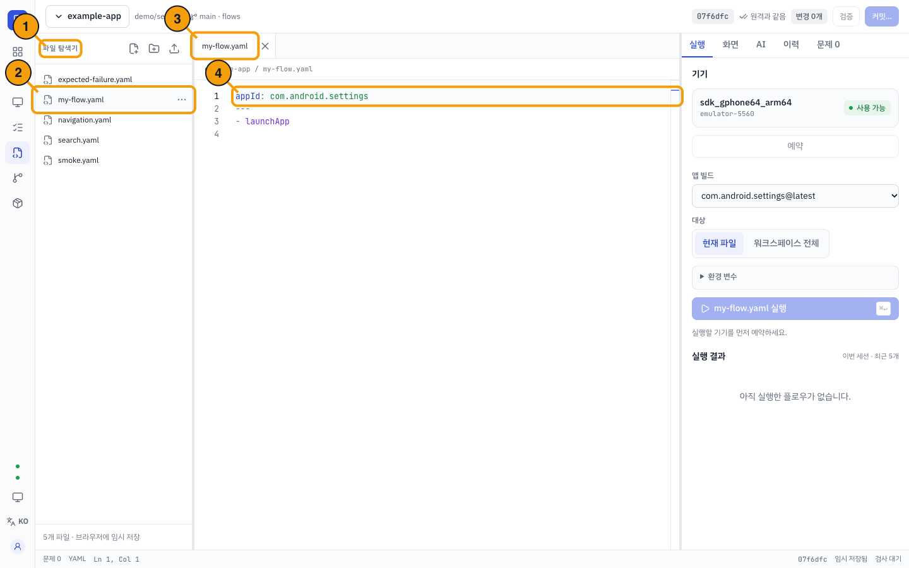
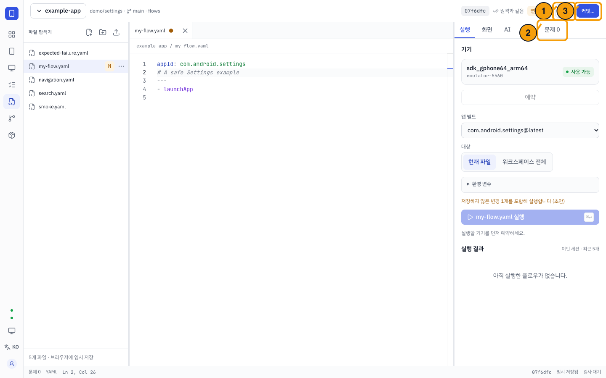
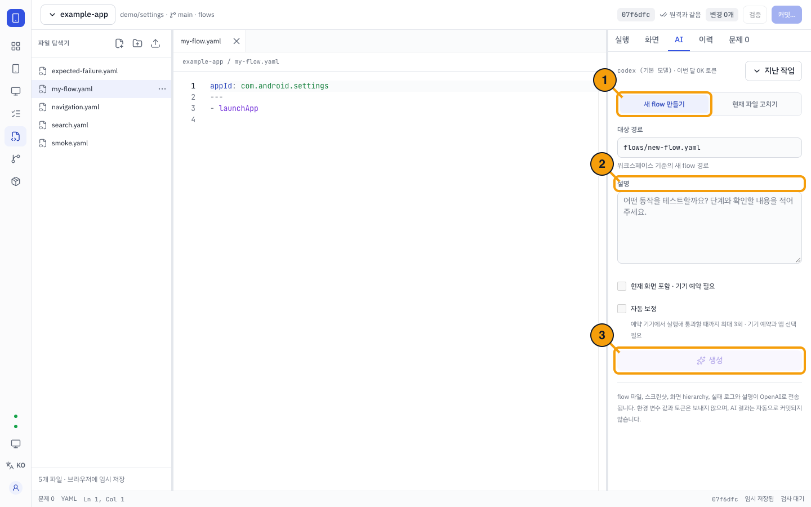

[English](../../guides/flow-editor-and-ai.md) | 한국어

# flow 에디터와 AI 도우미

**끝나면:** YAML 수정 내용을 검증하고 Git에 커밋할 수 있습니다. AI 제안도 내 눈으로 확인한 뒤에만 반영할 수 있습니다.

## 바로 가기

```text
http://localhost:8700/editor
```

워크스페이스와 YAML을 고른 뒤 수정하고 **검증**, **커밋…** 순서로 누르세요. AI는 선택 기능입니다.

## 시작 전에

[YAML이 있는 워크스페이스](workspaces-and-git.md)를 등록하세요. **flow**는 Maestro 테스트 파일입니다. **임시 변경**은 브라우저에 잠시 저장된 내용이고, **커밋**은 Git에 버전으로 남기는 일입니다. AI **제안**은 자동으로 커밋되지 않으며, 내가 고른 파일만 에디터에 반영됩니다.

## 직접 수정하기

### 1.1 에디터 열기

`http://localhost:8700/editor`를 여세요. **보여야 할 것:** **워크스페이스 선택** 또는 최근 작업한 워크스페이스. **다르다면:** API가 켜졌는지 확인하세요.

### 1.2 워크스페이스 고르기

**워크스페이스 선택**에서 내 저장소를 고르세요. **보여야 할 것:** 이름과 **파일** 목록. **다르다면:** **워크스페이스** 화면에서 등록·동기화하세요.

### 1.3 YAML 열기

**파일**에서 `.yaml` 파일을 누르세요. **보여야 할 것:** **코드** 영역에 파일 내용.



**표시 번호:** (1) **파일**, (2) `my-flow.yaml`, (3) **코드**, (4) `appId:`.

**다르다면:** 워크스페이스 경로를 확인하고 **동기화**하세요.

### 1.4 내용 바꾸기

코드에서 화면 글자 확인 한 줄을 바꾸세요. **보여야 할 것:** 변경 표시와 임시 저장 상태. **다르다면:** 코드 영역 안을 먼저 누르세요.

### 1.5 검증하기

**검증**을 누르세요. **보여야 할 것:** **문제** 영역에 결과가 나옵니다.



**표시 번호:** (1) **검증**, (2) **문제**, (3) **커밋…**.

**다르다면:** 오류가 가리키는 줄의 들여쓰기와 명령을 고치세요.

### 1.6 커밋 창 열기

**커밋…**을 누르세요. **보여야 할 것:** 커밋 메시지 입력 창. **다르다면:** 먼저 내용을 바꾸고 검증 오류를 해결하세요.

### 1.7 메시지 적기

짧은 변경 내용을 입력하세요. **보여야 할 것:** 메시지 칸에 글이 들어갑니다. **다르다면:** **커밋…** 창을 다시 여세요.

### 1.8 저장 확정

**커밋**을 누르세요. **보여야 할 것:** 새 커밋 번호 또는 커밋 완료 상태. **다르다면:** 원격 브랜치가 바뀌었으면 **가져오기**로 변경을 확인하고 충돌을 해결하세요.

## AI 제안 사용하기 (선택)

### 2.1 직접 실행 중인 API 멈추기

API 컴퓨터에서 Codex CLI가 이미 로그인돼 있다면 API 터미널에서 **Control-C**를 누르세요. **보여야 할 것:** 터미널 입력 줄이 돌아옵니다. **다르다면:** [설정 안내](../configuration.md)에서 현재 설치 방식의 공급자 설정을 확인하세요.

### 2.2 Codex 공급자로 API 켜기

`server/` 폴더에서 실행하세요.

```sh
FARM_AI_PROVIDER=codex uv run farm api
```

**보여야 할 것:** API가 8700 포트에서 실행됩니다. **다르다면:** API 컴퓨터에 Codex CLI가 설치되고 로그인됐는지 확인하세요.

### 2.3 AI 상태 확인

다른 터미널에서 실행하세요.

```sh
curl http://localhost:8700/api/v1/ai/status
```

**보여야 할 것:** 응답에 아래 상태가 있습니다.

```text
"enabled":true
```

**다르다면:** API 터미널의 공급자 오류를 읽으세요. 인증 정보는 flow나 공유할 명령에 적지 마세요.

### 2.4 AI 화면 열기

에디터의 **AI**를 누르세요. **보여야 할 것:** **AI 생성 모드**, **설명**, **생성**.



**표시 번호:** (1) **AI 생성 모드**, (2) **설명**, (3) **생성**.

**다르다면:** `/api/v1/ai/status`에서 공급자 상태를 확인하세요.

### 2.5 요청 적기

**설명**에 검사할 동작과 확인할 화면 글자를 적으세요. **보여야 할 것:** 입력한 요청. **다르다면:** 워크스페이스와 생성 방식을 먼저 고르세요.

### 2.6 제안 만들기

**생성**을 누르세요. **보여야 할 것:** AI 작업 뒤 변경 제안. **다르다면:** 작업 오류를 읽으세요. 기기 화면을 포함하거나 자동 복구하려면 **실행**에서 기기를 예약한 뒤 **화면**을 여세요. 글로만 요청할 때는 예약이 필요하지 않습니다.

### 2.7 제안 비교하기

제안 파일의 비교 화면을 여세요. **보여야 할 것:** 원래 YAML과 제안 YAML. **다르다면:** AI 작업이 끝날 때까지 기다리세요.

### 2.8 파일 고르기

반영할 제안 파일을 선택하세요. **보여야 할 것:** 선택 표시. **다르다면:** 제안의 파일 경로를 확인하세요.

### 2.9 에디터에 반영하기

**선택한 파일을 에디터에 반영**을 누르세요. **보여야 할 것:** 해당 파일이 변경된 상태. **다르다면:** 제안 파일을 다시 선택하세요. 반영 뒤에는 1.5~1.8단계로 검증하고 커밋하세요.

## 정리

직접 수정한 flow와 AI 제안을 검토해 Git에 남길 수 있습니다. **다음:** [테스트 실행](running-tests.md)을 하거나 [Git 이력](workspaces-and-git.md)을 살펴보세요.

## 문제 해결

| 증상 | 까닭 | 해결 |
| --- | --- | --- |
| **파일**이 비어 있음 | 경로·동기화 문제 | **워크스페이스**에서 **동기화** |
| **검증** 오류 | YAML 문법 또는 명령 문제 | **문제**의 줄 확인 |
| 커밋 실패 | 원격 브랜치 변경 | **가져오기** 뒤 충돌 해결 |
| AI가 보이지 않음 | 공급자 비활성 | `/api/v1/ai/status`와 서버 설정 확인 |
