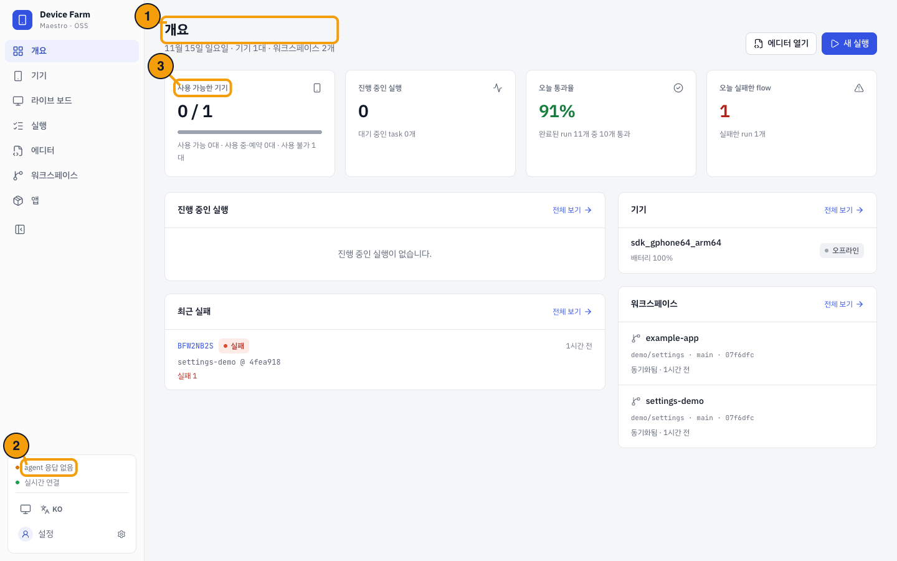

[English](../../guides/getting-started-docker.md) | 한국어

# Docker로 시작하기

**끝나면:** `http://localhost:8700/`에서 한국어 대시보드를 볼 수 있습니다. 기기와 agent는 다음 단계에서 연결합니다.

## 명령만 먼저 보기

[Docker](https://docs.docker.com/get-docker/)와 [Git](https://git-scm.com/downloads)을 설치한 뒤, 저장소의 **Code** 메뉴에서 복사한 주소로 `PASTE_REPOSITORY_URL`을 바꾸세요.

```sh
git clone PASTE_REPOSITORY_URL maestro-device-farm
cd maestro-device-farm
cp .env.example .env
docker compose up -d --build
```

## 시작 전에

macOS는 [Docker Desktop](https://docs.docker.com/desktop/setup/install/mac-install/), Windows는 [Docker Desktop](https://docs.docker.com/desktop/setup/install/windows-install/), Linux는 [Docker Engine](https://docs.docker.com/engine/install/)과 [Compose 플러그인](https://docs.docker.com/compose/install/linux/)을 설치하세요. Docker **컨테이너**는 앱을 따로 담아 실행하는 공간입니다. **Compose**가 `docker-compose.yml`을 읽고 필요한 컨테이너를 켭니다. macOS는 Terminal, Windows는 PowerShell, Linux는 터미널 앱을 열어 명령을 한 줄씩 붙여넣고 Enter를 누르세요.

## 차근차근 시작하기

### 1.1 Docker 켜기

macOS·Windows에서 **Docker Desktop**을 여세요. Linux에서는 배포판 안내에 따라 Docker 서비스를 시작하세요. **보여야 할 것:** Docker가 실행 중이라는 표시. **다르다면:** 위 설치 안내를 마치고 앱을 다시 켜세요.

### 1.2 Docker 확인

```sh
docker version
```

**보여야 할 것:** 아래 두 제목이 모두 나옵니다.

```text
Client:
Server:
```

**다르다면:** `Server:`가 없으면 Docker가 아직 켜지지 않은 것입니다.

### 1.3 Compose 확인

```sh
docker compose version
```

**보여야 할 것:** 아래처럼 한 줄이 나옵니다.

```text
Docker Compose version
```

**다르다면:** Compose 플러그인을 설치하거나 Docker Desktop을 업데이트하세요.

### 1.4 저장소 주소 복사

저장소 웹 페이지에서 **Code > HTTPS > Copy**를 누르세요. **보여야 할 것:** HTTPS 주소가 클립보드에 복사됩니다. **다르다면:** Git 서비스의 HTTPS 복제 메뉴를 찾으세요.

### 1.5 저장소 내려받기

복사한 주소를 넣어 실행하세요.

```sh
git clone PASTE_REPOSITORY_URL maestro-device-farm
```

**보여야 할 것:**

```text
Cloning into 'maestro-device-farm'...
```

**다르다면:** Git 설치와 저장소 접근 권한을 확인하세요.

### 1.6 폴더 들어가기

```sh
cd maestro-device-farm
```

**보여야 할 것:** 오류 없이 프롬프트가 새 폴더로 바뀝니다. **다르다면:** 내려받기를 실행한 터미널에서 다시 시도하세요.

### 1.7 기본 설정 복사

```sh
cp .env.example .env
```

**보여야 할 것:** 출력 없이 끝납니다. **다르다면:** `.env.example`이 있는 저장소 폴더인지 확인하세요.

### 1.8 API 시작

```sh
docker compose up -d --build
```

**보여야 할 것:** 빌드 메시지 뒤 API 컨테이너가 시작됩니다. **다르다면:** Docker 디스크 공간을 확인하고 `docker compose logs --tail=100 api`를 읽으세요.

### 1.9 상태 확인

```sh
docker compose ps
```

**보여야 할 것:** `api` 행에 `healthy`가 표시됩니다.

```text
NAME                         SERVICE   STATUS
maestro-device-farm-api-1    api       Up (healthy)
```

**다르다면:** 잠시 기다렸다가 다시 실행하고, 계속 실패하면 API 로그를 확인하세요.

### 1.10 화면 열기

브라우저에서 `http://localhost:8700/`을 여세요. **보여야 할 것:** **개요**와 **agent 응답 없음**. 기기를 아직 연결하지 않았으므로 정상입니다.



**표시 번호:** (1) **개요**, (2) **agent 응답 없음**, (3) **사용 가능한 기기**.

**다르다면:** 앞 단계에서 API가 `healthy`인지 확인하세요.

### 1.11 API 확인

```sh
curl http://localhost:8700/api/v1/healthz
```

**보여야 할 것:** 응답에 아래 상태가 들어 있습니다.

```text
"status":"ok"
```

**다르다면:** 브라우저와 명령에서 같은 포트를 쓰는지 확인하세요.

## 정리

대시보드가 켜졌습니다. **다음:** [기기 연결](connect-a-device.md)을 한 뒤 [첫 flow](your-first-flow.md)를 만들어 보세요.

## 문제 해결

| 증상 | 까닭 | 해결 |
| --- | --- | --- |
| `docker` 명령을 찾지 못함 | 설치 또는 PATH 반영 전 | Docker를 설치하고 터미널 다시 열기 |
| `Server:`가 없음 | Docker 서비스가 꺼짐 | Docker Desktop 또는 Linux 서비스 켜기 |
| `api`가 `healthy`가 아님 | 빌드·시작 오류 | `docker compose logs --tail=100 api` 확인 |
| 8700 포트가 열리지 않음 | API 중지 또는 포트 충돌 | `docker compose ps`와 [Docker 운영](../docker.md) 확인 |
