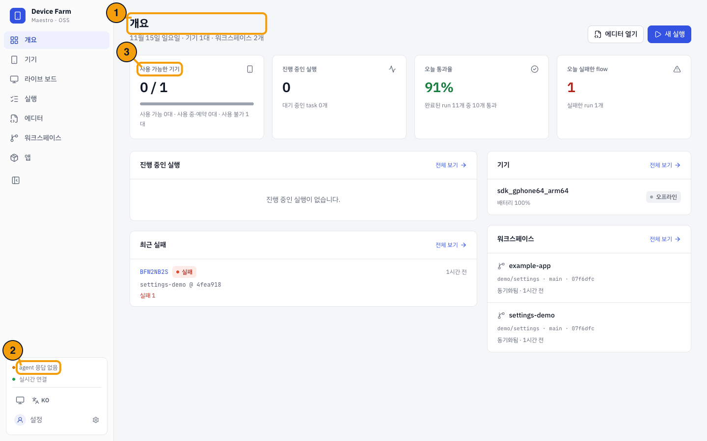

[English](../../guides/getting-started-native.md) | 한국어

# 컴퓨터에 직접 설치하기

**끝나면:** macOS 또는 Linux 컴퓨터에서 API와 한국어 대시보드가 켜집니다. 안드로이드 기기를 다루는 agent는 별도로 시작합니다.

## 명령만 먼저 보기

아래 도구를 설치한 뒤 `PASTE_REPOSITORY_URL`을 저장소 HTTPS 주소로 바꾸세요.

```sh
git clone PASTE_REPOSITORY_URL maestro-device-farm
cd maestro-device-farm/server
uv sync
cd ../web
pnpm install --frozen-lockfile
pnpm build
cd ../server
uv run farm api
```

마지막 터미널을 열어 둔 채 `http://localhost:8700/`을 방문하세요.

## 시작 전에

[Git](https://git-scm.com/downloads), [Python 3.12 이상](https://www.python.org/downloads/), [uv](https://docs.astral.sh/uv/getting-started/installation/), [Node.js](https://nodejs.org/en/download), [pnpm](https://pnpm.io/installation)을 설치하세요. 실제 기기 테스트에는 [Android Studio와 SDK Platform Tools](https://developer.android.com/studio), [Java 17 이상](https://adoptium.net/), [Maestro CLI](https://docs.maestro.dev/maestro-cli/how-to-install-maestro-cli)도 필요합니다. Windows에서 API를 띄우려면 [Docker 방법](getting-started-docker.md)을 쓰세요. **adb**는 컴퓨터와 안드로이드를 연결하는 도구입니다. **AVD**는 가상 기기 설정이고, 에뮬레이터가 이를 실행합니다.

## 설치하고 켜기

### 1.1 Python 확인

`python3 --version`을 실행하세요. **보여야 할 것:** 아래처럼 Python 3.12 이상이 나옵니다.

```text
Python 3.12.7
```

**다르다면:** Python을 설치하고 터미널을 다시 여세요.

### 1.2 uv 확인

`uv --version`을 실행하세요. **보여야 할 것:** 아래처럼 버전 한 줄이 나옵니다.

```text
uv 0.10.4
```

**다르다면:** 위 링크에서 uv를 설치하세요.

### 1.3 Node.js 확인

`node --version`을 실행하세요. **보여야 할 것:** 아래처럼 `v`로 시작하는 번호가 나옵니다.

```text
v22.18.0
```

**다르다면:** Node.js를 설치하세요.

### 1.4 pnpm 확인

`pnpm --version`을 실행하세요. **보여야 할 것:** 아래처럼 버전 번호가 나옵니다.

```text
10.29.1
```

**다르다면:** pnpm을 설치하세요.

### 1.5 주소 복사

저장소 웹 페이지에서 **Code > HTTPS > Copy**를 누르세요. **보여야 할 것:** 저장소 주소가 복사됩니다. **다르다면:** 사용 중인 Git 서비스의 HTTPS 복제 메뉴를 찾으세요.

### 1.6 내려받기

복사한 주소를 넣어 실행하세요.

```sh
git clone PASTE_REPOSITORY_URL maestro-device-farm
```

**보여야 할 것:**

```text
Cloning into 'maestro-device-farm'...
```

**다르다면:** Git 설치와 접근 권한을 확인하세요.

### 1.7 서버 폴더로 이동

`cd maestro-device-farm/server`를 실행하세요. **보여야 할 것:** 오류 없이 `server` 폴더로 이동합니다. **다르다면:** 내려받기를 실행한 터미널인지 확인하세요.

### 1.8 Python 패키지 설치

다음을 실행하세요.

```sh
uv sync
```

**보여야 할 것:** 마지막 부분에 이런 줄이 나옵니다. 숫자는 컴퓨터에 따라 다를 수 있습니다.

```text
Resolved 73 packages
Installed 73 packages
```

**다르다면:** Python 버전과 네트워크를 확인하세요.

### 1.9 웹 폴더로 이동

`cd ../web`을 실행하세요. **보여야 할 것:** `web` 폴더로 이동합니다. **다르다면:** 앞 단계에서 `server`에 있었는지 확인하세요.

### 1.10 웹 패키지 설치

다음을 실행하세요.

```sh
pnpm install --frozen-lockfile
```

**보여야 할 것:** 마지막에 걸린 시간이 나옵니다.

```text
Done in 3.2s
```

**다르다면:** Node.js와 pnpm 설치를 확인하세요.

### 1.11 화면 빌드

다음을 실행하세요.

```sh
pnpm build
```

**보여야 할 것:** 빌드 완료 줄이 나옵니다. 걸린 시간은 달라도 됩니다.

```text
✓ built in 2.3s
```

`web/dist` 폴더도 만들어집니다. **다르다면:** 처음 나온 TypeScript 또는 Vite 오류를 읽으세요.

### 1.12 서버 폴더로 돌아가기

`cd ../server`를 실행하세요. **보여야 할 것:** 다시 `server` 폴더입니다. **다르다면:** 현재 위치를 확인하세요.

### 1.13 API 켜기

다음을 실행하세요.

```sh
uv run farm api
```

**보여야 할 것:** 아래와 같은 줄이 나온 채 터미널이 계속 실행 중입니다.

```text
Uvicorn running on http://0.0.0.0:8700 (Press CTRL+C to quit)
```

**다르다면:** 포트 8700을 다른 프로그램이 쓰는지 확인하세요.

### 1.14 화면 확인

브라우저에서 `http://localhost:8700/`을 여세요. **보여야 할 것:** 왼쪽 메뉴와 **개요**.



**표시 번호:** (1) **개요**, (2) **agent 응답 없음**, (3) **사용 가능한 기기**.

**다르다면:** API 터미널을 열어 두고 `http://localhost:8700/api/v1/healthz`를 확인하세요.

### 1.15 상태 응답 확인

다른 터미널에서 다음을 실행하세요.

```sh
curl http://localhost:8700/api/v1/healthz
```

**보여야 할 것:** 응답에 상태가 표시됩니다.

```json
"status":"ok"
```

**다르다면:** API 터미널의 오류를 읽으세요.

## 정리

API와 대시보드가 켜졌습니다. **다음:** [기기 연결](connect-a-device.md)을 따라 하세요.

## 문제 해결

| 증상 | 까닭 | 해결 |
| --- | --- | --- |
| `uv sync` 실패 | Python 버전 또는 설치 문제 | Python 3.12 이상 설치 |
| `pnpm`을 찾지 못함 | pnpm 미설치 | 위 설치 링크 사용 |
| 빌드 실패 | TypeScript·Vite 오류 | 첫 오류 메시지부터 확인 |
| 브라우저 연결 실패 | API 중지 또는 포트 충돌 | `uv run farm api` 터미널 확인 |
