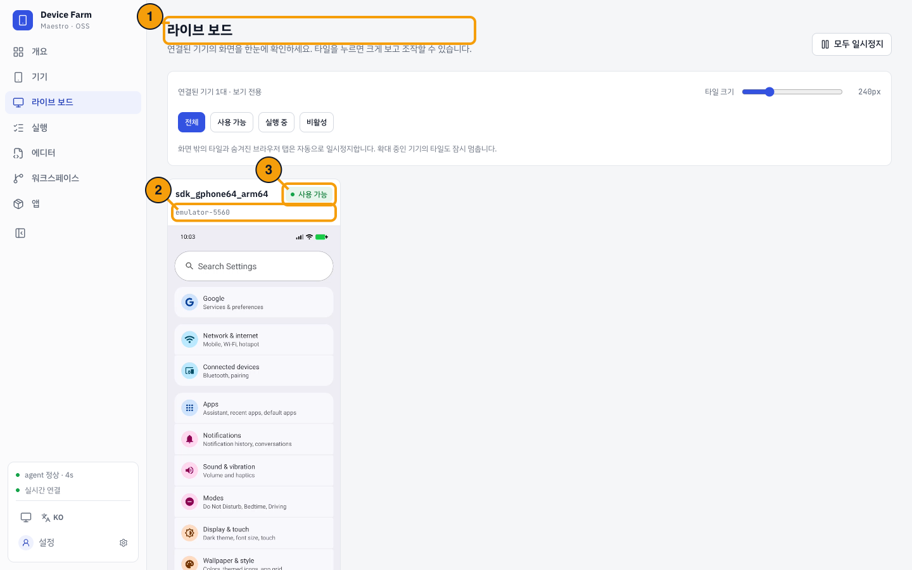
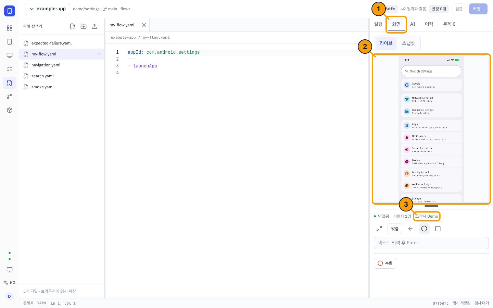

[English](../../guides/live-screen-and-recording.md) | 한국어

# 기기 화면 보기와 녹화

**끝나면:** 연결된 안드로이드 화면을 보고, 기기를 예약했다면 한 번의 조작을 YAML 초안으로 만들 수 있습니다.

## 바로 가기

```text
http://localhost:8700/live
```

연결된 기기를 열어 보세요. 직접 조작할 때는 먼저 **예약**, 그다음 **녹화 시작**과 **녹화 중지**를 사용하세요.

## 시작 전에

[기기 연결](connect-a-device.md)을 마치고 agent를 켜 두세요. 최근 Chrome 또는 Edge 브라우저를 쓰세요. **WebSocket**은 화면을 계속 보내는 연결입니다. **예약**은 한 사람이 잠시 기기를 조작할 권한을 갖는 것입니다. 녹화 결과는 Maestro YAML 초안이므로 Git에 저장하기 전에 확인하세요.

## 화면 보기

### 1.1 라이브 보드 열기

`http://localhost:8700/live`를 여세요. **보여야 할 것:** **기기 라이브 그리드**에 연결된 기기 칸.



**표시 번호:** (1) **기기 라이브 그리드**, (2) 에뮬레이터 번호, (3) **사용 가능**.

**다르다면:** **기기** 화면에서 상태와 agent 연결을 확인하세요.

### 1.2 큰 화면으로 보기

기기 칸을 누르세요. **보여야 할 것:** 더 큰 실시간 화면. **다르다면:** 기기가 오프라인인지, 브라우저가 화면 연결을 지원하는지 확인하세요.

### 1.3 에디터 열기

다른 브라우저 탭에서 `http://localhost:8700/editor`를 여세요. **보여야 할 것:** **워크스페이스 선택**. **다르다면:** [워크스페이스](workspaces-and-git.md)를 먼저 등록하세요.

### 1.4 워크스페이스 선택

녹화 flow를 넣을 워크스페이스를 고르세요. **보여야 할 것:** 파일 목록과 편집 패널. **다르다면:** 워크스페이스를 동기화하세요.

### 1.5 실행 탭에서 기기 예약하기

에디터의 **실행** 탭에서 사용 가능한 기기를 고르고 **예약**을 누르세요. **보여야 할 것:** 선택한 기기와 **해제** 버튼. **다르다면:** agent와 기기 상태를 확인하세요.

### 1.6 화면 탭 열기

**화면**을 누르세요. **보여야 할 것:** 실시간 기기 화면과 조작 도구.



**표시 번호:** (1) **화면** 탭, (2) 실시간 기기 화면, (3) **조작자** 상태.

**다르다면:** 워크스페이스를 선택했는지 확인하세요.

## 조작 녹화하기

### 2.1 조작 권한 확인하기

**화면**의 **조작자** 줄을 확인하세요. **보여야 할 것:** 활성 예약과 실시간 기기 화면. **다르다면:** **실행**으로 돌아가 예약 상태를 확인하세요.

### 2.2 녹화 시작

**녹화 시작**을 누르세요. **보여야 할 것:** **녹화 중**과 **녹화 중지**. **다르다면:** 예약이나 화면 연결이 끊어졌는지 확인하세요.

### 2.3 한 번 조작하기

기기 화면의 안전한 버튼 하나를 누르세요. **보여야 할 것:** 화면이 반응하고 녹화 단계 수가 바뀝니다. **다르다면:** 보기 전용이 아닌 조작 권한이 있는지 확인하세요.

### 2.4 녹화 멈추기

**녹화 중지**를 누르세요. **보여야 할 것:** **녹화 결과**와 **녹화 YAML**. **다르다면:** 마무리될 때까지 기다리고 연결을 확인하세요.

### 2.5 YAML 읽기

결과의 **녹화 YAML**을 여세요. **보여야 할 것:** 방금 한 조작에 대응하는 Maestro 명령. **다르다면:** 화면에서 눈에 띄는 동작 하나만 다시 녹화해 보세요.

## 정리

기기를 보고, 예약하고, 조작을 flow 초안으로 만들었습니다. **다음:** [에디터에서 검증](flow-editor-and-ai.md)하세요.

## 문제 해결

| 증상 | 까닭 | 해결 |
| --- | --- | --- |
| 기기 칸이 없음 | agent 또는 기기 오프라인 | **기기**와 agent 상태 확인 |
| 화면이 안 뜸 | 브라우저·연결 주소 문제 | Chrome/Edge와 stream 설정 확인 |
| **예약** 불가 | 다른 예약 또는 기기 상태 | 기기가 사용 가능할 때 다시 시도 |
| 녹화 단계가 없음 | 조작이 기록되지 않음 | 눈에 띄는 탭 하나만 다시 녹화 |
