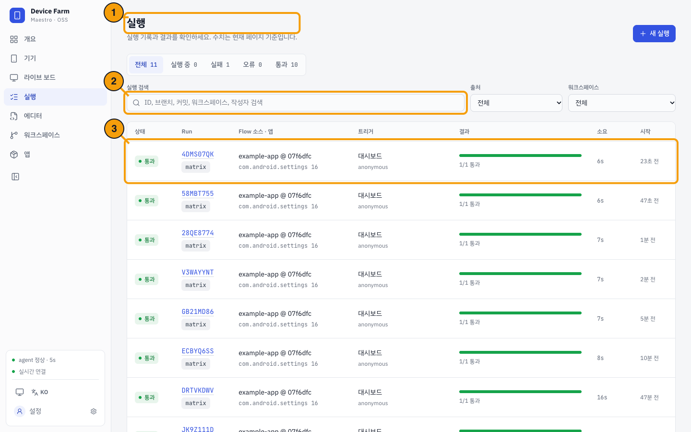
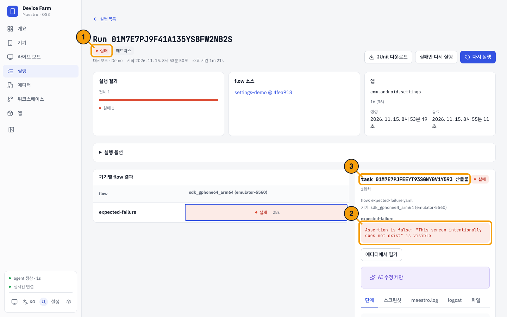
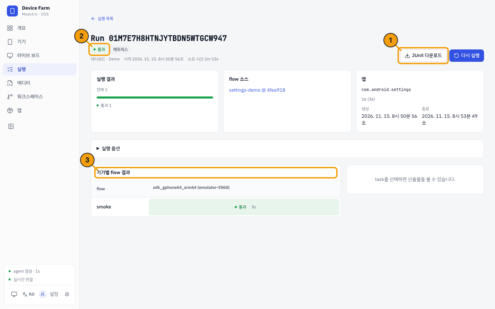

[English](../../guides/reading-results.md) | 한국어

# 실행 결과 읽기

**끝나면:** 실행 상태와 작업별 산출물을 확인하고, 완료된 실행의 JUnit 파일을 받을 수 있습니다.

## 바로 가기

```text
http://localhost:8700/runs
```

내 실행 번호를 누르고 작업 하나를 고르세요. 완료 뒤 **JUnit 다운로드**를 누르면 됩니다.

## 시작 전에

[테스트 실행](running-tests.md)을 한 번 마치세요. **작업**은 기기에 맡긴 테스트 한 묶음입니다. **산출물**은 화면 사진이나 로그처럼 실행 뒤 저장된 파일입니다. **JUnit**은 CI 같은 다른 도구도 읽는 XML 결과 형식입니다. **대기 중**은 차례를 기다리는 상태, **실행 중**은 테스트 중인 상태입니다. **통과**, **실패**, **오류**, **취소됨**은 끝난 결과입니다.

## 내 실행 살펴보기

### 1.1 실행 기록 열기

`http://localhost:8700/runs`를 여세요. **보여야 할 것:** **실행 기록**과 내가 시작한 실행 번호.



**표시 번호:** (1) **실행 기록**, (2) **실행 검색**, (3) **통과** 상태의 실행 줄.

**다르다면:** 아직 실행한 적이 없다면 먼저 실행하세요. 기록이 많으면 번호로 검색하세요.

### 1.2 실행 상세 열기

내 실행 번호를 누르세요. **보여야 할 것:** 실행 상태와 작업 목록. **다르다면:** 주소의 번호가 맞는지 확인하세요.

### 1.3 작업 고르기

작업 줄 하나를 누르세요. **보여야 할 것:** 그 작업의 상태와 **산출물**.



**표시 번호:** (1) 선택한 작업의 **실패**, (2) **task 산출물**, (3) **산출물**.

**다르다면:** 작업이 아직 **대기 중**이면 agent 상태를 확인하세요.

### 1.4 산출물 열기

**산출물** 아래에 나온 파일 하나를 누르세요. **보여야 할 것:** 파일 미리 보기 또는 다운로드. **다르다면:** 작업마다 화면 사진이나 로그가 모두 있는 것은 아닙니다.

### 1.5 JUnit 받기

실행이 끝난 뒤 **JUnit 다운로드**를 누르세요. **보여야 할 것:** 브라우저 다운로드 폴더에 XML 파일이 생깁니다.



**표시 번호:** (1) **JUnit 다운로드**, (2) **통과**, (3) **분할 실행 task 목록**.

**다르다면:** 모든 작업이 끝날 때까지 기다렸다가 다시 누르세요.

### 1.6 실패한 것만 다시 실행

실패한 실행에서 **실패만 다시 실행**을 누르세요. **보여야 할 것:** 새 실행 번호가 생깁니다. **다르다면:** 실패 또는 오류인 작업이 있는 완료된 실행인지 확인하세요.

## 명령으로 JUnit 받기

`RUN_ID`를 실제 실행 번호로 바꾼 뒤 실행하세요.

```sh
curl -o report.xml http://localhost:8700/api/v1/runs/RUN_ID/junit
```

**보여야 할 것:** `report.xml` 파일에 `<testsuites` 또는 `<testsuite`가 들어 있습니다. **다르다면:** 번호와 API 실행 상태를 확인하세요.

## 정리

이제 실행 기록, 작업, 산출물, JUnit을 찾아볼 수 있습니다. **다음:** 오류가 있다면 [문제 해결](troubleshooting.md)을 보세요.

## 문제 해결

| 증상 | 까닭 | 해결 |
| --- | --- | --- |
| 실행 줄이 안 보임 | 검색·필터가 가림 | 정확한 실행 번호 검색 |
| 작업 출력이 없음 | 아직 대기 중 | agent 상태 확인 후 기다리기 |
| JUnit이 안 받아짐 | 아직 실행 중 | 작업이 모두 끝난 뒤 다시 시도 |
| 다시 실행 버튼이 없음 | 해당 상태에서 사용할 수 없음 | 실패한 작업이 있는 완료된 실행 열기 |
