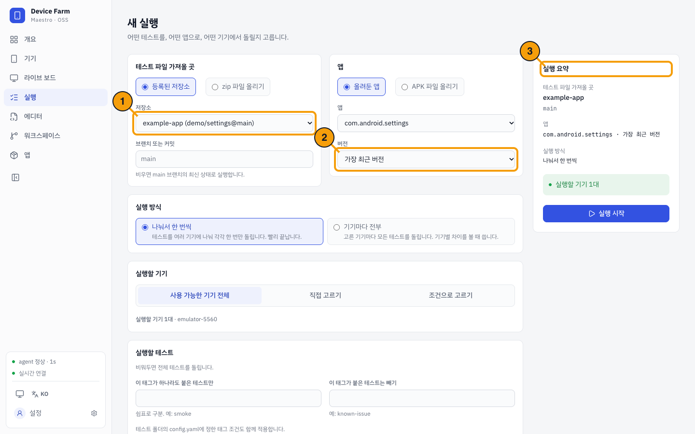
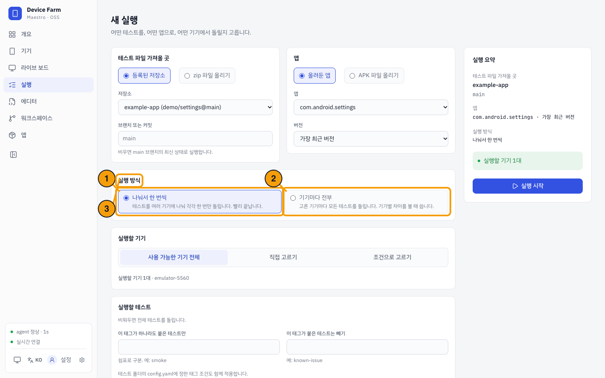
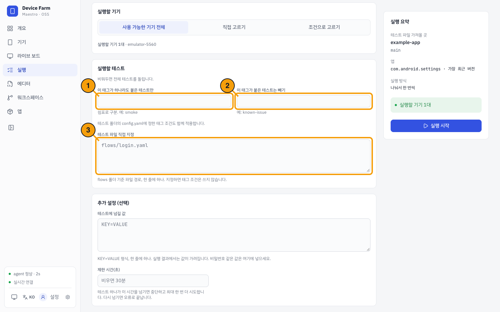
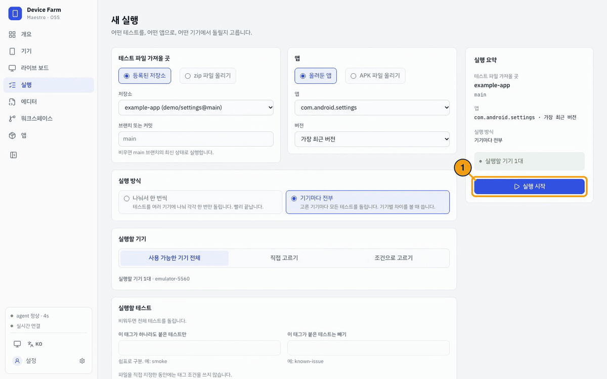

[English](../../guides/running-tests.md) | 한국어

# 테스트 실행하기

**끝나면:** 실행 번호가 생기고, 안드로이드 기기에서 flow가 실행되는 화면을 볼 수 있습니다.

## 바로 가기

워크스페이스·APK·agent·기기가 준비됐다면 아래 주소를 여세요.

```text
http://localhost:8700/runs/new
```

**등록된 저장소**, 앱 버전, **분할**, **사용 가능한 기기 전체**를 고르고 **실행 시작**을 누릅니다.

## 시작 전에

[기기 연결](connect-a-device.md)과 [첫 flow](your-first-flow.md)를 마치세요. **APK**는 앱 설치 파일입니다. YAML의 `appId`와 APK 패키지가 같아야 합니다. **워크스페이스**는 Git에 저장한 flow를 가져옵니다. **태그**는 flow를 고르는 이름표입니다. **분할**은 flow마다 작업 하나를 만들고, **매트릭스**는 기기마다 선택한 flow 묶음을 실행합니다.

## 새 실행 만들기

### 1.1 새 실행 열기

`http://localhost:8700/runs/new`를 여세요. **보여야 할 것:** **새 실행**과 **실행 설정**. **다르다면:** API 주소와 실행 상태를 확인하세요.

### 1.2 파일 출처 고르기

**테스트 파일 가져올 곳**에서 **등록된 저장소**를 누르세요. **보여야 할 것:** 저장소 선택 칸. **다르다면:** 먼저 [워크스페이스](workspaces-and-git.md)를 등록하세요.

### 1.3 저장소 목록 열기

**저장소를 고르세요**를 누르세요. **보여야 할 것:** 등록된 워크스페이스 목록. **다르다면:** **워크스페이스**에서 동기화하세요.

### 1.4 내 저장소 고르기

flow가 들어 있는 저장소를 누르세요. **보여야 할 것:** **실행 요약**에 저장소 이름이 표시됩니다.



**표시 번호:** (1) **저장소를 고르세요**, (2) **앱 버전을 고르세요**, (3) **실행 요약**.

**다르다면:** 등록한 경로에 `.yaml` 파일이 있는지 확인하세요.

### 1.5 앱 버전 고르기

**앱 빌드**에서 flow와 맞는 APK 버전을 고르세요. **보여야 할 것:** 앱 패키지와 버전이 **실행 요약**에 보입니다. **다르다면:** **APK 파일 올리기** 또는 **앱** 화면에서 APK를 올리세요.

### 1.6 실행 방식 고르기

**실행 방식**에서 **분할**을 누르세요. **보여야 할 것:** **분할** 카드가 선택됩니다. **매트릭스**는 선택한 flow 전체를 기기마다 다시 실행합니다.



**표시 번호:** (1) **분할**, (2) **매트릭스**, (3) **실행 방식**.

### 1.7 기기 고르기

**실행할 기기**에서 **사용 가능한 기기 전체**를 누르세요. **보여야 할 것:** 선택 가능 기기 수가 0보다 큽니다. **다르다면:** [기기 연결](connect-a-device.md)과 앱 최소 SDK, 예약 상태를 확인하세요.

### 1.8 태그 제한 지우기

첫 실행에서는 **이 태그가 하나라도 붙은 테스트만** 입력칸을 비워 두세요. **보여야 할 것:** 모든 flow가 대상입니다. 나중에 `smoke`를 넣으면 그 태그가 있는 flow만 고릅니다.



**표시 번호:** (1) **이 태그가 하나라도 붙은 테스트만**, (2) **이 태그가 붙은 테스트는 빼기**, (3) **테스트 파일 직접 지정**.

**다르다면:** 이전에 입력한 태그를 지우세요. 파일 경로를 직접 지정하면 태그 조건을 쓰지 않습니다.

### 1.9 실행 시작

**실행 시작**을 누르세요. **보여야 할 것:** `/runs/` 뒤에 새 실행 번호가 붙은 페이지가 열리고 **대기 중** 또는 **실행 중**이 표시됩니다.



**표시 번호:** (1) **실행 시작**, (2) 새 실행 번호, (3) **실행 중**.

**다르다면:** 오류 메시지를 읽으세요. `no_matching_devices`는 맞는 기기가 없다는 뜻이고, `no_flows`는 조건에 맞는 flow가 없다는 뜻입니다.

## 다른 선택 방법

| 선택 | 뜻 |
| --- | --- |
| **매트릭스** | 사용 가능한 각 기기에서 flow 묶음을 모두 실행 |
| **직접 고르기** | 특정 기기 번호 선택 |
| **조건으로 고르기** | 기기 태그·모델·안드로이드 API 레벨로 걸러내기 |
| **테스트 파일 직접 지정** | 태그 대신 워크스페이스 기준 파일 경로 입력 |
| **시간 제한 (초)** | 작업당 기본값 1800초 대신 직접 지정 |

## 정리

flow, 앱, 방식, 기기를 골라 실행했습니다. **다음:** [결과 읽기](reading-results.md)로 넘어가세요.

## 문제 해결

| 증상 | 까닭 | 해결 |
| --- | --- | --- |
| 저장소 목록이 비어 있음 | 등록 또는 동기화 전 | **워크스페이스**에서 등록·동기화 |
| 앱 버전이 없음 | APK를 올리지 않음 | **APK 파일 올리기** 사용 |
| 선택 가능 기기 0대 | agent·SDK·예약 조건 문제 | **기기** 상태 확인 |
| `no_flows` | 태그가 모든 파일을 제외함 | 태그를 지우고 다시 확인 |
