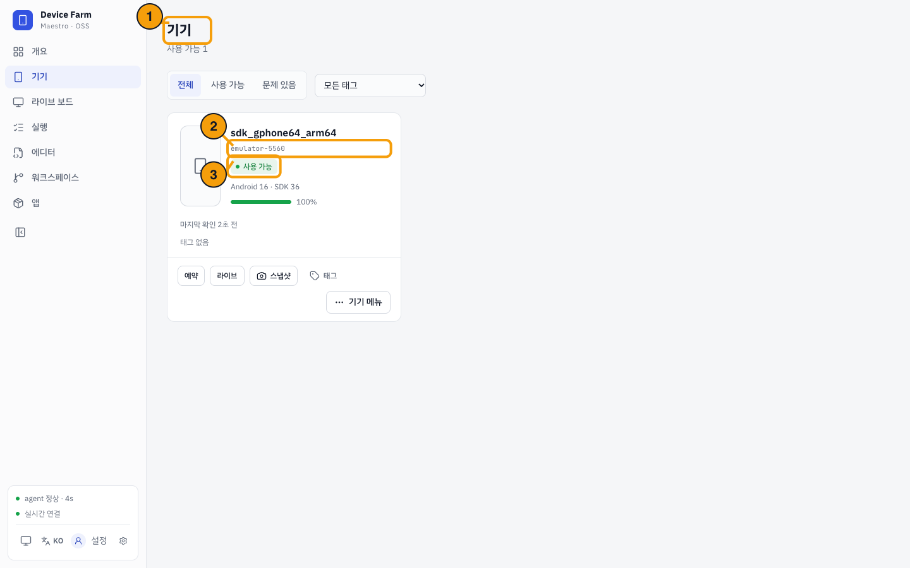
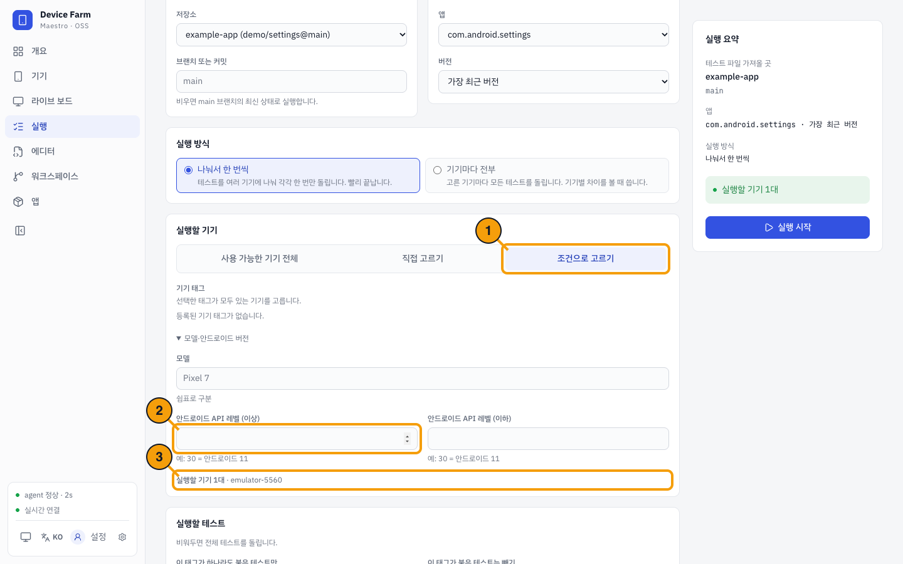
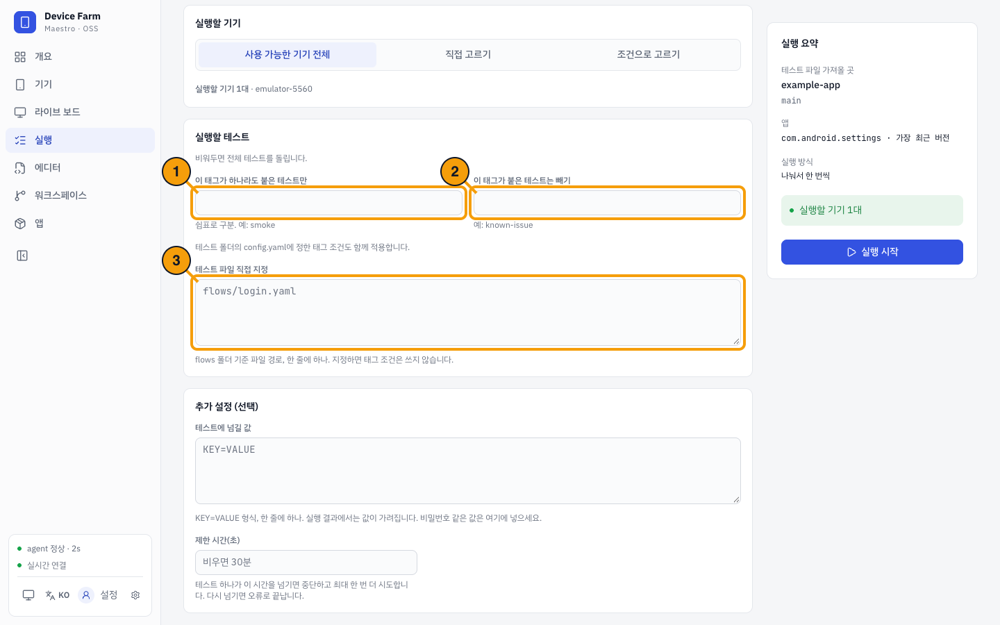
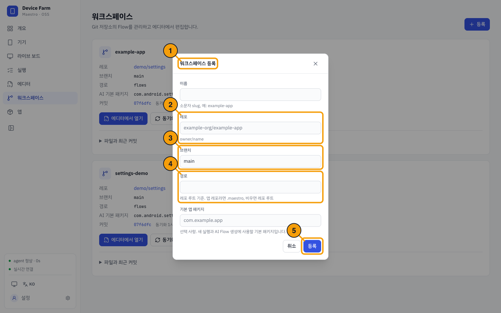
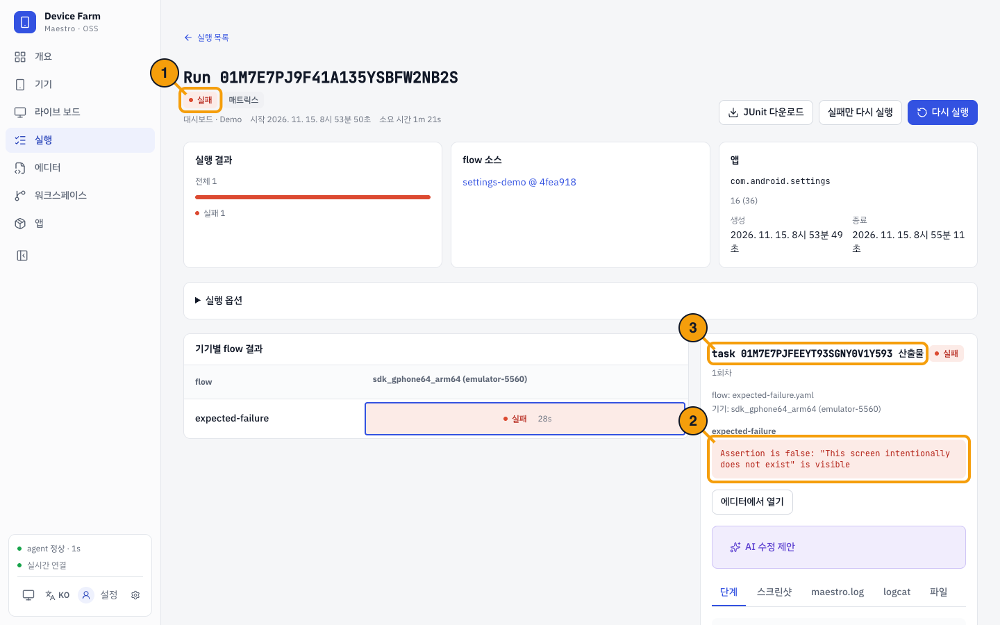
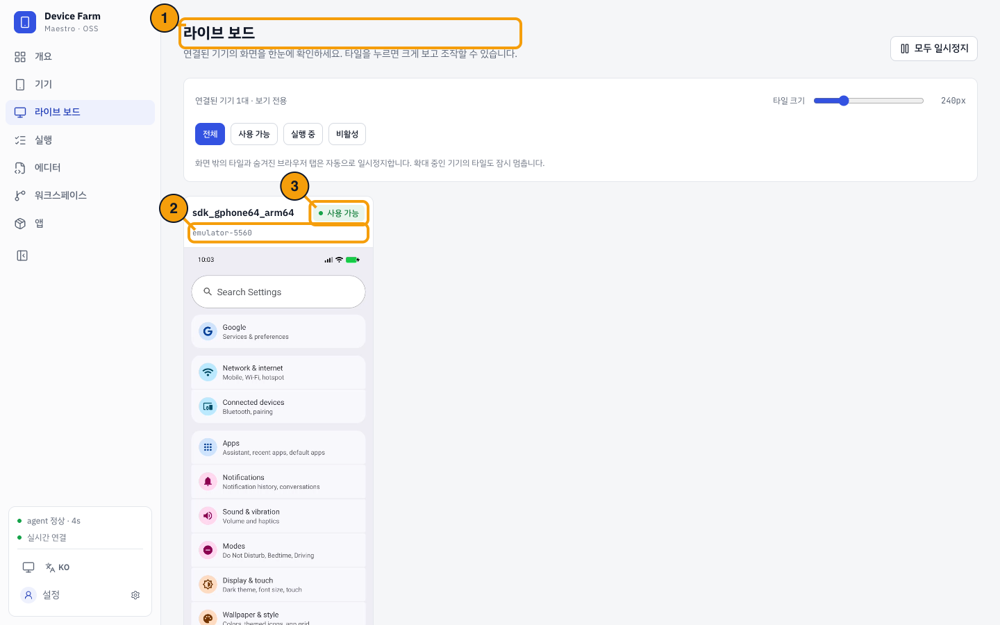

[English](../../guides/troubleshooting.md) | 한국어

# 문제 해결

**끝나면:** 어느 단계에서 막혔는지 찾고, 다시 실행하기 전에 고칠 항목 하나를 정할 수 있습니다.

## 바로 확인하기

API가 켜진 상태에서 실행하세요.

```sh
curl http://localhost:8700/api/v1/healthz
```

응답에 `"status":"ok"`가 있다면 아래 표에서 내가 본 오류를 찾으세요.

## 시작 전에

화면에 나온 오류 코드를 그대로 읽으세요. **adb**는 기기를 확인하는 도구, **agent**는 테스트를 실행하는 프로그램입니다. **flow**는 YAML 테스트 파일, **태그**는 테스트를 고르는 이름표, **산출물**은 실행 뒤 저장된 파일입니다. 증상에 해당하는 항목만 따라가면 됩니다.

## 1. 기기가 전부 오프라인

### 1.1 API 상태 보기

`http://localhost:8700/api/v1/healthz`를 여세요. **보여야 할 것:** `"status":"ok"`와 `agent` 항목. **다르다면:** API부터 다시 켜세요.

### 1.2 adb 목록 보기

agent가 있는 컴퓨터의 터미널에서 실행하세요.

```sh
adb devices
```

**보여야 할 것:**

```text
List of devices attached
YOUR_DEVICE_SERIAL    device
```

**다르다면:** [기기 연결](connect-a-device.md)을 따라 하세요. 예상하지 못한 기기가 보이면 agent를 켜지 마세요.

### 1.3 기기 화면 보기

`http://localhost:8700/devices`를 여세요. **보여야 할 것:** 내 기기가 **사용 가능**, **예약됨**, **실행 중** 중 하나로 표시됩니다.



**표시 번호:** (1) **기기**, (2) 기기 번호, (3) 상태 글자.

**다르다면:** API와 같은 데이터 폴더로 agent를 켜고 잠시 기다리세요.

## 2. `no_matching_devices`

### 2.1 새 실행 열기

`http://localhost:8700/runs/new`를 여세요. **보여야 할 것:** **새 실행**과 기기 선택. **다르다면:** API 주소를 확인하세요.

### 2.2 전체 기기 선택

**사용 가능한 기기 전체**를 누르세요. **보여야 할 것:** 선택 가능 기기 수가 0보다 큽니다. **다르다면:** 기기 상태, 앱 최소 SDK, 예약, 모델·태그 조건을 확인하세요.



**표시 번호:** (1) **조건으로 고르기**, (2) **안드로이드 API 레벨 (이상)**, (3) 선택 가능 기기 수.

## 3. `no_flows` 또는 `flow_not_found`

### 3.1 태그 제한 지우기

**새 실행**에서 **이 태그가 하나라도 붙은 테스트만** 입력칸을 비우세요. **보여야 할 것:** 태그 제한이 사라집니다. **다르다면:** 워크스페이스 파일 목록에서 경로를 확인하세요.



**표시 번호:** (1) 포함 태그, (2) 제외 태그, (3) **테스트 파일 직접 지정**.

## 4. `repo_unreachable` 또는 `branch_not_found`

### 4.1 워크스페이스 열기

`http://localhost:8700/workspaces`를 여세요. **보여야 할 것:** **워크스페이스 관리**. **다르다면:** API 주소를 확인하세요.

### 4.2 저장소 이름 비교

**레포** 값을 Git 웹 페이지의 `owner/repository`와 비교하세요. **보여야 할 것:** 두 곳의 이름이 같습니다. **다르다면:** 철자나 비공개 저장소 접근을 고치세요.

### 4.3 브랜치 이름 비교

**브랜치** 값을 flow가 있는 브랜치와 비교하세요. **보여야 할 것:** Git 웹 페이지에도 같은 브랜치가 있습니다. **다르다면:** 실제 브랜치 이름으로 바꾸세요.



**표시 번호:** (1) **워크스페이스 등록**, (2) **레포**, (3) **브랜치**, (4) **경로**, (5) **등록**.

## 5. `install_failed`, `timeout`, `no_junit`

### 5.1 작업 출력 열기

실패한 실행에서 작업 줄을 누르세요. **보여야 할 것:** 오류 코드와 가능한 **산출물**.



**표시 번호:** (1) 선택된 **실패** 작업, (2) **task 산출물**, (3) **산출물**.

**다르다면:** 작업이 끝날 때까지 기다리세요. 설치 실패면 APK·SDK·저장 공간을, 시간 초과면 오래 걸린 단계를, JUnit 오류면 텍스트 출력을 확인하세요.

## 6. 실시간 화면이 안 뜸

### 6.1 라이브 보드 열기

`http://localhost:8700/live`를 여세요. **보여야 할 것:** 연결된 기기 칸.



**표시 번호:** (1) **기기 라이브 그리드**, (2) 에뮬레이터 번호, (3) **사용 가능**.

**다르다면:** agent 상태, 브라우저 지원, 기기 상태, API와 agent 사이의 stream 주소를 확인하세요.

## 정리

API·기기·flow·워크스페이스·작업·화면 연결 중 어디를 봐야 하는지 찾았습니다. **다음:** 고친 뒤 [테스트 실행](running-tests.md)을 다시 하세요.

## 빠른 문제 표

| 증상 | 흔한 까닭 | 해결 |
| --- | --- | --- |
| 대시보드가 안 열림 | API 중지·포트 오류 | API 터미널 또는 `docker compose ps` 확인 |
| 기기가 **오프라인** | agent 응답 없음 | 같은 데이터 폴더에서 agent 시작 |
| `no_matching_devices` | 기기·SDK 조건 불일치 | **기기**와 선택 조건 확인 |
| `no_flows` | 태그 조건에 맞는 파일 없음 | 태그 지우기 |
| `flow_not_found` | 직접 입력한 경로가 틀림 | 워크스페이스 기준 경로 복사 |
| `repo_unreachable` | 저장소 접근·이름 문제 | `owner/repository` 확인 |
| `branch_not_found` | 브랜치 없음 | Git에 있는 브랜치 이름 사용 |
| `install_failed` | APK 호환성·저장 공간 문제 | 패키지·최소 SDK·공간 확인 |
| `timeout` | 작업 시간 초과 | 오래 걸린 단계 먼저 확인 |
| `no_junit` | 결과 보고서 없음 | 작업 출력 확인 |
| 실시간 화면이 비어 있음 | stream·브라우저 문제 | Chrome/Edge와 연결 설정 확인 |
