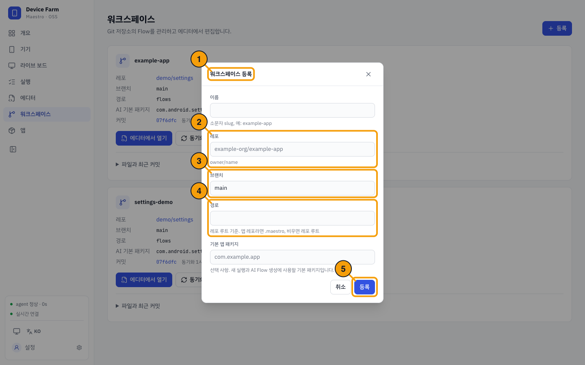
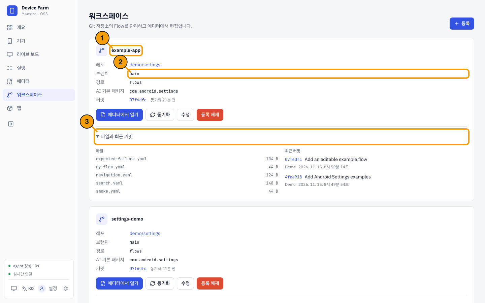

[English](../../guides/workspaces-and-git.md) | 한국어

# 워크스페이스와 Git

**끝나면:** Git 저장소가 워크스페이스로 등록되고 파일과 커밋 이력이 대시보드에 보입니다.

## 바로 가기

flow가 Git 저장소의 `.maestro` 폴더에 저장됐다면 여세요.

```text
http://localhost:8700/workspaces
```

**워크스페이스 등록**에서 저장소 이름, 브랜치, 경로를 넣고 **등록**을 누르면 됩니다.

## 시작 전에

**워크스페이스**는 Git 저장소·브랜치·flow 폴더를 묶은 것입니다. **브랜치**는 작업 흐름의 이름, **커밋**은 저장한 버전입니다. 실행할 때 사용한 커밋 번호가 기록됩니다. 아직 저장소가 없다면 [첫 flow 안내](your-first-flow.md)를 먼저 보세요. 비공개 저장소라면 API가 실행되는 컴퓨터에서 접근할 수 있게 설정하세요. 저장소 주소에 인증 정보를 넣지 마세요.

## 저장소 등록

### 1.1 페이지 열기

`http://localhost:8700/workspaces`를 여세요. **보여야 할 것:** **워크스페이스 관리**. **다르다면:** API 주소를 확인하세요.

### 1.2 등록 창 열기

**워크스페이스 등록**을 누르세요. **보여야 할 것:** 이름, **레포**, **브랜치**, **경로**, **기본 앱 패키지** 입력칸.



**표시 번호:** (1) **워크스페이스 등록**, (2) **레포**, (3) **브랜치**, (4) **경로**, (5) **등록**.

**다르다면:** 왼쪽 **워크스페이스** 메뉴를 확인하세요.

### 1.3 이름 입력

이름 칸에 `example-app`처럼 소문자로 적으세요. **보여야 할 것:** 공백 없는 이름. **다르다면:** 대문자와 공백을 빼세요.

### 1.4 저장소 입력

**레포**에 내 `owner/repository`를 적으세요. **보여야 할 것:** 짧은 저장소 이름. **다르다면:** 전체 URL 대신 계정/저장소 형식으로 적으세요.

### 1.5 브랜치 입력

**브랜치**에 flow가 있는 브랜치, 예를 들면 `main`을 적으세요. **보여야 할 것:** 해당 브랜치 이름. **다르다면:** Git 웹 페이지에서 브랜치 이름을 확인하세요.

### 1.6 폴더 입력

**경로**에 flow가 들어 있는 `.maestro`를 적으세요. **보여야 할 것:** 저장소 기준 상대 경로. **다르다면:** 저장소 맨 위에 YAML이 있으면 비워 두세요.

### 1.7 등록 확정

**등록**을 누르세요. **보여야 할 것:** 커밋 번호가 적힌 워크스페이스 줄. **다르다면:** 저장소 접근 권한과 브랜치를 확인하세요.

## 파일과 이력 보기

### 2.1 워크스페이스 열기

방금 만든 줄을 누르세요. **보여야 할 것:** **파일과 최근 커밋**.



**표시 번호:** (1) `example-app`, (2) `main`과 커밋 번호, (3) **파일과 최근 커밋**.

**다르다면:** **경로**가 flow 폴더를 가리키는지 확인하세요.

### 2.2 새 커밋 가져오기

Git에 새 파일을 올린 뒤 **동기화**를 누르세요. **보여야 할 것:** 커밋 번호와 파일 목록이 갱신됩니다. **다르다면:** 등록한 브랜치에 파일을 올렸는지 확인하세요.

### 2.3 에디터 열기

**에디터 열기**를 누르세요. **보여야 할 것:** **파일** 목록과 코드 편집 화면. **다르다면:** 동기화가 끝날 때까지 기다리세요.

### 2.4 이력 보기

에디터에서 **이력**을 누르세요. **보여야 할 것:** 파일 또는 워크스페이스의 커밋 목록. **다르다면:** 먼저 flow 파일을 선택하세요.

## 정리

이제 실행마다 어떤 Git 버전을 썼는지 알 수 있습니다. **다음:** [에디터로 수정](flow-editor-and-ai.md)하거나 [테스트 실행](running-tests.md)을 하세요.

## 문제 해결

| 증상 | 까닭 | 해결 |
| --- | --- | --- |
| `repo_unreachable` | 이름·접근·네트워크 문제 | `owner/repository`와 API 서버 접근 확인 |
| `branch_not_found` | 브랜치 이름이 다름 | Git 웹 페이지의 이름 입력 |
| 파일 목록이 비어 있음 | **경로**가 틀림 | flow 폴더 경로 확인 |
| 새 커밋이 안 보임 | 아직 가져오지 않음 | **동기화** 누르기 |
