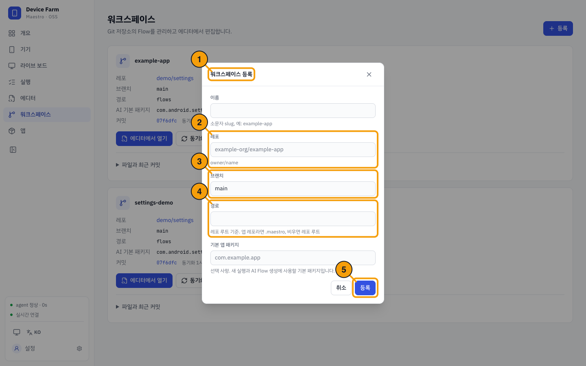
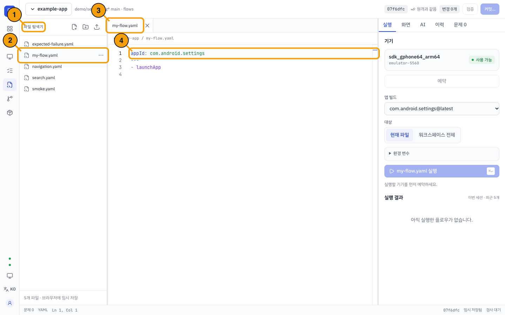

[English](../../guides/your-first-flow.md) | 한국어

# 첫 Maestro flow 만들기

**끝나면:** 내 앱에 맞춘 `.yaml` 테스트 파일이 Git 저장소에 저장되고 에디터에서도 보입니다.

## 바로 붙여넣을 내용

내 Git 저장소의 `.maestro/my-flow.yaml`에 아래 내용을 넣고 앱 패키지와 화면 글자를 바꾸세요.

```yaml
appId: com.example.app
tags:
  - smoke
---
- launchApp
- assertVisible: "Welcome"
```

## 시작 전에

[Docker](getting-started-docker.md) 또는 [직접 설치](getting-started-native.md)를 마치세요. 테스트할 앱의 APK와 내가 수정할 수 있는 Git 저장소가 필요합니다. **flow**는 Maestro 테스트 파일, **YAML**은 들여쓰기로 설정과 동작을 구분하는 글 형식입니다. **태그**는 `smoke`처럼 테스트를 고르는 이름표입니다. `appId`는 APK의 앱 패키지와 같아야 합니다.

## 파일 만들기

### 1.1 예제 보기

내려받은 프로젝트에서 `examples/flows/smoke.yaml`을 일반 텍스트 편집기로 여세요. **보여야 할 것:** `appId`, `tags`, `---`, `launchApp`, `assertVisible`. **다르다면:** `examples/flows` 폴더를 확인하세요.

### 1.2 새 파일 화면 열기

내 Git 저장소 웹 페이지에서 **Add file > Create new file**을 누르세요. **보여야 할 것:** 파일 이름 칸과 편집 창. **다르다면:** 사용하는 Git 서비스의 파일 만들기 메뉴를 찾으세요.

### 1.3 이름 붙이기

파일 이름 칸에 `.maestro/my-flow.yaml`을 적으세요. **보여야 할 것:** 편집 창 위에 이 경로가 표시됩니다. **다르다면:** 끝이 `.yaml`인지 확인하세요.

### 1.4 내용 붙여넣기

맨 위의 YAML을 편집 창에 붙여넣으세요. **보여야 할 것:** `---` 위에는 앱 정보, 아래에는 두 동작이 있습니다. **다르다면:** 서식 있는 문서가 아니라 일반 텍스트로 입력하세요.

### 1.5 앱 패키지 바꾸기

`com.example.app`을 내 APK의 패키지로 바꾸세요. **보여야 할 것:** 첫 줄 `appId:` 뒤에 내 앱 패키지가 있습니다. **다르다면:** 대시보드 **앱** 화면에 APK를 올려 패키지를 확인하세요.

### 1.6 화면 글자 바꾸기

`Welcome`을 앱 첫 화면에 실제로 보이는 글자로 바꾸세요. **보여야 할 것:** `assertVisible` 뒤에 같은 글자가 있습니다. **다르다면:** 언어가 바뀌어도 확인하기 쉬운 글자를 고르세요.

### 1.7 Git 저장 화면 열기

Git 웹 페이지의 **Commit changes**를 누르세요. **보여야 할 것:** 커밋 확인 창. **다르다면:** 파일 이름과 내용이 채워졌는지 확인하세요.

### 1.8 저장 확정

다시 **Commit changes**를 누르세요. **보여야 할 것:** `main` 브랜치의 `.maestro/my-flow.yaml`. **다르다면:** 어떤 브랜치에 저장했는지 확인하세요.

## 팜에 연결하기

### 2.1 워크스페이스 화면 열기

`http://localhost:8700/workspaces`를 여세요. **보여야 할 것:** **워크스페이스 관리**와 **워크스페이스 등록**. **다르다면:** API 실행 상태를 확인하세요.

### 2.2 등록 창 열기

**워크스페이스 등록**을 누르세요. **보여야 할 것:** 이름, **레포**, **브랜치**, **경로** 입력칸.



**표시 번호:** (1) **워크스페이스 등록**, (2) **레포**, (3) **브랜치**, (4) **경로**, (5) **등록**.

**다르다면:** 왼쪽의 **워크스페이스** 메뉴를 다시 누르세요.

### 2.3 저장소 이름 입력

**레포**에 실제 `owner/repository`를 적으세요. **보여야 할 것:** 전체 URL이 아닌 짧은 이름. **다르다면:** `https://`와 `.git`을 빼세요.

### 2.4 flow 폴더 입력

**경로**에 `.maestro`를 적으세요. **보여야 할 것:** 폴더 이름이 입력칸에 있습니다. **다르다면:** YAML이 저장소 맨 위에 있으면 비워 두세요.

### 2.5 등록하기

**등록**을 누르세요. **보여야 할 것:** 브랜치와 커밋 번호가 있는 워크스페이스 줄. **다르다면:** 저장소 접근과 브랜치를 확인하세요.

### 2.6 에디터 열기

해당 줄의 **에디터 열기**를 누르세요. **보여야 할 것:** **파일** 목록에 `my-flow.yaml`이 있습니다.



**표시 번호:** (1) **파일**, (2) `my-flow.yaml`, (3) **코드**, (4) `appId:`.

**다르다면:** 워크스페이스에서 **동기화**를 누르고 파일이 등록한 브랜치에 있는지 확인하세요.

### 2.7 검증하기

**검증**을 누르세요. **보여야 할 것:** 간단한 flow라면 YAML 오류가 없습니다. **다르다면:** 들여쓰기와 `---`, 따옴표를 확인하세요.

## 정리

첫 flow가 Git과 에디터에 저장됐습니다. **다음:** 맞는 APK와 기기를 준비해 [테스트 실행](running-tests.md)을 하세요.

## 문제 해결

| 증상 | 까닭 | 해결 |
| --- | --- | --- |
| 파일 목록에 flow가 없음 | 브랜치·폴더가 다름 | `.maestro` 경로 확인 후 **동기화** |
| YAML 오류 | 들여쓰기나 구분선 오류 | 위 예제와 한 줄씩 비교 |
| 앱이 열리지 않음 | `appId` 불일치 | **앱** 화면의 패키지 복사 |
| 글자 확인 실패 | 화면에 그 글자가 없음 | 실제 화면의 안정적인 글자로 바꾸기 |
